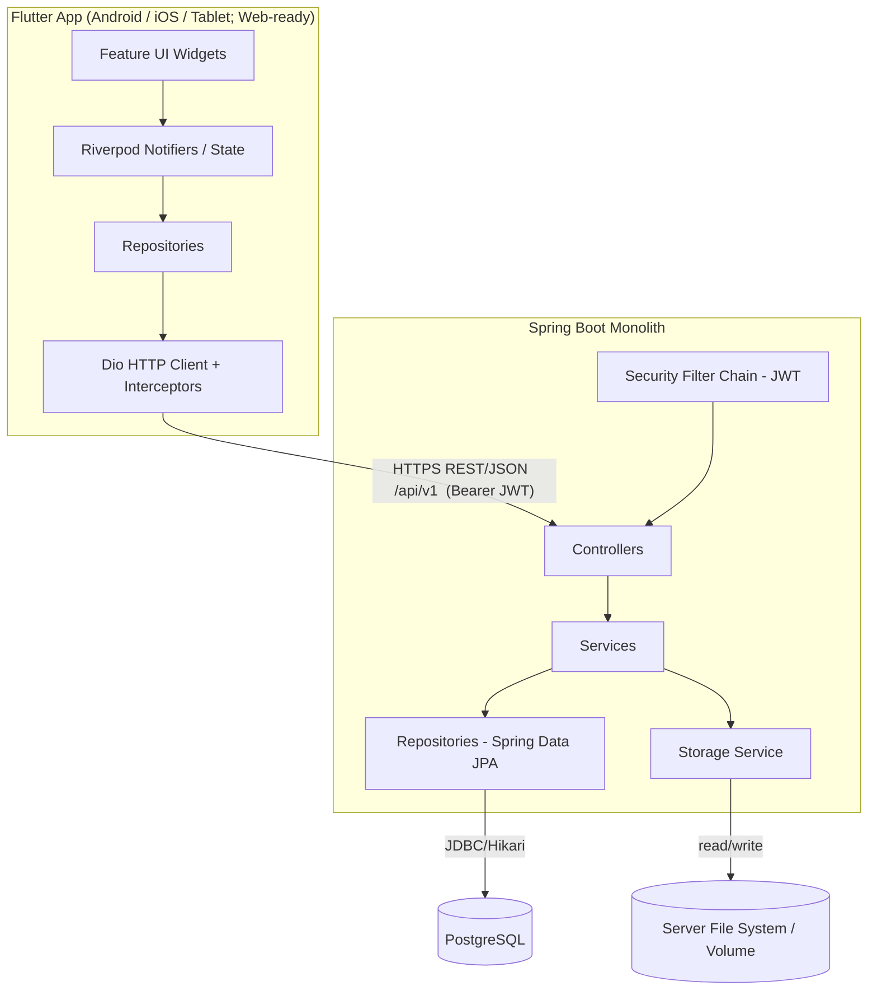
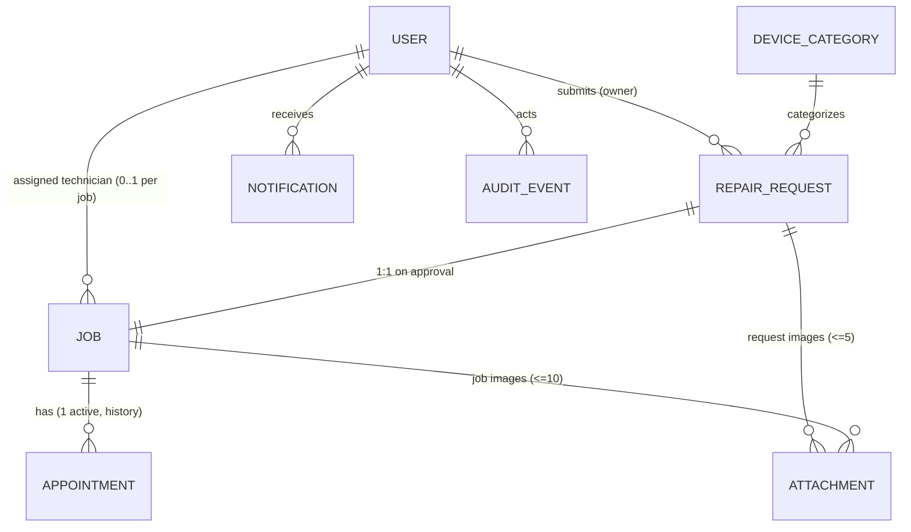
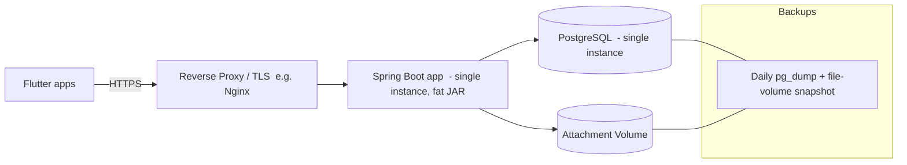

# RepairDesk — Technical Architecture (Version 1)

**Product:** RepairDesk (built for ACE Telecom)
**Document Type:** Authoritative Technical Architecture
**Version:** 1.0
**Status:** Final for Implementation Planning
**Authoring roles:** Principal Solution Architect · Principal Flutter Architect · Principal Spring Boot Architect · Principal Database Architect

> This document defines the **technical architecture** for RepairDesk V1. It is the authoritative source from which `Database.md`, `API.md`, `Tasks.md`, and the implementation are derived. It contains **architecture decisions only** — no source code, no task lists, no table DDL, no endpoint-by-endpoint contracts. It aligns with [Constitution](constitution.md), the [PRD](PRD.md), the approved V1 decisions in [Gap Analysis](gap-analysis.md), and the nine feature specifications.

**Guiding stance:** We are a startup building a **production-ready V1** for a *single repair business, single location, small team*. Every decision favors **simplicity, maintainability, and developer productivity** over scalability we do not yet need. Complexity is added only when a requirement demands it. Where the specs already resolved a decision, we adopt it; where they deferred to architecture, we decide here.

---

# Architecture Overview

## System Overview

RepairDesk is a **mobile-first service-management application**. A single Flutter client serves all four roles (Customer, Technician, Staff Member, Administrator), talking to a **single Spring Boot monolith** over a **versioned REST/JSON API**, backed by a **single PostgreSQL database**. Authentication is **JWT** (non-expiring sessions per the approved decision). File attachments are stored on the server's file system behind an authenticated streaming endpoint. Notifications are **in-app and polling-based** (no push in V1).



The deployment is intentionally a **single process + single database + single environment** (plus a reverse proxy for TLS and file serving). There are no microservices, no message brokers, no Kubernetes, and no distributed components.

## Architectural Principles

1. **Simplicity first (YAGNI).** Build for one business in one location with a small team. Do not introduce abstractions for multi-tenancy, microservices, or scale we will not hit in V1.
2. **Layered monolith.** Strict Controller → Service → Repository layering on the backend (Constitution); feature-first modularity on the frontend (Constitution). Clear seams enable a future split *only if* ever needed.
3. **Specs are law.** The feature specs and gap-analysis V1 decisions are the functional contract. Architecture serves them; it does not expand scope.
4. **Single source of truth per concern.** One status model, one RBAC model, one error-response shape, one notification model — defined once and reused.
5. **Security by default.** Every protected endpoint authenticates and authorizes server-side; the client never enforces security, only UX. Sensitive data is never exposed in responses or logs.
6. **Stateless API, persistent client session.** The server holds no session state; the client persists the JWT for non-expiring/auto-login behavior.
7. **Evolvable, not future-proofed.** Use thin abstractions at the *boundaries most likely to change* (file storage, notification delivery) so V2 (object storage, push) is a swap, not a rewrite. Avoid speculative abstraction everywhere else.
8. **Auditable and reliable.** Append-only audit trail, daily backups, transactional integrity, idempotent writes.

## Major Design Decisions (and why)

| Decision | Choice | Why |
| --- | --- | --- |
| Backend topology | **Monolith** (one Spring Boot app) | Single small team, single business; a monolith is the simplest deployable, testable, debuggable unit. Microservices would add ops cost with zero V1 benefit. |
| API style | **REST/JSON, versioned `/api/v1`** | Constitution mandate; universally supported by Flutter/Dio; easy to evolve. |
| Auth | **JWT, non-expiring, stateless tokens + per-request account-status check** | Gap-analysis decision (sessions end only on logout/disable/delete). Status check enforces revocation without server-side session storage. |
| State management | **Riverpod** | Constitution mandate; compile-safe DI, testable, great async handling for API-driven UI. |
| DB | **PostgreSQL, UUID PKs, Flyway** | Constitution mandate; relational model fits the request→job→appointment domain; Flyway gives controlled, versioned schema evolution. |
| Notifications | **Polling, in-app inbox + counters** | Gap-analysis GAP-02/OP-04. Avoids push infrastructure (FCM/APNs, sockets) entirely in V1. |
| File storage | **Server file system behind a `StorageService` abstraction** | Single location/low volume; object storage is unjustified complexity in V1, but the abstraction keeps S3 a future swap. |
| Concurrency | **Optimistic concurrency (version checks), no locking** | Gap-analysis decision; small team means rare conflicts; locking adds complexity and UX friction. |
| Deletion | **Soft delete / status-based logical removal** as the default | Preserves referential integrity and audit attributability while satisfying "access permanently revoked." |

---

# Technology Stack

## Frontend

| Technology | Role | Rationale |
| --- | --- | --- |
| **Flutter** | Cross-platform UI (Android, iOS, tablet; Web-ready) | One codebase for all targets and all roles (PRD platform strategy); strong tablet/responsive support; future Flutter Web without redesign. |
| **Riverpod** | State management & dependency injection | Constitution mandate. Compile-time-safe providers, easy mocking for tests, first-class async (`AsyncValue`) that models loading/error/data — ideal for a REST-driven app. Keeps business logic out of widgets. |
| **GoRouter** | Declarative routing & deep links | Constitution mandate. Declarative routes + redirect guards are the clean way to implement role-based landing and route protection; supports the URL-based navigation we'll want for Flutter Web. |
| **Dio** | HTTP client | Constitution mandate. Interceptors give one place for auth-token injection, error mapping, correlation-id propagation, and retry — central to our error-handling strategy. |
| **Freezed** | Immutable models, unions, copyWith | Generates immutable DTOs/state classes and sealed unions for result/failure types, eliminating boilerplate and a class of mutation bugs. |
| **build_runner** | Code generation runner | Drives Freezed and JSON serialization codegen; standard in the Flutter ecosystem. |
| **json_serializable** (supporting) | JSON (de)serialization | Pairs with Freezed/build_runner to map API JSON ↔ Dart models without hand-written parsing. |

## Backend

| Technology | Role | Rationale |
| --- | --- | --- |
| **Spring Boot** | Application framework | Constitution mandate. Batteries-included monolith framework: web, validation, data, security, actuator — minimal glue, high productivity. |
| **Spring Web (MVC)** | REST controllers | Standard, well-understood synchronous REST stack; sufficient for our load profile. |
| **Spring Security** | AuthN/AuthZ | Constitution mandate. Industry-standard filter chain for JWT validation and role-based authorization. |
| **JWT** (e.g., jjwt/Nimbus) | Token format | Constitution + gap-analysis. Self-contained identity/role claims; stateless verification. |
| **Spring Data JPA / Hibernate** | Persistence | Productive repository layer over PostgreSQL; aligns with Repository layer in the Constitution. |
| **Flyway** | DB migrations | Constitution mandate. Versioned, repeatable, environment-safe schema evolution; no schema change without a migration. |
| **Bean Validation (Jakarta Validation)** | Input validation | Declarative request validation feeding the consistent error model. |
| **HikariCP** (bundled) | Connection pool | Default high-performance pool; supports the 10k-record / response-time targets. |
| **Spring Boot Actuator** | Health/metrics | Lightweight, practical operational visibility for a single-instance deployment. |

## Database

| Technology | Role | Rationale |
| --- | --- | --- |
| **PostgreSQL** | Relational datastore | Constitution mandate. Strong relational integrity for the request/job/appointment model, native `uuid`, JSONB (for audit before/after snapshots), robust indexing for search targets, mature backups. |

> **Locked stack note:** The gap-analysis records the stack as locked (Flutter, Spring Boot, PostgreSQL, JWT, Flyway, Riverpod, GoRouter, Dio). This document adds only the natural code-gen/validation companions (Freezed, build_runner, json_serializable, Bean Validation) that the listed tools already imply.

---

# High-Level Architecture

```
Flutter Application
        ↓   HTTPS · REST/JSON · /api/v1 · Authorization: Bearer <JWT>
REST API (Controllers)
        ↓   in-process method calls
Spring Boot (Services → Repositories, Security filter, Storage service)
        ↓   JDBC (HikariCP)
PostgreSQL   +   Server File System (attachments)
```

## Interaction model

1. **Client → API.** The Flutter app issues REST calls through Dio. Every authenticated request carries `Authorization: Bearer <JWT>`. Requests and responses are JSON. The base path is `/api/v1` (Constitution).
2. **Security filter.** Before reaching a controller, the Spring Security filter chain validates the JWT signature, extracts identity + role claims, and **re-checks the account's current status** (active/disabled/deleted) so a previously issued token for a now-disabled account is rejected (gap-analysis JWT rule).
3. **Controller (thin).** Validates request shape (Bean Validation), maps DTO ↔ command, delegates to a service. No business logic (Constitution).
4. **Service (business logic).** Enforces status-transition rules, RBAC-sensitive operations, validation, transactions, audit writes, and notification creation. The single place where domain rules live (Constitution).
5. **Repository (persistence only).** Spring Data JPA repositories; no business rules (Constitution).
6. **Database.** PostgreSQL via Hikari; transactional writes; optimistic version checks for concurrency.
7. **File system.** Binary attachments are written/read through the `StorageService`; metadata rows live in the DB. Files are served only through an authenticated, authorization-checked streaming endpoint (never public URLs).
8. **Response.** Services return results mapped to response DTOs; errors are translated by a global exception handler into the **consistent error model** (below). Sensitive fields are never serialized.
9. **Polling.** For notifications/counters the client periodically calls lightweight read endpoints (no server push).

**Cross-cutting on every request:** a correlation id (MDC) for traceable logs, structured logging without sensitive data, and authorization enforced server-side regardless of what the UI shows.

---

# Frontend Architecture

## Feature-first structure

The app is organized **by feature**, not by technical type (Constitution: Feature-First). Each feature owns its UI, state, models, and data access, depending only on shared `core`/`shared` infrastructure. This keeps features independently understandable and changeable — ideal for a small team.

Within a feature we keep a light **presentation → application(state) → data** seam:
- **presentation/** widgets & screens (no API calls — Constitution).
- **application/** Riverpod notifiers/providers holding state and orchestrating use-cases.
- **data/** repositories + remote data sources (Dio) + feature DTOs/mappers.
- **domain/** (only where useful) feature models/value objects.

## Recommended folder structure

```
lib/
  main.dart
  app.dart                       # Root widget, ProviderScope, MaterialApp.router

  core/                          # App-wide infrastructure (no feature logic)
    config/                      # Env/config, base URL, constants
    network/                     # Dio setup, interceptors (auth, error, correlation-id)
    error/                       # Failure types, exception→failure mapping
    auth/                        # Token storage, session controller, auth state
    storage/                     # Secure storage wrapper (token), local prefs
    utils/                       # Formatters, validators, result types

  shared/                        # Reusable UI & cross-feature building blocks
    widgets/                     # Buttons, status chips, empty states, loaders
    models/                      # Shared DTOs (e.g., paginated response, error)
    theme/                       # Theme, colors, typography, responsive helpers
    constants/                   # Enums (Role, RequestStatus, JobStatus), labels

  features/
    authentication/              # login, register, reset password, session
      presentation/
      application/
      data/
      domain/
    repair_request/              # customer intake (Customer Home entry)
    request_review/              # staff queue + decision
    jobs/                        # job management
    scheduling/                  # calendar, appointments
    customer_management/         # read-only customer view (staff/admin)
    staff_management/            # admin user/role management
    repair_status_tracking/      # Customer Home (list + detail + inbox)
    dashboard/                   # role landing + nav hub
    notifications/               # inbox, counters, polling controllers
    account_settings/            # customer self-edit (mobile, password)

  router/
    app_router.dart              # GoRouter config
    routes.dart                  # Route names/paths
    guards.dart                  # Redirect logic (auth + role protection)
```

**Why this shape:**
- **`core/` vs `shared/`:** `core` is non-visual infrastructure (network, auth, errors); `shared` is reusable UI and cross-feature value types. Separating them prevents UI utilities from leaking into infrastructure and vice-versa.
- **`features/` mirrors the specs.** Each feature spec maps to one folder, so a developer goes from a spec to code location instantly.
- **`router/` is centralized** because navigation guards must reason about global auth/role state in one place.

## Navigation strategy

- **GoRouter** with a centralized route table and a **redirect guard** that reads the global auth/session state.
- **Role-based landing** is computed in the guard from the authenticated role (see *Role-Based Navigation*).
- **Route protection** is declarative: unauthenticated access to protected routes redirects to `/login`; authenticated access to a route the role cannot use redirects to the role's landing screen. This is **UX enforcement only** — the backend is the security authority.
- **Deep links / Web-readiness:** path-based routes keep behavior consistent for the future Flutter Web target.

## State management strategy

- **Riverpod** as the single state/DI mechanism. No service locators, no business logic in widgets (Constitution).
- **`AsyncValue`** models loading/data/error uniformly so every screen handles the three states consistently.
- **Provider layering:** `core` providers (Dio, storage, session) → repository providers → feature notifier providers → widgets watch notifiers. Widgets never call repositories or Dio directly.
- **Immutability:** state and DTOs are **Freezed** classes; updates use `copyWith`, avoiding accidental mutation.
- **Session/auth state** is a top-level provider that the router guard watches, so login/logout/disable immediately re-routes.

## Error handling strategy (frontend)

- A **Dio error interceptor** converts transport/HTTP errors into a typed **`Failure`** union (Freezed sealed type): `NetworkFailure`, `ValidationFailure(fieldErrors)`, `AuthFailure`, `PermissionFailure`, `NotFoundFailure`, `ConflictFailure` (optimistic-concurrency/stale state), `ServerFailure(correlationId)`.
- Repositories return `Result<T>` (success | failure); notifiers surface failures as `AsyncError`, and screens render them via shared error widgets (inline field errors, snackbars, retryable banners).
- **Connectivity errors** are non-blocking and retryable; entered data is preserved (per specs' error-handling sections). No false success is ever shown.
- **Validation errors** from the backend map to per-field messages; client-side validation is a UX convenience only — the server is authoritative.
- **401/invalid token** triggers session teardown → redirect to login (preserving in-progress input where feasible).

## Authentication flow (frontend)

1. **Token at rest:** JWT stored in **platform secure storage** (Keychain/Keystore). Never in plain prefs or logs.
2. **Auth interceptor** attaches the bearer token to every request.
3. **App launch / auto-login:** read stored token → if present, route to role landing (optimistically) and validate on first protected call; if missing/invalid/rejected → `/login` (gap-analysis auto-login).
4. **Login / register:** on success, store token, hydrate session state (identity + role), route to role landing. Registration auto-signs-in (Authentication spec).
5. **Logout:** clear token from secure storage and session state, route to `/login` — succeeds locally even if the server call fails (Authentication spec).
6. **Disabled/deleted mid-session:** the next protected call returns 401/403 with an account-invalid signal → session teardown → `/login`.

---

# Role-Based Navigation

All navigation decisions are driven by the authenticated **role** (single role per user) and account status. The router guard enforces UX; the backend enforces security.

| Role | Landing screen | Primary menu / navigation | Route protection |
| --- | --- | --- | --- |
| **Customer** | **Customer Home** (repair list) — `repair_status_tracking` | Repair list, repair detail, notification inbox (bell), "+ New Repair Request", Account Settings | Only customer-owned routes; any operational/admin route redirects to Customer Home. |
| **Technician** | **Personal Schedule** (today's appointments) — `scheduling` | Today/this-week schedule, my assigned jobs, transient alerts | Only assigned-work routes; cannot open other technicians' schedules, queues, or admin routes. |
| **Staff Member** | **Jobs** — `jobs` | Dashboard hub → Jobs, Appointments, Customers (read-only); Staff Members/Products/Settings/Repair Requests routes redirect away (admin-only) | Operational routes for assigned work only; cannot access the pending-request review queue (admin-only). |
| **Administrator** | **Requests & Jobs** — `request_review`/`jobs` | Dashboard hub → Repair Requests (review queue), Jobs, Appointments, Customers, Staff Members, Products, Shop Settings | Full app; standard auth guard only. |

**Implementation notes:**
- **Single guard, role-aware:** the GoRouter `redirect` reads `(isAuthenticated, role, accountStatus)` and resolves landing + access in one place (Dashboard spec: landing reflects *current* role/status).
- **Tile visibility = route availability:** the Dashboard hub renders only tiles the role may use; hidden tiles still correspond to server-enforced authorization (hiding is not security — Dashboard spec).
- **Customer has no dashboard:** Customer Home *is* the customer landing (gap-analysis GAP-01).
- **Notifications by role:** customer → inbox/bell; staff/admin → counter badges; technician → transient alerts (gap-analysis GAP-02).

---

# Backend Architecture

## Layered design (Constitution: Controller → Service → Repository)

| Layer | Responsibility | Must NOT do |
| --- | --- | --- |
| **Controller (web)** | Map HTTP ↔ DTO, validate request shape (Bean Validation), enforce coarse role access (annotations), delegate to services, return response DTOs. Thin. | No business logic, no persistence, no transaction orchestration. |
| **Service (business)** | All domain rules: status transitions, RBAC-sensitive decisions, validation beyond shape, transactions (`@Transactional`), audit-event creation, notification creation, orchestration across repositories, optimistic-concurrency handling. | No HTTP/web concerns; no raw SQL beyond repositories. |
| **Repository (persistence)** | Spring Data JPA interfaces; queries, pagination, projections. | No business rules; no cross-aggregate orchestration. |
| **Security** | JWT filter, authentication, authorization (roles/authorities), account-status revocation check, password hashing. | No business decisions beyond access control. |
| **Configuration** | Beans, profiles, properties, CORS, Flyway, Jackson, storage config, exception handler registration. | No domain logic. |

## Package structure

A **package-by-feature** layout on top of the layered rules keeps each feature's controller/service/repository/domain together, mirroring the frontend and the specs.

```
com.acetelecom.repairdesk
  RepairDeskApplication

  common/                         # cross-cutting (no domain rules)
    error/                        # GlobalExceptionHandler, ApiError model, error codes
    audit/                        # AuditEvent entity, AuditService (append-only)
    web/                          # base DTOs (paged response), correlation-id filter
    util/                         # reference-number generator, time, mappers

  config/
    SecurityConfig                # filter chain, password encoder, CORS
    JwtConfig, WebConfig, JacksonConfig, FlywayConfig, StorageConfig, OpenApiConfig

  security/
    JwtAuthenticationFilter, JwtService, TokenStore (claims), CurrentUser
    AccountStatusChecker          # rejects disabled/deleted accounts per request

  feature/
    auth/         (controller, service, dto)            # login/register/reset/logout
    user/         (controller, service, repository, domain)   # accounts, roles (Staff Mgmt)
    customer/     (controller, service)                 # read-only customer views
    request/      (controller, service, repository, domain)   # repair requests + review
    job/          (controller, service, repository, domain)
    appointment/  (controller, service, repository, domain)   # child of job
    devicecategory/ (controller, service, repository, domain) # product mgmt (categories)
    settings/     (controller, service, repository, domain)   # business settings
    notification/ (controller, service, repository, domain)   # inbox + counters
    attachment/   (controller, service, repository, domain)   # upload/stream metadata
    dashboard/    (controller, service)                 # counters/landing aggregation
```

**Responsibilities by feature package** map 1:1 to the specs: `request` owns the `Pending Review → Approved/Rejected/Information Required` lifecycle and **auto-creates a Job on approval** (1:1); `job` owns the job lifecycle and assignment; `appointment` owns scheduling as a **child of the job**; `notification` owns the inbox/counters; `user` owns Staff-Management operations and the **active-technician roster**; `customer` is a **read-only** projection over `user` + `request`/`job`.

> Single role per user is modeled as one `role` field/authority on the account; no role-join tables (gap-analysis: one role per user).

---

# Authentication Architecture

Adopts the **approved V1 decisions** (Authentication spec + gap-analysis GAP-03/GAP-04).

## JWT strategy
- **Token:** signed JWT carrying minimal claims — subject (user id), username, and **single role** — plus issued-at. **No expiry** (gap-analysis: non-expiring sessions).
- **Validation per request:** verify signature, then **check account status** (active vs disabled vs deleted). A valid signature is *not* sufficient — a disabled/deleted account is rejected even with a previously valid token. This makes revocation possible without server-side session storage.
- **Stateless server:** no HTTP session, no server token store required for the happy path. (Optional future hardening — a token denylist/version counter — is noted as a tradeoff, not built in V1.)
- **Secrets/algorithm:** symmetric signing key from secured configuration (env/secret), HMAC-SHA. Key is never logged or returned.
- **Passwords:** hashed with **BCrypt**; minimum length **8 characters**, no complexity rule (gap-analysis GAP-04); never returned or logged.

## Login flow
1. Client submits username/mobile + password.
2. Service loads the account, verifies BCrypt hash, confirms status = active.
3. On success, mint JWT (identity + role) and return it with role-appropriate landing info; on failure return a **generic** invalid-credentials error (no field disclosure — Authentication spec).

## Session persistence & auto-login
- Client stores the JWT in **secure storage**; the session survives app restarts (non-expiring).
- On launch, a stored, still-valid token (active account) auto-authenticates and routes to the role landing; otherwise → login (gap-analysis auto-login).

## Logout
- Client clears the token locally (always succeeds). Because tokens are stateless, server-side invalidation is not required; the account-status model handles disable/delete revocation.

## Authorization
- **Coarse-grained:** Spring Security restricts endpoints by role (e.g., admin-only user management, staff/admin review actions).
- **Fine-grained (ownership):** services enforce record ownership/assignment (a customer may act only on their own requests; a technician only on assigned jobs) — gap-analysis Permissions Review.
- **Default admin:** a single `admin` account (password `Admin@1234`, must change on first login) is **seeded idempotently** on first deployment (existence check before insert) — gap-analysis GAP-03. Credentials are handed over out-of-band, never shown in UI.

---

# Domain Model

Major business entities, their responsibilities, and key relationships. (No schemas here — see `Database.md`.)

| Entity | Responsibility | Key relationships / notes |
| --- | --- | --- |
| **User (Account)** | Single account/identity, exactly **one role** (Customer/Technician/Staff/Admin), status (active/disabled/deleted), credentials. Source of truth for contact (username, mobile). | Owns RepairRequests (as customer); may be assigned to Jobs (as technician). Managed via Staff Management; self-edits mobile/password. |
| **RepairRequest** | Customer intake record and its review lifecycle (`Pending Review → Information Required → Approved/Rejected/Cancelled`). Holds device/issue/appointment-preference snapshot + priority. | Belongs to a User (owner). References a DeviceCategory. **1:1 → Job on approval.** Owns request Attachments (≤5). |
| **Job** | Active repair lifecycle (`Created → Assigned → Scheduled → In Progress ⇄ Awaiting Parts → Completed`, plus `Cancelled`). Operational source of truth post-approval. | **1:1 with approved RepairRequest**; **Job Number = Request Reference**. Optional assigned technician (one). Owns job Attachments (≤10). Has Appointments. |
| **Appointment** | Date/time + technician booking for a job; reschedule history. | **Child of Job**; at most one *active* appointment per job; reschedule creates a new record and cancels the prior (gap-analysis ENTY-03). Mirrors job status. |
| **DeviceCategory** | Catalog of repairable device categories driving the request form. | Referenced by RepairRequest/Job. **Archivable (soft delete)**; archived categories hidden from new requests but retained on existing records. Admin-managed. |
| **Notification** | Persisted customer-facing in-app notification (status changes, appointments). | Belongs to a recipient User; references the related request/job. Customer inbox = last 30 (gap-analysis GAP-02). |
| **AuditEvent** | Append-only record of who did what, when (status changes, assignments, decisions, account changes, etc.). | **Polymorphic** (entity type + id) + actor reference + actor snapshot. Admin sees full log; staff see per-record history. |
| **Attachment** | Metadata for an uploaded image (type, size, owner ref, uploader, storage key). | Belongs polymorphically to a RepairRequest **or** a Job. Binary lives on the file system; access is role/ownership-checked. |
| **Settings (Business)** | Singleton business configuration: working hours per weekday, slot duration, business info. | Read by Scheduling/Request intake; Admin-only writes (gap-analysis GAP-01 Settings). |

**Reference number:** one human-readable **repair reference** is generated at request creation and **carried unchanged to the job** (Jobs decision). It is distinct from the UUID primary key and is the customer/staff-quotable identifier.



---

# Database Architecture

## Database strategy
- **Single PostgreSQL database**, accessed via Spring Data JPA/Hibernate with **HikariCP** pooling.
- **UUID primary keys** (Constitution: "UUID where appropriate"). Recommend **time-ordered UUIDs (UUIDv7)** or DB-generated ordered UUIDs to preserve index locality and avoid B-tree fragmentation that random UUIDv4 causes (tradeoff noted in Risks).
- **Normalized relational model** matching the domain (request, job, appointment, user, etc.). JSONB used narrowly for audit before/after snapshots.
- **Search/performance:** explicit indexes on common search/filter columns (reference number, customer name/mobile, status, technician, dates) to meet the **<2s search / <3s load / 10k+ records** targets; all list endpoints are **paginated** (no unbounded queries).

## Entity relationships (logical)
- `User 1—* RepairRequest` (owner); `User 0..1—* Job` (assigned technician).
- `RepairRequest 1—1 Job` (created on approval; shared reference).
- `Job 1—* Appointment` (one active at a time; history retained).
- `DeviceCategory 1—* RepairRequest`.
- `User 1—* Notification` (recipient).
- `Attachment` belongs to a RepairRequest **or** a Job (polymorphic owner via `owner_type` + `owner_id`, or two nullable FKs — finalized in `Database.md`; polymorphic recommended for one upload pipeline).
- `AuditEvent` polymorphic to any entity.
- `Settings` single-row configuration (+ working-hours rows per weekday).

## Soft-delete strategy
The product needs *logical* removal far more than physical deletion. Default to **soft delete** to protect referential integrity and audit attributability:
- **DeviceCategory:** `archived` flag (spec mandate). Hidden from new requests; retained on existing records.
- **User:** "delete" is implemented as a **logical delete** (status = `DELETED`) plus immediate access revocation (status check rejects the token) and optional PII scrubbing. This satisfies "access permanently revoked" while keeping foreign keys (jobs/requests/audit) valid and history attributable. **Disable** is a separate reversible status. (Tradeoff in Risks.)
- **RepairRequest / Job:** never deleted in V1; **terminal statuses** (`Rejected`/`Cancelled`/`Completed`) serve as the logical archive; records are **retained indefinitely** (Jobs decision).
- **Attachment:** hard-deleted (row + binary) when removed or when its owning request is deleted; otherwise retained for the record's life.

Soft-deleted/archived rows are filtered out by default at the repository/service layer.

## Audit strategy
- **Single append-only `AuditEvent` table**, polymorphic (`entity_type`, `entity_id`), capturing actor id + **actor snapshot** (so deletes don't erase attributability), action, optional before/after JSONB, correlation id, timestamp.
- Written **inside the same transaction** as the change by services (gap-analysis ENTY-02: "append-only event journal").
- **Visibility:** Administrators see the full log; Staff see per-record history for records they can access (gap-analysis PERM-04). Sensitive values are protected within audit data.

## Migration strategy (Flyway)
- **All schema via Flyway** versioned migrations (`V1__init.sql`, `V2__...`); **no schema change without a migration** (Constitution). Migrations run on application startup.
- **Reference/seed data:** working-hours defaults (Mon–Sat 09:00–18:00), default slot duration (60 min), and the **idempotent default admin seed** (existence check) via migration or a guarded bootstrap runner (gap-analysis GAP-03).
- **Conventions:** forward-only in production; immutable applied migrations; repeatable migrations (`R__`) only for safe, idempotent reference data. Naming/ordering rules documented in `Database.md`.

---

# File Storage Architecture

**Stance: keep V1 deliberately simple; challenge any cloud complexity.** For a single-location business with low image volume (≤5 per request, ≤10 per job, 10 MB/file), an object-storage service (S3/GCS) and CDNs are **unnecessary** in V1.

- **Storage medium:** the **server's local file system** (a dedicated, backed-up data volume), accessed only through a `StorageService` abstraction. The abstraction is the *one* future-proofing we keep so V2 can swap to object storage without touching feature code.
- **Metadata in DB:** each upload creates an `Attachment` row (owner ref, uploader, content type, size, storage key/path); the **binary never lives in the database**.
- **Upload strategy:** multipart upload to an authenticated endpoint; the service performs **server-side validation** — true content-type sniffing (not just extension), allowed image types (**JPEG/PNG/HEIC/WebP**), per-file (**10 MB**) and per-request total (**25 MB**) limits, and count limits (**≤5 request / ≤10 job**). Stored under non-guessable keys.
- **Access control:** files are served **only** through an authenticated streaming endpoint that re-checks ownership/role (customer → own request images; technician → assigned-job images; staff/admin per RBAC). **No public/guessable URLs.** Job attachments are **internal-only** in V1 (not shown to customers).
- **Retention:** attachments live for the life of their owning record; request attachments are deleted with the request (Repair-Request decision). EXIF stripping is **out of scope** in V1 (deferred). Backups must include the file volume alongside the DB.

> Decisions deferred to this layer by the specs/gap-analysis (storage provider, validation pipeline) are resolved above with the simplest workable choice.

---

# Notification Architecture

Implements the **two-layer, polling-based** model (gap-analysis GAP-02, OP-04). **No push notifications, no WebSockets/SSE in V1.**

| Channel | Mechanism | Detail |
| --- | --- | --- |
| **Customer notification inbox** | **Persisted** `Notification` rows | Bell + unread badge on Customer Home. Inbox returns the **last 30** items; each links to the related request/job. Created server-side by services on milestone events (submitted, accepted→preparing, rejected, info-needed, scheduled/rescheduled/cancelled, in-progress, awaiting-parts, completed, job-cancelled). **One** notification on job cancellation (no duplicate appointment notification — CON-03). |
| **Staff counters** | **Computed**, not stored | Requests & Jobs screen shows live counts (Pending, Approved, Active Jobs) via lightweight aggregate queries. **No staff inbox.** |
| **Technician alerts** | Transient in-app | Surfaced from assignment/appointment events; shown transiently (no persistent inbox in V1). May reuse `Notification` rows filtered to the technician or a lightweight feed; displayed as alerts, not an inbox. |
| **Action confirmations** | Client-side toast/snackbar | For the actor's own actions ("Request submitted", "Appointment saved"). **Not persisted, not counted.** |

**Polling strategy:**
- Client polls lightweight read endpoints **every ~30s while foregrounded**, **no polling when backgrounded** (gap-analysis OP-04).
- Endpoints: customer unread-count + recent inbox; staff counters; technician alerts. These are cheap, indexed reads.
- Acceptable latency: updates may lag the event by up to the poll interval — accepted for V1; push is Phase 2 and slots in behind the same `NotificationService` without redesign.

---

# Error Handling Architecture

## Frontend
- **API errors:** Dio interceptor maps HTTP status + backend error body → typed `Failure` union; screens render appropriate UI (inline, snackbar, retry banner). Correlation id from the response is surfaced for support on server errors.
- **Validation errors:** backend field errors map to per-field messages; client-side validation is UX-only and re-checked server-side.
- **Connectivity errors:** non-blocking, retryable; in-progress input preserved; **never** show false success.
- **Auth/permission errors:** 401 → session teardown + login redirect; 403 → permission message, no data exposed.
- **Conflict (stale state):** 409 → "record changed since you loaded it"; reload latest, no silent overwrite (optimistic concurrency).

## Backend
- **Global exception handling:** a single `@ControllerAdvice` translates exceptions (validation, not-found, permission, conflict/optimistic-lock, auth, generic) into the **consistent error model** (Constitution: consistent error structure).
- **Error response model (shape):**

```json
{
  "timestamp": "ISO-8601",
  "status": 422,
  "errorCode": "VALIDATION_ERROR",
  "message": "Human-readable, non-sensitive summary",
  "path": "/api/v1/...",
  "correlationId": "uuid",
  "fieldErrors": [ { "field": "password", "message": "Password must be at least 8 characters" } ]
}
```

- **Rules:** stable machine-readable `errorCode`s per error category; **never expose stack traces, SQL, or sensitive data** (Constitution); validation via Bean Validation; transactions roll back so no partial writes (e.g., approval that fails job creation is not left half-applied — Request-Review error handling); idempotent write intent so safe retries don't double-apply.

---

# Security Architecture

(V1 scope only — aligns with Constitution Security Principles and the specs.)

- **Authentication:** JWT bearer on every protected request; signature + **account-status** verification; BCrypt password hashing; generic auth-failure messaging (no enumeration); password reset worded to prevent account enumeration (Authentication spec).
- **Authorization:** role-based at the endpoint (Spring Security) **plus** ownership/assignment checks in services (customer→own data, technician→assigned jobs, staff/admin per matrix). Admin-only for user/role/product/settings. **Last-active-admin guard** prevents lockout (Staff-Management spec). Enforced server-side regardless of UI.
- **File security:** server-side type/size/count validation, content sniffing, non-guessable keys, authenticated authorization-checked streaming, internal-only job attachments, treat uploads as untrusted (Repair-Request/Jobs specs).
- **Input validation:** all inputs validated and sanitized server-side (Bean Validation + service rules); trimming; uniqueness checks (username/mobile); status-transition validity enforced centrally.
- **Audit logging:** security-relevant events (logins where useful, permission-denied attempts, account changes, decisions) recorded as `AuditEvent`s; admin-only full visibility.
- **Transport & platform:** HTTPS terminated at the reverse proxy; **CORS** configured for the future Flutter Web origin; secrets (JWT key, DB creds) from environment/secret storage, never in code or logs; sensitive fields (Serial/IMEI, contact) least-exposure per role.

---

# Logging and Monitoring

Kept **practical** for a single-instance V1.

- **Application logging:** SLF4J + Logback, structured (key-value/JSON) where convenient; sensible levels (INFO for lifecycle, DEBUG behind profile). **No sensitive data** (passwords, tokens, full IMEI) in logs.
- **Correlation id:** a servlet filter assigns/propagates a correlation id into the **MDC**, included in every log line and returned in error responses for traceable support.
- **Error logging:** unhandled/server errors logged at ERROR with correlation id and stack trace **server-side only** (never returned to clients).
- **Audit logging:** business/security audit is **separate** from technical logs — the append-only `AuditEvent` table (queryable, retained, attributable), not log files.
- **Monitoring:** **Spring Boot Actuator** health/readiness and basic metrics; a process supervisor/reverse-proxy health check. Heavier APM/log aggregation is a future enhancement, not a V1 requirement.

---

# Testing Strategy

Focused on V1 — test the **critical business logic and contracts**, not everything (Constitution: new features require tests; critical logic requires unit tests).

## Frontend
- **Unit tests:** Riverpod notifiers/controllers, repositories (mocked Dio), DTO/mapper (de)serialization, validators, error mapping. Use mocking (e.g., mocktail).
- **Widget tests:** key screens and states (Customer Home list/empty/detail, login/validation, request form validation, role-based routing/guard behavior, status-chip mapping to customer-friendly labels). Loading/error/data (`AsyncValue`) paths covered.
- (Golden/integration tests are optional V1 nice-to-haves.)

## Backend
- **Unit tests (services):** the high-value rules — **status-transition validity** (request and job lifecycles, illegal transitions blocked), **RBAC/ownership** enforcement, **approval auto-creates 1:1 job**, **scheduling validation** (hours/slot/past/active-technician, single active appointment), **last-active-admin guard**, **optimistic-concurrency conflict**, notification creation rules. Mock repositories (Mockito).
- **Integration tests:** controller→service→repository→DB against **PostgreSQL via Testcontainers** (fidelity over H2), covering security filter behavior (JWT valid/invalid/disabled-account), key endpoints, Flyway migrations applying cleanly, and the error-response contract.
- **Repository tests:** custom queries, pagination, search filters, soft-delete filtering.

---

# Deployment Architecture

**Deliberately simple — single everything, with room to grow.**



- **One Spring Boot application** packaged as an executable JAR (containerization with Docker recommended for reproducible builds/runs, but a single VM/host is acceptable for V1).
- **One PostgreSQL database** (managed instance or co-hosted).
- **One environment** to start; **Flyway runs on startup** to converge the schema. Additional environments (staging) can be added later without architectural change.
- **Reverse proxy** (e.g., Nginx) terminates TLS, serves as the HTTPS entry point, and can offload attachment streaming if desired.
- **Configuration** via environment variables / Spring profiles (DB URL/creds, JWT secret, storage path, CORS origins). No secrets in the repo.
- **Reliability ops:** **daily backups** of both the database (`pg_dump`) and the attachment volume (PRD reliability). Logs to host/stdout.
- **Future (deferred):** CI/CD pipeline, staging env, container orchestration, object storage, blue/green — none required for V1.

---

# Non-Functional Requirements Mapping

| NFR (PRD) | Target | Architecture decisions that satisfy it |
| --- | --- | --- |
| **Performance** | <3s load, <2s search, 10k+ records | Pagination on all lists; targeted indexes (reference, name/mobile, status, technician, dates); HikariCP pooling; lightweight polling endpoints; lazy-loaded lists in Flutter; computed counters instead of heavy aggregates. |
| **Security** | JWT, RBAC, secure uploads, audit, no data leakage | JWT + per-request status check; Spring Security role + service ownership checks; BCrypt; server-side file validation + authenticated streaming; consistent non-leaky error model; append-only audit; HTTPS + CORS + secret config. |
| **Reliability** | Daily backups, error monitoring, recovery | Single-process simplicity; transactional writes + rollback; idempotent retries; Flyway-managed schema; daily DB + file backups; Actuator health; correlation-id traceability. |
| **Maintainability** | Mobile-first, consistent, evolvable | Feature-first frontend + package-by-feature backend mirroring the specs; strict layering; single status/RBAC/error/notification models; Freezed immutability; thin boundary abstractions (storage, notifications); ADRs; focused tests. |
| **Usability** | Mobile-first, responsive tablet, consistent nav | Flutter responsive layouts; GoRouter role-based landing/guards; shared widgets/theme; customer-friendly status mapping centralized. |

---

# Risks and Tradeoffs

| Decision | Why chosen | Alternatives considered | Tradeoffs accepted |
| --- | --- | --- | --- |
| **Monolithic Spring Boot** | Simplest deployable/testable unit for a small team; matches scope. | Microservices; modular-monolith with enforced module boundaries. | Less independent scaling/deploy; mitigated by clean package-by-feature seams should a split ever be needed. |
| **Non-expiring JWT** | Approved decision; frictionless persistent sessions. | Short-lived access + refresh tokens; opaque sessions. | A leaked token stays valid until disable/delete; mitigated by per-request **account-status check** and HTTPS. Optional token-version/denylist deferred. |
| **Stateless auth + per-request status check** | Enables revocation without server session store. | Pure stateless (no check) → can't revoke; server-side sessions → stateful. | One extra user-status lookup per request (cacheable); acceptable at our scale. |
| **Polling notifications** | No push infra; meets transparency needs. | FCM/APNs push; WebSocket/SSE. | Up to ~30s latency; battery via foreground-only polling. Push is a clean Phase-2 swap behind `NotificationService`. |
| **Local file system storage** | Lowest complexity for low volume; backed-up volume. | S3/GCS/object storage; DB BLOBs. | Tied to host/volume; single-node. `StorageService` abstraction makes object storage a future swap; DB-BLOB rejected (bloat/backup cost). |
| **Optimistic concurrency, no locking** | Conflicts rare with a small team; better UX. | Pessimistic DB locks; record claim/lock. | Rare lost-update prompts (handled with reload + re-confirm); acceptable per specs. |
| **Soft delete / logical removal (esp. Users)** | Preserves FK integrity + audit attributability while revoking access. | True hard delete with identity snapshots everywhere. | "Removed" is logical, not physical (rows remain, access revoked, PII optionally scrubbed). Documented so handover expectations are clear. |
| **UUID PKs (time-ordered)** | Constitution mandate; safe references; merge-friendly. | Sequential bigint; random UUIDv4. | Slightly larger keys/indexes; mitigated by **UUIDv7/ordered** to keep index locality. Human-readable reference number handled separately. |
| **Appointment as child of Job** | Matches domain; one active appointment + history. | Independent Appointment aggregate. | Slightly less independence; simpler and correct for V1 (gap-analysis ENTY-03). |
| **Package-by-feature (not by layer)** | Matches specs and frontend; high navigability. | Package-by-layer (controllers/, services/...). | Per-feature discipline required; offset by clear conventions. |

---

# Architecture Decision Records

Concise ADRs capturing the key decisions and final rationale. (Status: **Accepted** for V1 unless noted.)

**ADR-001 — Monolithic Spring Boot Architecture.**
Single deployable Spring Boot application with strict Controller→Service→Repository layering and package-by-feature. *Rationale:* lowest operational and cognitive cost for a small team and single business; clean seams allow future extraction if ever justified. *Alternatives:* microservices, modular monolith. *Accepted tradeoff:* no independent scaling/deploy in V1.

**ADR-002 — Riverpod for State Management.**
Riverpod is the single state/DI mechanism; no business logic in widgets. *Rationale:* Constitution mandate; compile-safe DI, testability, first-class async (`AsyncValue`). *Alternatives:* Bloc, Provider, GetX. *Tradeoff:* team must follow provider-layering conventions.

**ADR-003 — JWT Authentication, Non-Expiring, with Status Revocation.**
Stateless signed JWT (identity + single role), no expiry, validated against current account status each request. *Rationale:* approved gap-analysis decision; persistent sessions with revocation but no server session store. *Alternatives:* refresh tokens, opaque server sessions. *Tradeoff:* token valid until disable/delete; mitigated by status check + HTTPS.

**ADR-004 — PostgreSQL with UUID PKs and Flyway.**
Single PostgreSQL DB, time-ordered UUID primary keys, all schema via Flyway migrations. *Rationale:* Constitution mandate; relational integrity for request/job/appointment; controlled schema evolution; JSONB for audit snapshots. *Alternatives:* MySQL; sequential IDs; ORM auto-DDL. *Tradeoff:* larger keys (mitigated by UUIDv7); migrations are forward-only in prod.

**ADR-005 — Polling-Based In-App Notifications.**
Two-layer model: persisted customer inbox (last 30) + computed staff counters + transient technician alerts, delivered by ~30s foreground polling. *Rationale:* gap-analysis GAP-02/OP-04; avoids push/socket infrastructure. *Alternatives:* FCM/APNs push, WebSocket/SSE. *Tradeoff:* sub-minute latency; clean Phase-2 upgrade path.

**ADR-006 — Feature-First Frontend / Package-by-Feature Backend.**
Both tiers organized by feature mirroring the specs, over a shared `core`/`shared` (frontend) and `common`/`config` (backend). *Rationale:* navigability and parallel work for a small team. *Alternatives:* layer-first. *Tradeoff:* requires per-feature consistency conventions.

**ADR-007 — Local File-System Storage Behind a StorageService.**
Attachments on a backed-up server volume; metadata in DB; authenticated streaming; server-side validation. *Rationale:* simplest fit for low volume; abstraction enables future object storage. *Alternatives:* S3/GCS, DB BLOBs. *Tradeoff:* single-node storage; addressed by the abstraction + backups.

**ADR-008 — Optimistic Concurrency (No Locking).**
Version-checked updates; conflicts surfaced for reload/re-confirm. *Rationale:* rare conflicts at small scale; better UX than locks. *Alternatives:* pessimistic locks, record claim. *Tradeoff:* occasional conflict prompts.

**ADR-009 — Soft Delete / Logical Removal as Default.**
Archive flag for device categories; logical-delete + access revocation for users; status-based archival (no deletion) for requests/jobs; hard delete only for attachments. *Rationale:* preserve referential integrity and audit attributability while honoring "access permanently revoked." *Alternatives:* universal hard delete with denormalized snapshots. *Tradeoff:* physical rows persist; PII scrub optional on user removal.

**ADR-010 — Consistent Error Model + Global Exception Handling.**
One `@ControllerAdvice` produces a standard error body (`errorCode`, message, correlationId, fieldErrors); no sensitive data leaked. *Rationale:* Constitution; predictable client handling; supportable. *Alternatives:* ad-hoc per-controller errors. *Tradeoff:* requires disciplined error taxonomy (worth it).

**ADR-011 — Appointment as a Child of Job; One Active per Job.**
Reschedules create new appointment records and cancel the prior; job keeps the active reference; history retained. *Rationale:* matches scheduling spec and gap-analysis ENTY-03. *Alternatives:* independent appointment aggregate. *Tradeoff:* slightly less autonomy; simpler and correct.

**ADR-012 — Single Reference Number Across Request and Job.**
A human-readable repair reference is generated at request creation and reused as the Job Number, distinct from the UUID PK. *Rationale:* Jobs decision (one reference per repair lifecycle); customer continuity. *Alternatives:* separate request/job numbers. *Tradeoff:* a small generation/uniqueness concern centralized in one utility.

**ADR-013 — Simple Single-Environment Deployment.**
One Spring Boot instance + one PostgreSQL + reverse proxy + daily backups; Flyway on startup; Docker recommended. *Rationale:* startup V1 simplicity and reliability without orchestration. *Alternatives:* Kubernetes, multi-env CI/CD now. *Tradeoff:* manual-ish ops initially; environments/CI added later without redesign.

---

## Alignment Confirmation

- **Constitution:** layered backend, feature-first frontend, Riverpod/GoRouter/Dio, REST `/api/v1` + JSON + consistent errors, Flyway + UUID, JWT + RBAC + no sensitive leakage, tests for features/critical logic, docs updated. ✔
- **Feature specs:** request/job/appointment lifecycles, RBAC matrix, scheduling rules, customer-friendly status mapping, attachment limits, Customer Home + inbox, staff counters, technician alerts, Staff-Management operations + last-admin guard, read-only Customer Management, role-based Dashboard landing. ✔
- **Gap-analysis V1 decisions:** non-expiring JWT, default admin seed, 8-char password, 1:1 approval→job, single terminal `Completed`, Job=Request reference, one technician/job, one active appointment/job, polling notifications (inbox 30 / counters / alerts), optimistic concurrency, soft delete/archive, audit-per-record, deferred file storage resolved simply. ✔

This architecture is intentionally minimal, fully aligned with the approved scope, and detailed enough to derive `Database.md`, `API.md`, and `Tasks.md`.
