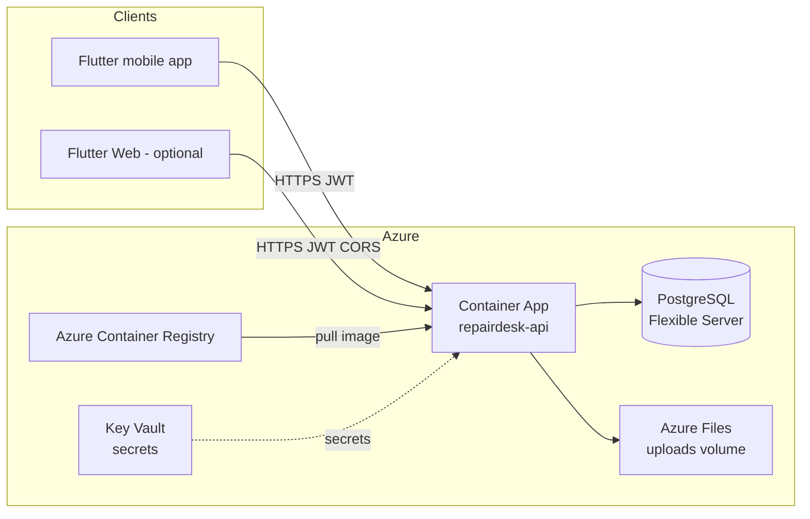

# RepairDesk — Azure Container Apps Deployment Guide

**Document type:** Deployment guide (backend API)  
**Audience:** DevOps / platform engineers deploying RepairDesk V1 to Azure  
**Related docs:** [Deployment-Runbook.md](Deployment-Runbook.md) (VM + Docker Compose), [Architecture.md](Architecture.md)

This guide deploys the **Spring Boot backend only** to **Azure Container Apps (ACA)**. PostgreSQL runs on **Azure Database for PostgreSQL Flexible Server**. File attachments use an **Azure Files** volume mount (V1 uses local disk storage in the container).

---

## 1. Target architecture



| Component | Azure service | Notes |
|-----------|---------------|--------|
| API container | **Container Apps** | Built from `backend/Dockerfile` |
| Container image | **Azure Container Registry (ACR)** | Private registry |
| Database | **PostgreSQL Flexible Server** | Not in the app container |
| Secrets | **Key Vault** (recommended) or ACA secrets | JWT, DB password, admin password |
| Attachments | **Azure Files** share mounted to `/app/uploads` | Persists across restarts |
| TLS | **Container Apps ingress** | HTTPS termination at the edge |

**API base path:** all REST endpoints are under `/api/v1` (see `application.yml`).

---

## 2. Prerequisites

- Azure subscription with permissions to create Resource Groups, ACR, Container Apps, PostgreSQL, Storage, and Key Vault
- [Azure CLI](https://learn.microsoft.com/en-us/cli/azure/install-azure-cli) (`az`) logged in: `az login`
- Docker (to build and push the image locally), **or** GitHub Actions / ACR Tasks for CI build
- Domain name (optional) for a custom API hostname

**Suggested naming (adjust to your org):**

| Resource | Example name |
|----------|----------------|
| Resource group | `rg-repairdesk-prod` |
| Region | `eastus` (or your preferred region) |
| ACR | `acrrepairdesk` (globally unique, alphanumeric only) |
| Container Apps environment | `cae-repairdesk` |
| Container App | `repairdesk-api` |
| PostgreSQL server | `psql-repairdesk-prod` |
| Storage account (files) | `strepairdeskprod` |

---

## 3. One-time Azure setup

Set shell variables (customize before running):

```bash
RESOURCE_GROUP=rg-repairdesk-prod
LOCATION=eastus
ACR_NAME=acrrepairdesk          # must be globally unique
ACA_ENV=cae-repairdesk
ACA_APP=repairdesk-api
PG_SERVER=psql-repairdesk-prod
PG_DB=repairdesk
PG_USER=repairdesk
STORAGE_ACCOUNT=strepairdeskprod
FILE_SHARE=repairdesk-uploads
KV_NAME=kv-repairdesk-prod      # must be globally unique
```

### 3.1 Resource group

```bash
az group create --name $RESOURCE_GROUP --location $LOCATION
```

### 3.2 Azure Container Registry

```bash
az acr create \
  --resource-group $RESOURCE_GROUP \
  --name $ACR_NAME \
  --sku Basic \
  --admin-enabled false

ACR_LOGIN_SERVER=$(az acr show --name $ACR_NAME --query loginServer -o tsv)
echo $ACR_LOGIN_SERVER
```

### 3.3 PostgreSQL Flexible Server

Use a **private** or **public with firewall restricted to Azure services** configuration. For production, prefer **private access** via a VNet-integrated Container Apps environment (advanced). For a first test deployment, public access with strict firewall is acceptable.

```bash
# Generate a strong DB password and store it locally for now
DB_PASSWORD="$(openssl rand -base64 24)"

az postgres flexible-server create \
  --resource-group $RESOURCE_GROUP \
  --name $PG_SERVER \
  --location $LOCATION \
  --admin-user $PG_USER \
  --admin-password "$DB_PASSWORD" \
  --sku-name Standard_B1ms \
  --tier Burstable \
  --storage-size 32 \
  --version 16 \
  --public-access 0.0.0.0

az postgres flexible-server db create \
  --resource-group $RESOURCE_GROUP \
  --server-name $PG_SERVER \
  --database-name $PG_DB
```

> **Security:** After deployment, remove `0.0.0.0` public access and use VNet/private endpoints when moving to production. See [Section 6](#6-security-configuration).

Connection string for the app:

```text
jdbc:postgresql://psql-repairdesk-prod.postgres.database.azure.com:5432/repairdesk?sslmode=require
```

### 3.4 Azure Files (attachment storage)

```bash
az storage account create \
  --resource-group $RESOURCE_GROUP \
  --name $STORAGE_ACCOUNT \
  --location $LOCATION \
  --sku Standard_LRS \
  --kind StorageV2

az storage share-rm create \
  --resource-group $RESOURCE_GROUP \
  --storage-account $STORAGE_ACCOUNT \
  --name $FILE_SHARE \
  --quota 50
```

---

## 4. Build and push the Docker image

From your machine (or CI), with the repo cloned:

```bash
cd backend

# Log in to ACR
az acr login --name $ACR_NAME

# Build and push
docker build -t $ACR_LOGIN_SERVER/repairdesk-api:1.0.0 .
docker push $ACR_LOGIN_SERVER/repairdesk-api:1.0.0
```

The image is defined in `backend/Dockerfile` (multi-stage Java 21, non-root user, port 8080).

---

## 5. Deploy to Azure Container Apps

### 5.1 Generate production secrets

```bash
JWT_SECRET="$(openssl rand -hex 32)"
ADMIN_PASSWORD="$(openssl rand -base64 16)"
echo "Save these securely — they will not be shown again."
```

### 5.2 (Recommended) Store secrets in Key Vault

```bash
az keyvault create \
  --resource-group $RESOURCE_GROUP \
  --name $KV_NAME \
  --location $LOCATION \
  --enable-rbac-authorization true

# Store secrets (run as a user/principal with Key Vault Secrets Officer)
az keyvault secret set --vault-name $KV_NAME --name db-password      --value "$DB_PASSWORD"
az keyvault secret set --vault-name $KV_NAME --name jwt-secret       --value "$JWT_SECRET"
az keyvault secret set --vault-name $KV_NAME --name admin-password   --value "$ADMIN_PASSWORD"
```

For V1 you can also pass secrets directly as Container App secrets (simpler, slightly less ideal than Key Vault references).

### 5.3 Container Apps environment + app

```bash
az containerapp env create \
  --resource-group $RESOURCE_GROUP \
  --name $ACA_ENV \
  --location $LOCATION

# Storage mount for uploads (Azure Files)
STORAGE_KEY=$(az storage account keys list -g $RESOURCE_GROUP -n $STORAGE_ACCOUNT --query "[0].value" -o tsv)

az containerapp env storage set \
  --resource-group $RESOURCE_GROUP \
  --name $ACA_ENV \
  --storage-name uploads \
  --azure-file-account-name $STORAGE_ACCOUNT \
  --azure-file-account-key "$STORAGE_KEY" \
  --azure-file-share-name $FILE_SHARE \
  --access-mode ReadWrite

# Enable ACR pull via managed identity
az containerapp create \
  --resource-group $RESOURCE_GROUP \
  --name $ACA_APP \
  --environment $ACA_ENV \
  --image $ACR_LOGIN_SERVER/repairdesk-api:1.0.0 \
  --registry-server $ACR_LOGIN_SERVER \
  --registry-identity system \
  --system-assigned \
  --target-port 8080 \
  --ingress external \
  --min-replicas 1 \
  --max-replicas 2 \
  --cpu 0.5 \
  --memory 1.0Gi \
  --secrets \
    db-password="$DB_PASSWORD" \
    jwt-secret="$JWT_SECRET" \
    admin-password="$ADMIN_PASSWORD" \
  --env-vars \
    SPRING_PROFILES_ACTIVE=prod \
    DB_URL="jdbc:postgresql://${PG_SERVER}.postgres.database.azure.com:5432/${PG_DB}?sslmode=require" \
    DB_USERNAME=$PG_USER \
    DB_PASSWORD=secretref:db-password \
    JWT_SECRET=secretref:jwt-secret \
    STORAGE_LOCATION=/app/uploads \
    CORS_ALLOWED_ORIGINS=https://your-flutter-web-domain.com \
    APP_ADMIN_DEFAULT_USERNAME=admin \
    APP_ADMIN_DEFAULT_PASSWORD=secretref:admin-password \
    APP_ADMIN_DEFAULT_MOBILE=0000000000 \
  --volume-name uploads-vol \
  --storage-name uploads \
  --mount-path /app/uploads
```

Grant the Container App identity permission to pull from ACR:

```bash
ACA_PRINCIPAL_ID=$(az containerapp show -g $RESOURCE_GROUP -n $ACA_APP --query identity.principalId -o tsv)
ACR_ID=$(az acr show -g $RESOURCE_GROUP -n $ACR_NAME --query id -o tsv)
az role assignment create \
  --assignee $ACA_PRINCIPAL_ID \
  --role AcrPull \
  --scope $ACR_ID
```

### 5.4 Get the public API URL

```bash
FQDN=$(az containerapp show -g $RESOURCE_GROUP -n $ACA_APP --query properties.configuration.ingress.fqdn -o tsv)
echo "API base URL: https://${FQDN}/api/v1"
```

### 5.5 Verify health

```bash
curl -sf "https://${FQDN}/api/v1/actuator/health"
curl -sf "https://${FQDN}/api/v1/ping"
```

Expected: `{"status":"UP"}` and ping JSON with `"status":"ok"`.

---

## 6. Security configuration

This section maps RepairDesk’s application security model to Azure best practices.

### 6.1 Application security (built into the backend)

| Control | Implementation |
|---------|----------------|
| **Authentication** | JWT (stateless); all routes except `/ping`, `/auth/**`, `/actuator/health`, `/actuator/info`, Swagger require a valid token |
| **Authorization** | Role-based (`@Secured`): Customer, Technician, Staff, Admin — see [Architecture.md](Architecture.md) |
| **Password storage** | BCrypt hashes in PostgreSQL; minimum 8 characters |
| **Attachment access** | `/attachments/{storageKey}` requires authentication; ownership checks in `AttachmentService` |
| **CORS** | Restricted to origins in `CORS_ALLOWED_ORIGINS` (relevant for Flutter Web; mobile apps are not CORS-limited) |
| **Health endpoint** | `show-details: never` — no sensitive info exposed |
| **CSRF** | Disabled (stateless JWT API — correct for mobile/SPA clients) |
| **Default admin** | Seeded once on first boot if no admin exists; **change password immediately** after first login |

Public endpoints (no JWT):

- `GET /api/v1/ping`
- `POST /api/v1/auth/login`, `/auth/register`, etc.
- `GET /api/v1/actuator/health`
- Swagger UI (`/api/v1/swagger-ui/**`) — **consider restricting in production** (see below)

### 6.2 Azure network security

| Control | Recommendation |
|---------|----------------|
| **Ingress** | Container Apps **external** ingress with **HTTPS only** (default). Do not expose port 8080 directly on a VM. |
| **PostgreSQL** | **Do not** allow `0.0.0.0/0` in production. Use **private access** (VNet integration) or firewall rules limited to Azure Container Apps outbound IPs. |
| **ACR** | Private registry; pull via **managed identity** (no admin user, no passwords in env). |
| **Storage (uploads)** | Azure Files share is **not** public; only mounted inside the container. |
| **Key Vault** | Store `JWT_SECRET`, `DB_PASSWORD`, `ADMIN_PASSWORD`; use Key Vault references in Container Apps for production. |

**Restrict PostgreSQL firewall (after testing):**

```bash
# Remove open internet rule when using private networking or known outbound IPs
az postgres flexible-server firewall-rule delete \
  --resource-group $RESOURCE_GROUP \
  --name $PG_SERVER \
  --rule-name AllowAllAzureServicesAndResourcesWithinAzureIps_YYYY-MM-DD_HH-MM-SS
```

For production, integrate Container Apps with a **VNet** and use PostgreSQL **private endpoint**.

### 6.3 Secrets management

| Secret | Env variable | Notes |
|--------|--------------|-------|
| DB password | `DB_PASSWORD` | Use ACA `secretref:` or Key Vault reference |
| JWT signing key | `JWT_SECRET` | **Minimum 32 characters**; rotate by redeploying with new secret (invalidates existing tokens) |
| Admin bootstrap password | `APP_ADMIN_DEFAULT_PASSWORD` | Used only when seeding admin on **first** boot; remove/rotate after login |
| ACR credentials | — | Use managed identity (`AcrPull`), not admin password |

Generate JWT secret:

```bash
openssl rand -hex 32
```

**Never commit secrets to git.** The repo’s `.gitignore` excludes `.env` files.

### 6.4 Production environment variables (required)

| Variable | Example | Required |
|----------|---------|----------|
| `SPRING_PROFILES_ACTIVE` | `prod` | Yes |
| `DB_URL` | `jdbc:postgresql://....postgres.database.azure.com:5432/repairdesk?sslmode=require` | Yes |
| `DB_USERNAME` | `repairdesk` | Yes |
| `DB_PASSWORD` | (secret) | Yes |
| `JWT_SECRET` | (secret, ≥32 chars) | Yes |
| `STORAGE_LOCATION` | `/app/uploads` | Yes (must match volume mount) |
| `CORS_ALLOWED_ORIGINS` | `https://app.yourdomain.com` | Yes if using Flutter Web |
| `APP_ADMIN_DEFAULT_USERNAME` | `admin` | Yes (first boot only) |
| `APP_ADMIN_DEFAULT_PASSWORD` | (secret) | Yes (first boot only) |
| `APP_ADMIN_DEFAULT_MOBILE` | `0000000000` | Yes (placeholder) |
| `SERVER_PORT` | `8080` | Default OK |

Optional tuning:

| Variable | Default | Purpose |
|----------|---------|---------|
| `DB_POOL_MAX` | `10` | HikariCP max connections |
| `DB_POOL_MIN` | `2` | HikariCP min idle |

### 6.5 Swagger / OpenAPI in production

Swagger UI is currently **publicly accessible** without authentication. For a production ACA deployment:

1. **Option A (recommended for V1 test):** Leave enabled for internal QA; restrict ingress with an IP allow list or Azure Front Door WAF rule.
2. **Option B (hardened):** Disable Swagger in prod via a future profile flag or network rule blocking `/swagger-ui/**`.

Document your choice in the runbook for your environment.

### 6.6 TLS and custom domain

Container Apps provides a default `*.azurecontainerapps.io` hostname with TLS.

To use your own domain (e.g. `api.repairdesk.yourdomain.com`):

```bash
az containerapp hostname add \
  --resource-group $RESOURCE_GROUP \
  --name $ACA_APP \
  --hostname api.repairdesk.yourdomain.com

# Bind managed certificate (requires DNS CNAME validation)
az containerapp hostname bind \
  --resource-group $RESOURCE_GROUP \
  --name $ACA_APP \
  --hostname api.repairdesk.yourdomain.com \
  --environment $ACA_ENV \
  --validation-method CNAME
```

Update the Flutter app build:

```bash
flutter build apk --release \
  --dart-define=API_BASE_URL=https://api.repairdesk.yourdomain.com/api/v1
```

---

## 7. Updating the API (new version)

```bash
# Build and push new tag
docker build -t $ACR_LOGIN_SERVER/repairdesk-api:1.0.1 ./backend
docker push $ACR_LOGIN_SERVER/repairdesk-api:1.0.1

# Deploy new revision (Flyway migrations run automatically on startup)
az containerapp update \
  --resource-group $RESOURCE_GROUP \
  --name $ACA_APP \
  --image $ACR_LOGIN_SERVER/repairdesk-api:1.0.1
```

Monitor logs:

```bash
az containerapp logs show \
  --resource-group $RESOURCE_GROUP \
  --name $ACA_APP \
  --follow
```

---

## 8. Flutter app configuration

Rebuild the mobile app with the ACA URL (compile-time):

```bash
cd frontend
flutter build apk --release \
  --dart-define=API_BASE_URL=https://${FQDN}/api/v1
```

Or update `frontend/.env.server.json`:

```json
{
  "API_BASE_URL": "https://api.repairdesk.yourdomain.com/api/v1"
}
```

Then:

```bash
flutter build apk --release --dart-define-from-file=.env.server.json
```

---

## 9. Smoke test checklist

After deployment, run:

- [ ] `GET https://<fqdn>/api/v1/actuator/health` → `{"status":"UP"}`
- [ ] `GET https://<fqdn>/api/v1/ping` → `{"status":"ok",...}`
- [ ] `POST https://<fqdn>/api/v1/auth/login` with admin credentials → JWT returned
- [ ] `GET https://<fqdn>/api/v1/dashboard/counters` with JWT → 200
- [ ] Flutter app login works against the ACA URL
- [ ] Create repair request + upload photo → file persists after container restart (Azure Files mount)
- [ ] PostgreSQL not reachable from the public internet (firewall verified)

---

## 10. Security checklist (Azure + application)

### Before go-live

- [ ] `JWT_SECRET` is random (≥32 chars) and stored in Key Vault or ACA secrets — not in git
- [ ] `DB_PASSWORD` is strong and not committed
- [ ] PostgreSQL firewall does **not** allow `0.0.0.0/0` (production)
- [ ] SSL to PostgreSQL enabled (`sslmode=require` in `DB_URL`)
- [ ] ACR admin user disabled; image pull uses managed identity
- [ ] Default admin password changed via app after first login
- [ ] `APP_ADMIN_DEFAULT_PASSWORD` rotated or removed from active secret store after seeding
- [ ] `CORS_ALLOWED_ORIGINS` lists only trusted web origins (not `*`)
- [ ] Swagger exposure decision documented (restricted or disabled)
- [ ] Azure Files upload volume mounted; attachments not stored in ephemeral container disk only
- [ ] Container App ingress is HTTPS-only
- [ ] Automated PostgreSQL backups enabled (Azure default on Flexible Server)
- [ ] Log Analytics / diagnostics enabled on Container Apps environment for audit

### Ongoing

- [ ] Rotate `JWT_SECRET` on a schedule (requires redeploy; users must re-login)
- [ ] Review Container App revision logs for auth failures / 401 spikes
- [ ] Patch container image when Spring Boot / Java base image updates are released
- [ ] Monitor disk quota on Azure Files share (attachment growth)

---

## 11. Cost estimate (rough, V1 test)

| Service | SKU | Approx. monthly |
|---------|-----|-----------------|
| Container Apps | 0.5 vCPU, 1 GiB, 1 replica | ~$15–30 |
| PostgreSQL Flexible | Burstable B1ms | ~$15–25 |
| ACR Basic | — | ~$5 |
| Storage (Files) | 50 GB | ~$2–5 |
| **Total** | | **~$40–65/month** |

Actual cost depends on region, egress, and scale.

---

## 12. Troubleshooting

| Symptom | Likely cause | Fix |
|---------|--------------|-----|
| Container fails to start | DB connection refused | Check `DB_URL`, firewall, `sslmode=require` |
| Flyway migration error | Schema drift | Check logs; restore DB from backup; never use `ddl-auto=update` |
| 401 on all API calls | Missing/invalid JWT | Verify login; check `JWT_SECRET` unchanged across restarts |
| Uploads disappear after restart | No volume mount | Confirm Azure Files mount at `/app/uploads` and `STORAGE_LOCATION=/app/uploads` |
| Flutter app “No connection” | Wrong `API_BASE_URL` | Rebuild APK with correct HTTPS ACA URL |
| CORS errors (Web only) | Origin not in allow list | Add origin to `CORS_ALLOWED_ORIGINS` and redeploy |

---

## 13. Related files in this repo

| Path | Purpose |
|------|---------|
| `backend/Dockerfile` | Container image build |
| `backend/src/main/resources/application.yml` | Env vars and prod profile |
| `backend/src/main/java/.../SecurityConfig.java` | JWT, CORS, public routes |
| `deploy/docker-compose.prod.yml` | Alternative VM-based deployment |
| `deploy/env.example` | Reference env var names |
| `docs/Deployment-Runbook.md` | VM + Docker Compose runbook |

---

## 14. Contacts

| Role | Contact |
|------|---------|
| System Admin | _add contact_ |
| Application Owner | _add contact_ |
