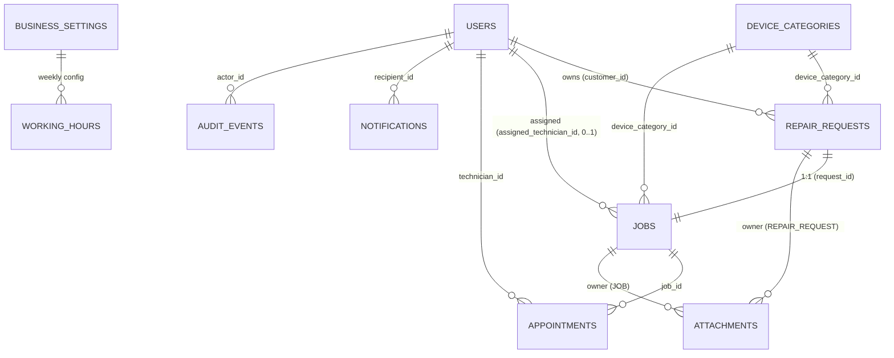

# RepairDesk — Database Design (Version 1)

**Product:** RepairDesk (built for ACE Telecom)
**Document Type:** Database Design / Schema Specification
**Version:** 1.0
**Status:** Final for Implementation
**Derived from:** [Architecture.md](Architecture.md) (Domain Model, Database Architecture), the nine feature specs, and the approved V1 decisions in [gap-analysis.md](gap-analysis.md).

> This document defines the **PostgreSQL schema** for V1: tables, columns, types, constraints, relationships, indexes, soft-delete/audit strategy, the Flyway migration plan, and seed data. It is implemented via **Flyway migrations** (Constitution: no schema change without a migration). It does not define API contracts (see [API.md](API.md)) or application code.

---

# 1. Conventions

| Concern | Convention |
| --- | --- |
| **Engine** | PostgreSQL (single database). |
| **Naming** | `snake_case`; tables **plural** (`repair_requests`); columns `snake_case`; PK column `id`; FKs `<entity>_id`. |
| **Primary keys** | `UUID` (per Constitution). Recommend **time-ordered UUID (v7)** generated by the app (or DB) to preserve index locality (ADR-004). Stored as native `uuid`. |
| **Timestamps** | `timestamptz`. `created_at NOT NULL DEFAULT now()`; `updated_at` set on modification. |
| **Optimistic locking** | `version BIGINT NOT NULL DEFAULT 0` (JPA `@Version`) on mutable aggregates (ADR-008). No DB row locks in V1. |
| **Enumerations** | Stored as `VARCHAR` with `CHECK` constraints (mapped via JPA `@Enumerated(STRING)`). Chosen over native PG enums to add values without `ALTER TYPE` friction. |
| **Soft delete** | Logical removal via status/flag columns (see §4). Repositories filter out removed/archived rows by default. |
| **Money / cost** | None in V1 (no invoicing/payments). |
| **Money of truth** | Account profile (`users`) is the authoritative customer contact; request contact fields are request-local snapshots (gap-analysis DATA-04). |
| **Sensitive fields** | `password_hash`, `device_serial` (IMEI) — never returned in API responses or logs; access restricted by role. |
| **Reference numbers** | Human-readable repair reference generated once at request creation and **reused as the Job Number** (ADR-012); distinct from the UUID PK. |

**Enum value sets (canonical):**

```text
role            : CUSTOMER | TECHNICIAN | STAFF | ADMIN
account_status  : ACTIVE | DISABLED | DELETED
request_status  : PENDING_REVIEW | INFORMATION_REQUIRED | APPROVED | REJECTED | CANCELLED
job_status      : CREATED | ASSIGNED | SCHEDULED | IN_PROGRESS | AWAITING_PARTS | COMPLETED | CANCELLED
appointment_status : SCHEDULED | IN_PROGRESS | COMPLETED | CANCELLED
priority        : LOW | NORMAL | HIGH | URGENT
warranty_status : IN_WARRANTY | OUT_OF_WARRANTY | UNKNOWN
attachment_owner_type : REPAIR_REQUEST | JOB
notification_related_type : REPAIR_REQUEST | JOB | APPOINTMENT
```

---

# 2. Entity Relationship Overview



**Cardinality summary:**
- `users (1) → repair_requests (N)` via `customer_id`.
- `users (0..1) → jobs (N)` via `assigned_technician_id` (one technician per job).
- `repair_requests (1) ↔ jobs (1)` — job created on approval, shares `reference_number`.
- `jobs (1) → appointments (N)` — at most **one active** (`SCHEDULED`/`IN_PROGRESS`) at a time; reschedules retained as history.
- `device_categories (1) → repair_requests/jobs (N)`.
- `attachments` polymorphic to a request **or** a job (`owner_type` + `owner_id`); no DB FK (integrity enforced in service).
- `notifications (N) → users (1)` recipient.
- `audit_events` polymorphic to any entity.
- `business_settings (1) → working_hours (7)` — one row per weekday.

---

# 3. Table Definitions

Each table lists columns with type, nullability, default, and notes. PK = `id UUID` unless stated. `created_at`, `updated_at`, `version` follow §1 conventions.

## 3.1 `users` — Accounts (all roles)

| Column | Type | Null | Default | Notes |
| --- | --- | --- | --- | --- |
| id | uuid | No | (app) | PK. |
| username | varchar(50) | No | | Unique among non-deleted (partial unique). Login identifier. |
| mobile | varchar(20) | No | | Unique among non-deleted. Login identifier + authoritative contact. |
| name | varchar(100) | Yes | | Display name (optional). |
| password_hash | varchar(100) | No | | **BCrypt** hash. Never exposed. |
| role | varchar(20) | No | | `CHECK` in `role` set. Exactly one role per user. |
| status | varchar(20) | No | `'ACTIVE'` | `CHECK` in `account_status`. `DISABLED` reversible; `DELETED` logical removal. |
| must_change_password | boolean | No | `false` | `true` for seeded default admin until changed. |
| created_at | timestamptz | No | now() | |
| updated_at | timestamptz | Yes | | |
| version | bigint | No | 0 | Optimistic lock. |

**Constraints / indexes:**
- Partial unique: `UNIQUE (lower(username)) WHERE status <> 'DELETED'`; `UNIQUE (mobile) WHERE status <> 'DELETED'` — allows reuse after logical delete.
- Index `(role, status)` — drives the **active technician roster** (`role='TECHNICIAN' AND status='ACTIVE'`) and role filters.
- Index for search on `name` and `mobile` (e.g., trigram or prefix index for `<2s` search target).
- **Business rule (service-enforced, not a DB constraint):** at least one `ACTIVE` `ADMIN` must always exist (last-admin guard).

## 3.2 `device_categories` — Product/Device catalog (Admin-managed)

| Column | Type | Null | Default | Notes |
| --- | --- | --- | --- | --- |
| id | uuid | No | (app) | PK. |
| name | varchar(100) | No | | Category name (e.g., Mobile Phone). |
| description | varchar(500) | Yes | | Optional. |
| archived | boolean | No | `false` | Soft delete; archived categories hidden from new requests, retained on existing records. |
| created_at | timestamptz | No | now() | |
| updated_at | timestamptz | Yes | | |
| version | bigint | No | 0 | |

**Constraints / indexes:**
- Partial unique: `UNIQUE (lower(name)) WHERE archived = false` — active names unique; archived names freed.
- Index `(archived)` for active-list filtering.

## 3.3 `repair_requests` — Customer intake + review lifecycle

| Column | Type | Null | Default | Notes |
| --- | --- | --- | --- | --- |
| id | uuid | No | (app) | PK. |
| reference_number | varchar(30) | No | | Unique. Human-readable; reused by the job. |
| customer_id | uuid | No | | FK → users(id). Owner. |
| device_category_id | uuid | No | | FK → device_categories(id). |
| contact_name | varchar(100) | No | | Request-local snapshot (editable; not authoritative). |
| contact_mobile | varchar(20) | No | | Request-local snapshot. |
| contact_email | varchar(255) | Yes | | Optional (reserved for future email). |
| device_brand | varchar(100) | Yes | | Free text (no managed brand list in V1). |
| device_model | varchar(100) | Yes | | Free text. |
| device_serial | varchar(100) | Yes | | Serial/IMEI; **sensitive**, internal-only. |
| purchase_date | date | Yes | | Not in the future (service-validated). |
| warranty_status | varchar(20) | Yes | | `CHECK` in `warranty_status` (customer-indicated). |
| issue_description | text | No | | Required. |
| preferred_date | date | No | | Preference only; not a booking. |
| preferred_time | time | No | | Preference (slot-aligned, within working hours). |
| status | varchar(30) | No | `'PENDING_REVIEW'` | `CHECK` in `request_status`. |
| priority | varchar(10) | No | `'NORMAL'` | `CHECK` in `priority`; set by staff during review. |
| rejection_reason_code | varchar(40) | Yes | | Set on reject (predefined list). |
| rejection_reason_internal | text | Yes | | Internal-only rationale. |
| customer_facing_message | text | Yes | | Shown to customer on reject. |
| info_requested_message | text | Yes | | Set when moved to `INFORMATION_REQUIRED`. |
| submitted_at | timestamptz | No | now() | Initial submission. |
| reviewed_at | timestamptz | Yes | | First/last decision time. |
| reviewed_by | uuid | Yes | | FK → users(id) (staff/admin). |
| created_at | timestamptz | No | now() | |
| updated_at | timestamptz | Yes | | |
| version | bigint | No | 0 | Optimistic lock. |

**Constraints / indexes:**
- `UNIQUE (reference_number)`.
- FKs: `customer_id`, `device_category_id`, `reviewed_by`.
- Index `(status)`, `(customer_id)`, `(device_category_id)`, `(priority, submitted_at)` (queue sort), search index on `contact_name`/`contact_mobile`/`reference_number`.

## 3.4 `jobs` — Active repair lifecycle (1:1 with approved request)

| Column | Type | Null | Default | Notes |
| --- | --- | --- | --- | --- |
| id | uuid | No | (app) | PK. |
| reference_number | varchar(30) | No | | Unique. **Equals** the originating request reference. |
| request_id | uuid | No | | FK → repair_requests(id); **unique** (1:1). |
| customer_id | uuid | No | | FK → users(id). Denormalized for queries. |
| device_category_id | uuid | Yes | | FK → device_categories(id) (snapshot). |
| assigned_technician_id | uuid | Yes | | FK → users(id) (Technician). Null until assigned. |
| current_appointment_id | uuid | Yes | | FK → appointments(id). Active appointment (nullable; FK added after appointments exists). |
| status | varchar(20) | No | `'CREATED'` | `CHECK` in `job_status`. |
| priority | varchar(10) | No | `'NORMAL'` | `CHECK` in `priority`. |
| issue_description | text | No | | Snapshot from request. |
| device_brand | varchar(100) | Yes | | Snapshot. |
| device_model | varchar(100) | Yes | | Snapshot. |
| device_serial | varchar(100) | Yes | | Snapshot; sensitive. |
| purchase_date | date | Yes | | Snapshot. |
| warranty_status | varchar(20) | Yes | | Customer-indicated snapshot. |
| warranty_confirmed_by_staff | varchar(20) | Yes | | `CHECK` in `warranty_status` (`YES`/`NO`/`UNKNOWN` semantics) — staff confirmation (gap-analysis DATA-06). |
| resolution_summary | text | Yes | | Required before `COMPLETED`. |
| parts_needed_note | text | Yes | | Free text (no structured parts in V1). |
| cancellation_reason | text | Yes | | Required on `CANCELLED`. |
| completed_at | timestamptz | Yes | | Set on completion (cycle-time reporting). |
| created_at | timestamptz | No | now() | Created on approval. |
| updated_at | timestamptz | Yes | | |
| version | bigint | No | 0 | Optimistic lock. |

**Constraints / indexes:**
- `UNIQUE (reference_number)`, `UNIQUE (request_id)`.
- FKs: `request_id`, `customer_id`, `device_category_id`, `assigned_technician_id`, `current_appointment_id`.
- Index `(status)`, `(assigned_technician_id, status)` (technician job list), `(priority, created_at)` (queue), search index on `reference_number`.
- **Service rule:** only an `ACTIVE` `TECHNICIAN` may be assigned.

## 3.5 `appointments` — Scheduling records (child of job)

| Column | Type | Null | Default | Notes |
| --- | --- | --- | --- | --- |
| id | uuid | No | (app) | PK. |
| job_id | uuid | No | | FK → jobs(id). |
| technician_id | uuid | No | | FK → users(id) (Technician). Required at scheduling. |
| scheduled_date | date | No | | Working day. |
| start_time | time | No | | Within working hours, slot-aligned. |
| end_time | time | No | | Derived = start + slot duration. |
| status | varchar(20) | No | `'SCHEDULED'` | `CHECK` in `appointment_status`; mirrors job. |
| customer_requested_date | date | Yes | | Display-only preference snapshot. |
| customer_requested_time | time | Yes | | Display-only. |
| appointment_notes | text | Yes | | Optional internal note. |
| cancellation_reason | text | Yes | | Required on cancel. |
| supersedes_appointment_id | uuid | Yes | | FK → appointments(id). Reschedule chain (new supersedes old). |
| created_by | uuid | No | | FK → users(id) (staff/admin). |
| created_at | timestamptz | No | now() | |
| updated_at | timestamptz | Yes | | |
| version | bigint | No | 0 | Optimistic lock. |

**Constraints / indexes:**
- FKs: `job_id`, `technician_id`, `created_by`, `supersedes_appointment_id`.
- Index `(technician_id, scheduled_date)` — calendar + **conflict check** (overlap for same technician where status in `SCHEDULED`/`IN_PROGRESS`).
- Index `(job_id)`, `(status, scheduled_date)`.
- **Service rule:** at most one active appointment per job; overlap is a **soft warning** (not a DB constraint); outside-hours/past-time are hard-blocked in the service.

## 3.6 `attachments` — Image metadata (polymorphic)

| Column | Type | Null | Default | Notes |
| --- | --- | --- | --- | --- |
| id | uuid | No | (app) | PK. |
| owner_type | varchar(20) | No | | `CHECK` in `attachment_owner_type`. |
| owner_id | uuid | No | | Request or Job id (no DB FK — polymorphic). |
| uploaded_by | uuid | No | | FK → users(id). |
| content_type | varchar(100) | No | | Validated (JPEG/PNG/HEIC/WebP). |
| file_size_bytes | bigint | No | | ≤10 MB/file (service-enforced). |
| original_filename | varchar(255) | Yes | | |
| storage_key | varchar(255) | No | | Unique; non-guessable path/key on the file volume. |
| created_at | timestamptz | No | now() | |
| version | bigint | No | 0 | |

**Constraints / indexes:**
- `UNIQUE (storage_key)`.
- Index `(owner_type, owner_id)`.
- **Service rules:** ≤5 per request / ≤10 per job; ≤25 MB total per request; integrity of `owner_id` validated in service; binary lives on the file system, not in the DB.

## 3.7 `notifications` — Customer inbox + technician feed

| Column | Type | Null | Default | Notes |
| --- | --- | --- | --- | --- |
| id | uuid | No | (app) | PK. |
| recipient_id | uuid | No | | FK → users(id). |
| type | varchar(40) | No | | Event type (see API/notification set). |
| message | text | No | | Rendered message (customer-friendly). |
| related_type | varchar(20) | Yes | | `CHECK` in `notification_related_type`. |
| related_id | uuid | Yes | | Target request/job/appointment. |
| reference_number | varchar(30) | Yes | | For display/deep-link. |
| read | boolean | No | `false` | Unread badge / mark-read. |
| created_at | timestamptz | No | now() | |

**Constraints / indexes:**
- FK: `recipient_id`.
- Index `(recipient_id, created_at DESC)` — inbox (**last 30**).
- Index `(recipient_id, read)` — unread count.
- **Note:** customers have a persisted inbox; staff use **computed counters** (no rows); technician alerts may be sourced from rows filtered to the technician but displayed transiently (gap-analysis GAP-02).

## 3.8 `audit_events` — Append-only audit journal (polymorphic)

| Column | Type | Null | Default | Notes |
| --- | --- | --- | --- | --- |
| id | uuid | No | (app) | PK. |
| entity_type | varchar(40) | No | | e.g., `REPAIR_REQUEST`, `JOB`, `APPOINTMENT`, `USER`. |
| entity_id | uuid | No | | Target record. |
| action | varchar(60) | No | | e.g., `STATUS_CHANGED`, `ASSIGNED`, `APPROVED`, `RESCHEDULED`, `USER_DISABLED`. |
| actor_id | uuid | Yes | | FK → users(id) (null = system). |
| actor_username | varchar(50) | Yes | | **Snapshot** so attributability survives user deletion. |
| before_data | jsonb | Yes | | Optional prior state. |
| after_data | jsonb | Yes | | Optional new state. |
| reason | text | Yes | | e.g., cancellation/rejection reason. |
| correlation_id | varchar(64) | Yes | | Links to request log trace. |
| created_at | timestamptz | No | now() | |

**Constraints / indexes:**
- Index `(entity_type, entity_id, created_at)` — per-record history.
- Index `(actor_id)`, `(action)`.
- **Append-only:** inserts only; no `UPDATE`/`DELETE` (enforced by app convention; optionally a trigger). Admin sees full log; staff see per-record history (gap-analysis PERM-04).

## 3.9 `business_settings` — Singleton configuration (Admin)

| Column | Type | Null | Default | Notes |
| --- | --- | --- | --- | --- |
| id | smallint | No | 1 | Single row; `CHECK (id = 1)`. |
| business_name | varchar(150) | Yes | `'ACE Telecom'` | Display/reference. |
| business_address | varchar(500) | Yes | | Display/reference. |
| business_phone | varchar(20) | Yes | | Display/reference. |
| business_email | varchar(255) | Yes | | Display/reference (not used for system notifications in V1). |
| slot_duration_minutes | int | No | 60 | `CHECK IN (30,60,90,120)`. |
| booking_horizon_days | int | No | 60 | Intake preference horizon. |
| updated_at | timestamptz | Yes | | |
| version | bigint | No | 0 | |

## 3.10 `working_hours` — Weekly business calendar (Admin)

| Column | Type | Null | Default | Notes |
| --- | --- | --- | --- | --- |
| id | uuid | No | (app) | PK. |
| day_of_week | smallint | No | | `CHECK 0..6` (0=Mon … 6=Sun). Unique. |
| is_closed | boolean | No | `false` | If closed, times null. |
| open_time | time | Yes | | Required when not closed. |
| close_time | time | Yes | | Required when not closed; > open_time. |
| version | bigint | No | 0 | |

**Constraints:** `UNIQUE (day_of_week)`; service validates `open_time < close_time` when `is_closed = false`. No holiday calendar in V1 (weekly recurring only).

---

# 4. Soft-Delete Strategy (per ADR-009)

| Entity | Removal mechanism | Reuse / integrity |
| --- | --- | --- |
| `users` | `status = DELETED` (logical) + access revoked via status check; optional PII scrub. `DISABLED` = reversible. | Partial unique indexes free username/mobile after delete; FKs from requests/jobs/audit stay valid; `audit_events.actor_username` snapshot preserves attributability. |
| `device_categories` | `archived = true`. | Hidden from new requests; existing requests/jobs retain the reference. Active-name uniqueness is partial. |
| `repair_requests` / `jobs` | **Not deleted.** Terminal statuses (`REJECTED`/`CANCELLED`/`COMPLETED`) are the logical archive; retained indefinitely. | N/A. |
| `attachments` | **Hard delete** (row + binary) on removal or when an owning request is deleted. | Service deletes file via `StorageService` then row in one transaction-of-intent. |
| `notifications` | Retained; inbox returns last 30. Optional age-based pruning is a future op. | N/A. |
| `audit_events` | Never deleted. | Append-only. |

Repositories apply default filters (`status <> 'DELETED'`, `archived = false`, exclude superseded appointments) unless an admin/audit view requests otherwise.

---

# 5. Audit Strategy

- Every state-changing service operation writes one `audit_events` row **inside the same transaction** as the change (atomic with the business write).
- Captures: entity type/id, action, actor (id + username snapshot), optional before/after JSONB, reason, correlation id, timestamp.
- Covered events (from feature specs): request created/edited/cancelled, status changes, approve/reject/request-info, priority changes, internal notes added, job created/assigned/reassigned/unassigned, schedule/reschedule/cancel, completion, account create/edit/role-change/enable/disable/delete, and permission-denied attempts.
- **Visibility:** Administrators query the full journal; Staff see the per-record history for records they can access; sensitive values are protected.

---

# 6. Reference Number Strategy (ADR-012)

- A single human-readable repair reference is generated at **request creation** and copied verbatim to the **job** on approval.
- **Mechanism:** a dedicated PostgreSQL sequence drives a zero-padded number; format documented for handover. Example format: `RD-YYYY-NNNNNN` (year + 6-digit padded sequence) or simply `RD-NNNNNN`.

```sql
CREATE SEQUENCE repair_reference_seq START 1 INCREMENT 1;
-- Service formats, e.g., 'RD-2026-' || lpad(nextval('repair_reference_seq')::text, 6, '0')
```

- `repair_requests.reference_number` and `jobs.reference_number` hold the **same** value (both `UNIQUE`). The UUID `id` remains the technical key.

---

# 7. Indexing & Performance (maps to NFRs)

To meet **<2s search, <3s load, 10k+ records**:
- Unique indexes on all `reference_number` columns and login identifiers.
- Composite indexes on the dominant query paths: request queue `(status, priority, submitted_at)`; job list `(status)`, `(assigned_technician_id, status)`, `(priority, created_at)`; calendar `(technician_id, scheduled_date)`; inbox `(recipient_id, created_at DESC)`.
- Search columns (`contact_name`, `mobile`, `name`) use prefix/trigram indexes appropriate to the search style.
- **All list endpoints are paginated** at the repository layer (no unbounded scans).
- HikariCP connection pooling; read queries use projections where full aggregates aren't needed.

---

# 8. Flyway Migration Plan

Forward-only, versioned migrations (Constitution). Applied on startup. Suggested breakdown:

| Migration | Creates |
| --- | --- |
| `V1__core_accounts_settings.sql` | `users`, `device_categories`, `business_settings`, `working_hours`; their indexes/constraints; `repair_reference_seq`. |
| `V2__requests.sql` | `repair_requests` + indexes/FKs. |
| `V3__jobs.sql` | `jobs` + indexes/FKs (FK `request_id`). |
| `V4__appointments.sql` | `appointments` + indexes/FKs; then add `jobs.current_appointment_id` FK. |
| `V5__attachments_notifications_audit.sql` | `attachments`, `notifications`, `audit_events` + indexes. |
| `V6__seed_reference_data.sql` | Default `business_settings` row, `working_hours` (Mon–Sat 09:00–18:00, Sun closed), starter `device_categories`. Idempotent. |
| `V7__seed_default_admin.sql` | Idempotent default admin (existence check before insert), `must_change_password = true`. |

**Migration rules:** applied migrations are immutable; new changes get new versioned files; repeatable migrations (`R__`) only for safe, idempotent reference data; no Hibernate auto-DDL in any environment.

---

# 9. Seed Data

| Data | Detail |
| --- | --- |
| **Default admin** | `username='admin'`, `mobile` placeholder, `password_hash = bcrypt('Admin@1234')`, `role='ADMIN'`, `status='ACTIVE'`, `must_change_password=true`. Inserted only if no `admin` exists (gap-analysis GAP-03). |
| **Business settings** | One row, `slot_duration_minutes=60`, `booking_horizon_days=60`, `business_name='ACE Telecom'`. |
| **Working hours** | Mon–Sat `09:00–18:00` open; Sun `is_closed=true` (gap-analysis Settings default). |
| **Device categories** | Starter active set: Mobile Phone, Laptop, Tablet, Camera (gap-analysis examples; admin can add/edit/archive). |

---

# 10. Retention & Backups

- **Requests, jobs, appointments, audit:** retained indefinitely in V1 (no purge policy; terminal statuses act as archive).
- **Attachments:** retained for the life of the owning record; deleted with the request if the request is deleted.
- **Backups:** daily `pg_dump` of the database **plus** a snapshot of the attachment volume (Architecture deployment/reliability). Backups must be consistent across DB + files.

---

# 11. Alignment Notes

- **Constitution:** PostgreSQL, Flyway-only schema, UUID identifiers, no sensitive data exposure. ✔
- **Architecture.md:** entities, polymorphic attachments, appointment-as-child, soft-delete strategy, optimistic locking, reference-number reuse, indexing for NFRs. ✔
- **Gap-analysis V1 decisions:** one role/user, 1:1 request→job, single terminal `COMPLETED`, one technician/job, one active appointment/job, warranty-confirmed-by-staff flag (DATA-06), attachment limits, archived categories, default admin seed, password handling. ✔

This schema is precise enough to author the Flyway migration scripts directly and is the source for [API.md](API.md) request/response field definitions.
