# RepairDesk Admin Portal — User Manual

**Print layout:** [Admin-Portal-User-Manual.html](Admin-Portal-User-Manual.html)  
**Audience:** shop administrators  
**Portals (same screens):**

| Site | Address |
| --- | --- |
| Azure Web App | https://repairdesk-admin-portal.azurewebsites.net |
| Azure Static Web App | https://black-cliff-0c84a7c00.7.azurestaticapps.net |

Staff daily work is in the [Staff Portal User Manual](Staff-Portal-User-Manual.md). Technician work on the phone is in the [Technician App User Manual](Technician-Portal-User-Manual.md).

An administrator can do every Staff task, plus the pages in this guide: people, the repair queue, the office pin, the Attendance switch, the catalog, and business settings.

---

## Index

1. [Admin credentials](#1-admin-credentials)
2. [Sign in](#2-sign-in)
3. [What an administrator sees](#3-what-an-administrator-sees)
4. [Create a Staff user](#4-create-a-staff-user)
5. [Create a Technician](#5-create-a-technician)
6. [Manage users](#6-manage-users)
7. [Create another administrator](#7-create-another-administrator)
8. [Repair requests](#8-repair-requests)
9. [Office location and attendance](#9-office-location-and-attendance)
10. [Technician locations and customer ETA](#10-technician-locations-and-customer-eta)
11. [Jobs, pins, and the rest of the shop day](#11-jobs-pins-and-the-rest-of-the-shop-day)
12. [Device catalog](#12-device-catalog)
13. [Business settings](#13-business-settings)
14. [Notifications and your account](#14-notifications-and-your-account)
15. [Quick reference](#15-quick-reference)

---

## 1. Admin credentials

Use these to open the Admin Portal. Keep them private.

| Field | Value |
| --- | --- |
| **Portal URL** | https://repairdesk-admin-portal.azurewebsites.net |
| **Same portal** | https://black-cliff-0c84a7c00.7.azurestaticapps.net |
| **Username** | `admin` |
| **Password** | `Admin$1234` |
| **Role** | Administrator |

The first sign-in after the site has been idle can take up to a minute. If it looks stuck, wait and try once more.

---

## 2. Sign in

1. Open either portal URL. Both open the same RepairDesk screens.
2. Enter **Username** `admin` and the administrator password.
3. Click **Sign in**.
4. You land on the **Dashboard**.

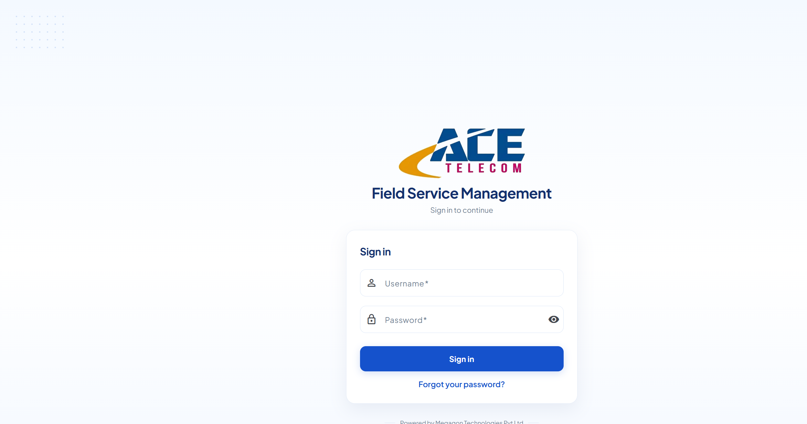

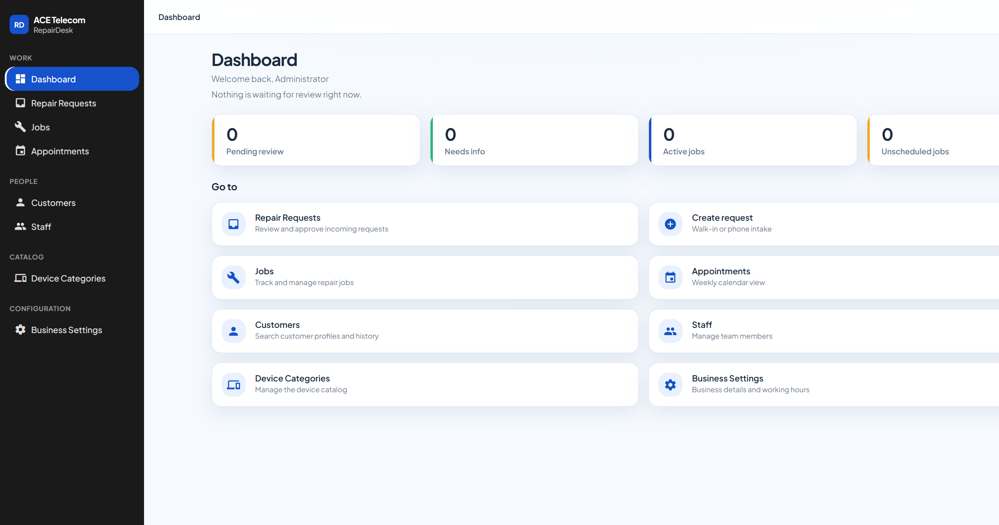

The dashboard cards are **Pending review**, **Needs info**, **Active jobs**, and **Unscheduled jobs**. Pending review and Needs info open the repair queue. Active jobs and Unscheduled jobs open Jobs. **Go to** repeats the sidebar, including **Create request**, **Locations**, and **Attendance**.

---

## 3. What an administrator sees

| Group | Pages |
| --- | --- |
| **Work** | Dashboard, Repair Requests, Locations, Attendance, Jobs, Appointments |
| **People** | Customers, Staff |
| **Catalog** | Device Categories |
| **Configuration** | Business Settings, Office location |

| People | Page | Who else can open it |
| --- | --- | --- |
| Staff, Technicians, other Admins | People → **Staff** | Administrator only |
| Customers | People → **Customers** | Staff and Administrator |
| Repair queue | Work → **Repair Requests** | Administrator only. Staff who open it see a restricted page. |

Do **not** create customers from Staff. Customer accounts are created from **Create request** (walk-in / phone) or they register in the mobile app.

You can do every task in the [Staff Portal User Manual](Staff-Portal-User-Manual.md): create a request, place a pin, assign a technician, book a visit, read the Locations map, and read the Attendance list. The sections below are the work only an administrator does, plus the map settings Staff cannot change.

---

## 4. Create a Staff user

1. In the left sidebar, open **People → Staff**.
2. Click **Add user** (top right).

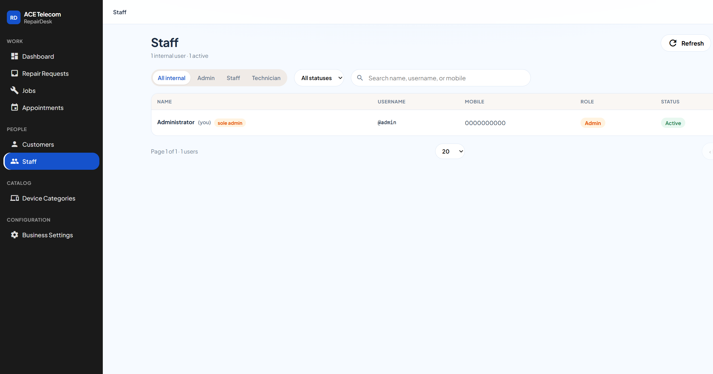

3. Fill the **Add user** dialog:

   | Field | What to enter |
   | --- | --- |
   | **Full name** | Required. Example: `Anita Kumar` |
   | **Username** | Required, at least 3 characters. Cannot be changed later. Example: `anita` |
   | **Mobile** | Required, unique. |
   | **Temporary password** | Required, at least 8 characters. Share it with the person yourself — RepairDesk does not email it. |
   | **Role** | Choose **Staff** (this is the default). |

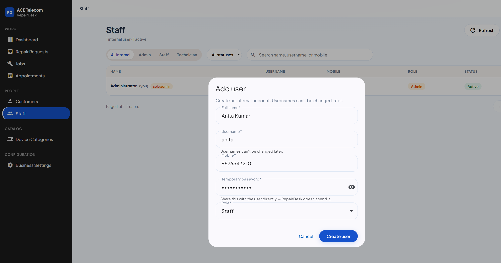

4. Click **Create user**.
5. Give the person their **username** and **temporary password** so they can sign in.

A Staff user can work requests, jobs, customers, appointments, the Locations map, and the Attendance list. They cannot open Staff management, the repair queue, the catalog, business settings, or office location.

---

## 5. Create a Technician

Same flow as Staff, with one change:

1. **People → Staff → Add user**.
2. Fill name, username, mobile, and a temporary password.
3. Set **Role** to **Technician**.

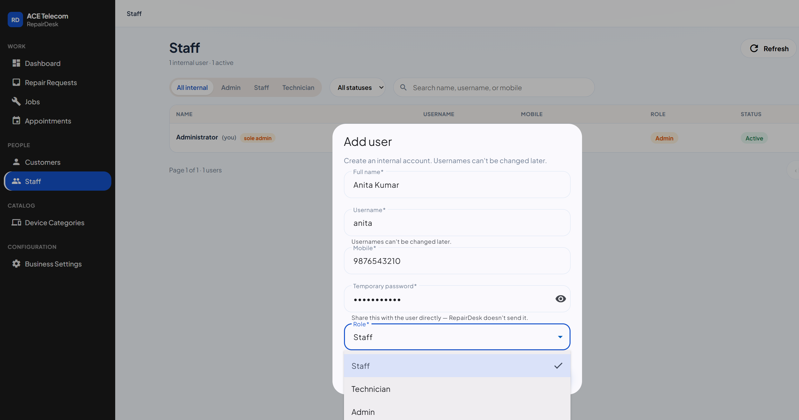

4. Click **Create user**.
5. Give them the RepairDesk Android app, the username, and the temporary password. They sign in on the phone, not with the customer **Register** link. Their steps are in the [Technician App User Manual](Technician-Portal-User-Manual.md).

Only **Active Technicians** appear when you assign a job or book an appointment.

If you later change a Technician to Staff or Admin, existing jobs stay assigned to them, but they will not be selectable for new assignments.

Travel time on Locations uses a two-wheeler route. There is no vehicle field on Add user.

---

## 6. Manage users (Staff, Technicians, Admins)

Open **People → Staff**. The table lists internal accounts only.

### 6.1 Find someone

- **Role tabs:** All internal · Admin · Staff · Technician
- **Status:** All statuses · Active · Disabled
- **Search:** name, username, or mobile

Your own row is marked **(you)**.

### 6.2 Edit name, mobile, or role

1. Click the row, or open the **⋮** menu → **Edit**.
2. Update **Full name**, **Mobile**, and/or **Role**.
3. Username is shown but cannot be edited.
4. Click **Save**.

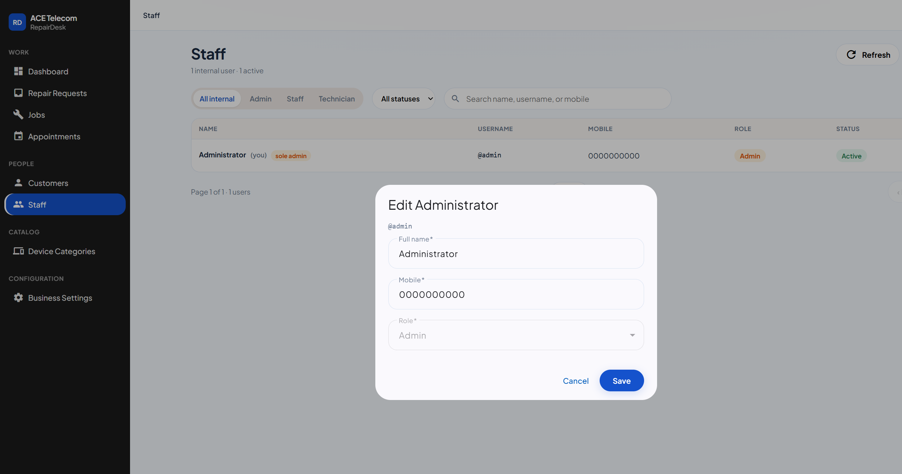

You cannot change **your own** role. Ask another administrator if you need that.

### 6.3 Disable or enable

- **⋮ → Disable** — they are signed out immediately and cannot sign in. Jobs and history are kept.
- **⋮ → Enable** — they can sign in again.

Use Disable for leave or a temporary stop. Use Delete only when the account should not come back.

### 6.4 Reset a password

1. **⋮ → Reset password**.
2. Enter a new password (minimum 8 characters).
3. Click **Reset password**.
4. Tell the person the new password yourself. It is never shown again in the portal.

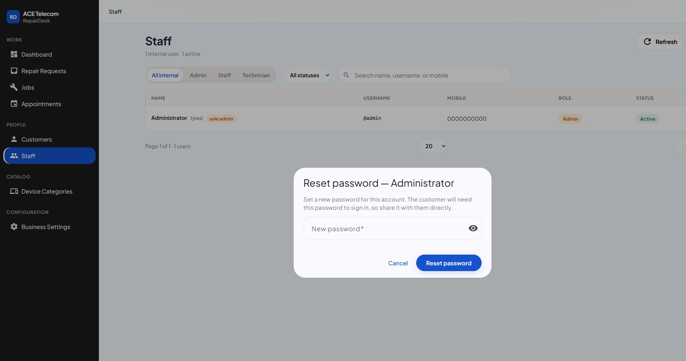

### 6.5 Delete an account

1. **⋮ → Delete**.
2. Confirm. Access is revoked immediately. Username and mobile become available for a new account.

There is no undo. You cannot delete **your own** account.

### 6.6 Rules that protect the shop

- There must always be **at least one active Administrator**. You cannot disable, delete, or demote the last admin.
- You cannot delete yourself or change your own role.

---

## 7. Create another administrator

Use **Add user** and set **Role** to **Admin**. Create a second admin before you disable or delete anyone who is currently the only admin.

---

## 8. Repair requests

**Work → Repair Requests.** This queue is administrator-only.

| Control | What it does |
| --- | --- |
| Status chips | Pending review is the default. Also Information required, Approved, Rejected, and the other request statuses. |
| Search | Reference, customer, or mobile |
| Category | Device category |
| Sort | Submitted, reference, or status |
| **Create request** | The same intake form Staff use. An administrator also sees **Create and approve**, which creates the request and the job in one step. |
| **Refresh** | Loads the queue again |

Open a row to decide it.

| Button | What it does |
| --- | --- |
| **Approve & create job** | Creates the job with the same reference number and copies the service pin onto the job. You can set priority and a note. |
| **Reject** | Sends a rejection message to the customer. This ends the request. |
| **Request info** | Asks the customer for something that is missing. The request moves to information required. |

The request page shows the service address and map when a pin was saved. You do not move the pin here. After approval, move it on the job (section 11).

Customer photos on the request are read-only. A serial number can be revealed and hidden.

---

## 9. Office location and attendance

Only an administrator opens **Configuration → Office location** in the portal, or **Office location** on the RepairDesk phone app.

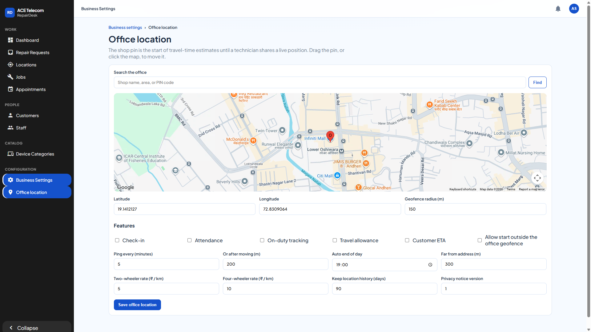

The shop pin is where travel time starts until a technician shares a position.

### Place the shop

1. Type the shop name, area, or PIN code and click **Find**, or click the map, or drag the red pin.
2. Check **Latitude**, **Longitude**, and **Geofence radius (m)**. The radius in the screenshot is **150** metres. That circle is the shop area used when a technician taps **Start day**.
3. Click **Save office location**.

The pin in the screenshot is Infinity Mall, Andheri West (19.1412127, 72.8309064).

### What the switches mean

All of these are **off** in the screenshot. Leave them off unless you intend to turn that behaviour on. Saving the form stores every switch, so do not tick one by accident.

| Switch | What it is for |
| --- | --- |
| **Check-in** | Later, a technician check-in at the job can record whether they were near the service address. |
| **Attendance** | Shows **Start day** / **End day** on the technician’s home screen. The Attendance list stays available either way. |
| **On-duty tracking** | Later, points while the technician is on duty. Today the portal stores the position sent when a technician opens a job. |
| **Travel allowance** | Rates below, in rupees per kilometre, kept for a later allowance calculation. They are not paid out from this screen. |
| **Customer ETA** | Allows a customer-facing ETA later. The number staff see on Locations is already calculated. The customer app does not show it yet. |
| **Allow start outside the office geofence** | A clear fix outside the shop circle can still start the day, and the list flags it **Outside shop**. While this is off, that start is refused and the day is not saved. |

| Field | In the screenshot | What it is for |
| --- | --- | --- |
| **Ping every (minutes)** | 5 | How often a future on-duty track would send a point. |
| **Or after moving (m)** | 200 | Or when the phone has moved this far. |
| **Auto end of day** | 19:00 | Closes any day that is still open at this India time. The technician gets one in-app notice. The job is left as it is. |
| **Far from address (m)** | 300 | The distance that would flag a later check-in as far from the job. |
| **Two-wheeler rate (₹ / km)** | 5 | Stored for a later allowance. |
| **Four-wheeler rate (₹ / km)** | 10 | Stored for a later allowance. |
| **Keep location history (days)** | 90 | How long later GPS points would be kept. Attendance day rows stay in the list. |
| **Privacy notice version** | 1 | Shown on the phone before the first **Start day**: the start time, and whether they were at the shop, are stored. |

Changing a number or a switch does nothing until you click **Save office location**.

A fix is treated as clear when the phone reports an accuracy no wider than the geofence radius. A clear fix inside the circle is **Inside shop**. A clear fix outside the circle is refused unless **Allow start outside the office geofence** is on. No fix, a fix wider than the radius, or no shop pin still starts the day, flagged **Location missing** or **Location uncertain**. A mocked location still starts the day, flagged **Mocked location**. **End day** always closes an open day. Opening a job, **Start Repair**, and **Start Navigating** do not check the work day.

### The attendance list

**Work → Attendance** in the portal, or **Attendance** on the phone app. Staff see this same page. Technicians do not. It is one row per active technician per India date, including people who have not started. Coordinates are not shown.

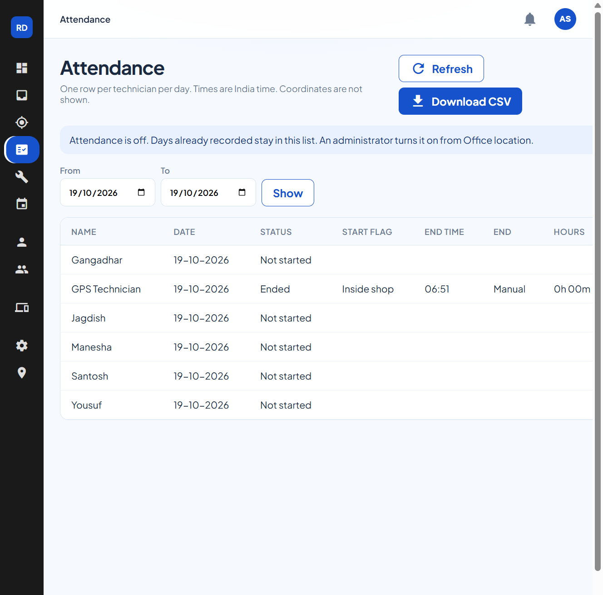

The page opens on today in India. Set **From** and **To**, then **Show**. The range can cover at most 31 days. **Refresh** reloads the list. **Download CSV** saves the same columns. The phone list has the same facts and no download.

| Column | What it shows |
| --- | --- |
| **Name** | The technician |
| **Date** | India date, day-month-year |
| **Status** | **Not started**, **On duty since** a time, **Ended**, or **Auto-ended** |
| **Start flag** | **Inside shop**, **Outside shop**, **Location uncertain**, **Location missing**, or **Mocked location** |
| **End time** | India time the day closed |
| **End** | **Manual** when they tapped **End day**. **Auto** when **Auto end of day** closed it |
| **Hours** | Time from start to end, for example **7h 40m** |

While **Attendance** is off, the list still opens. A notice says an administrator turns it on from Office location. Days already recorded stay in the list. The steps a technician follows are in the [Technician App User Manual](Technician-Portal-User-Manual.md). How Staff read the list day to day is in the [Staff Portal User Manual](Staff-Portal-User-Manual.md).

---

## 10. Technician locations and customer ETA

**Work → Locations** in the portal, or **Locations** on the phone app. Staff see this same page. They cannot change the office pin.

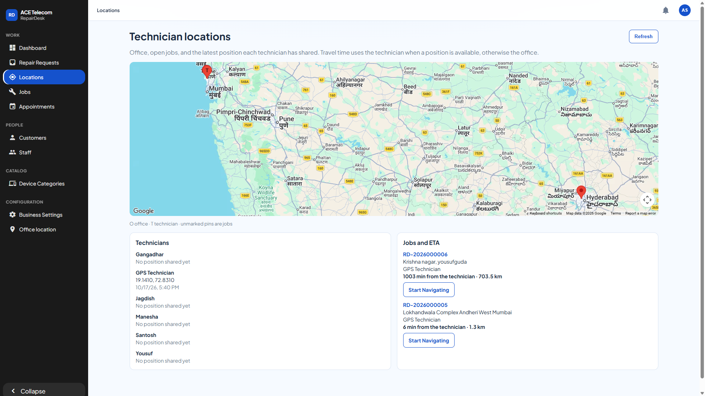

| On the map | Meaning |
| --- | --- |
| **O** | The shop pin from Office location. |
| **T** | A technician who has shared a position. |
| Unmarked pin | An open job that has a service pin. |

A position appears when that technician opens an assigned job in the RepairDesk app and the phone can read GPS. **Start day** on the phone is the work-day record on **Attendance**. It does not move the **T** pin. **Refresh** loads the latest points. The page does not move the pins by itself.

| The travel line says | Meaning |
| --- | --- |
| **from the technician** | Minutes start at that person’s last shared point. |
| **from the office** | That person has not shared a point, so minutes start at the shop pin. |
| **No ETA yet** | There is no technician point and no office pin. |
| **estimated** | A straight-line fallback, because a driving route was not available. |

Example from the screenshot: GPS Technician last shared a point in Andheri. **RD-2026000005** in Lokhandwala is **6 min from the technician · 1.3 km**. **RD-2026000006** in Yousufguda is **1003 min from the technician · 703.5 km** because the job pin is in Hyderabad.

**Start Navigating** on a job row opens Google Maps directions to that pin. Staff tell the customer the minutes on this page when they ask when the technician will arrive.

---

## 11. Jobs, pins, and the rest of the shop day

These are the same screens Staff use. The full steps, including create-request search and the customer’s Maps link, are in the [Staff Portal User Manual](Staff-Portal-User-Manual.md).

| Task | Where |
| --- | --- |
| Walk-in or phone intake | Dashboard → **Create request**, or Repair Requests → **Create request** |
| Approve that intake in the same step | **Create and approve** on the create form (administrator only) |
| Assign a technician | Jobs → open the job → **Assign** |
| Book a visit | **Schedule appointment** on the job, or Work → **Appointments** |
| Move a job pin | Job → **Edit** → search (5 letters), paste the customer’s Maps link, or drag → **Save**. **Cancel** discards the edit. |
| Directions | **Start Navigating** |
| Notes, bench photos, start / pause / complete / cancel | On the job. Customers never see internal notes or job attachments. |

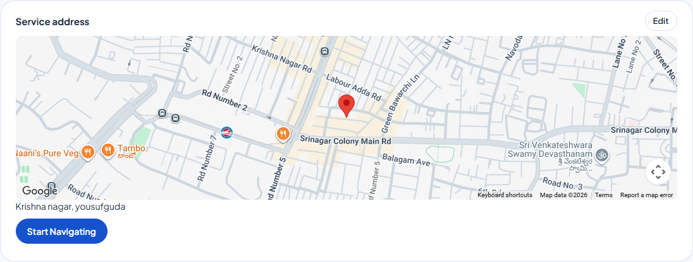

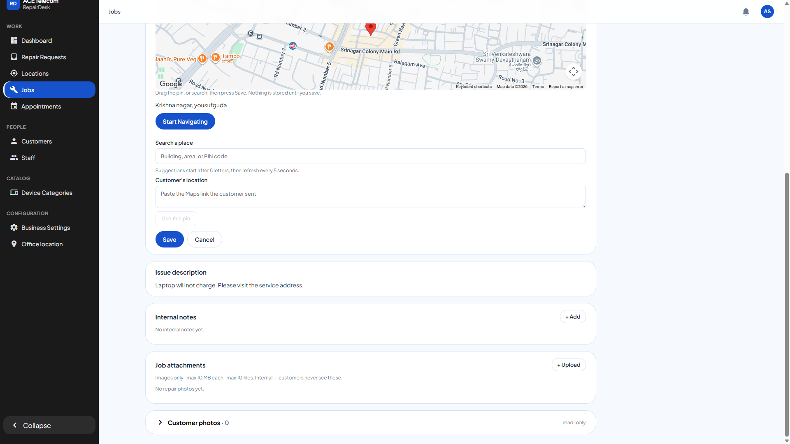

The technician follows the saved coordinates. A typed area name without a picked building or a dragged pin is only the centre of that area. A photo of a map is not a pin.

On the RepairDesk phone app, an administrator sees **Edit** under the service address. That opens **Place the pin** (search, customer link, use my location, drag, then **Use this pin**). A technician does not see **Edit**.

---

## 12. Device catalog

**Catalog → Device Categories.** Staff cannot open this. The names here are the device types on Create request and in the customer app.

| Action | What it does |
| --- | --- |
| **Add category** | New device type, with an optional description. |
| Search | Finds a category by name. |
| **Edit** | Changes the name or description. |
| **Archive** / **Restore** | Hides a category from new requests, or brings it back. **Show archived** lists the hidden ones. |
| Open a category | Its **brands**. Add, edit, or remove brands. A category can use a configured brand list, or allow a free-text brand. |

Archiving does not delete old requests that already used that category.

---

## 13. Business settings

**Configuration → Business Settings.** Staff cannot open this. This is the shop’s public details and when visits can be booked. The map pin is on **Office location**, not on this page.

| Section | What you set |
| --- | --- |
| **Business information** | Business name, address, phone, and email. |
| **Scheduling** | How many days ahead a visit can be booked. |
| **Working hours** | Open and close for each weekday, or closed all day. Times are the shop’s local hours. |

Each section shows whether it is saved. If a banner says business information was saved and working hours were not, click **Retry working hours**. Changes apply when that section is saved.

---

## 14. Notifications and your account

| Item | Where |
| --- | --- |
| Notifications | Bell at the top right |
| Your profile | Account menu → **My Account** |
| Change your own mobile or password | My Account. You cannot change your own username or role. |
| Sign out | My Account → **Sign out** |
| Reset someone else’s password | People → Staff → **⋮ → Reset password** |

---

## 15. Quick reference

| Item | Value |
| --- | --- |
| Admin portal | https://repairdesk-admin-portal.azurewebsites.net |
| Same screens | https://black-cliff-0c84a7c00.7.azurestaticapps.net |
| Admin username | `admin` |
| Create Staff / Technician | People → Staff → **Add user** |
| Repair queue | Work → **Repair Requests** → **Approve & create job** |
| Office pin and attendance switches | Configuration → **Office location** → **Save office location** |
| Technician work days | Work → **Attendance** |
| Where technicians are | Work → **Locations** |
| Move a job pin | Job → **Edit** → **Save** |
| Device types | Catalog → **Device Categories** |
| Shop hours and booking window | Configuration → **Business Settings** |
| Manage customers | People → **Customers** |
| Password minimum | 8 characters |
| Username | Permanent after create |
| Attendance switch | Off until you mean technicians to see **Start day**. The list stays available |
