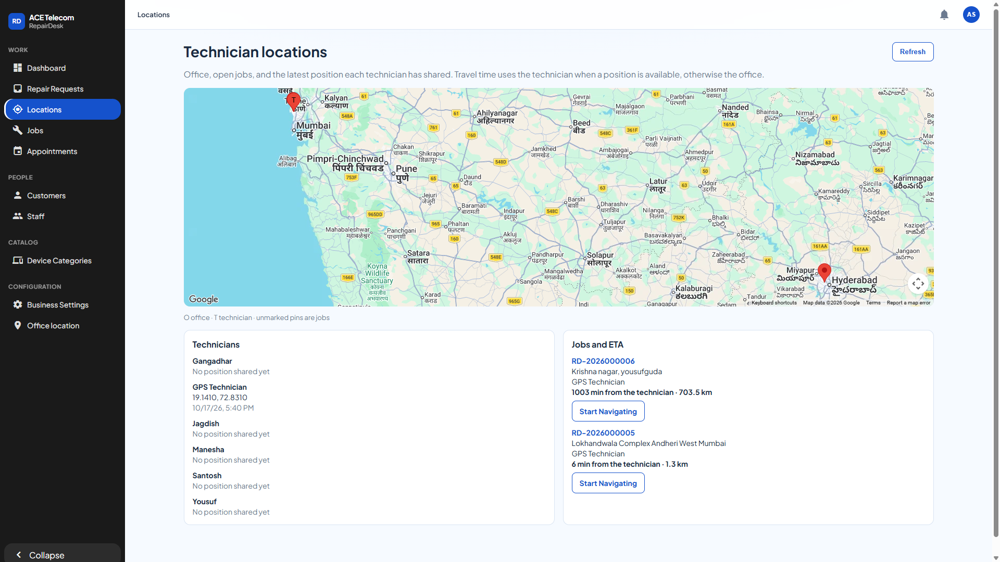
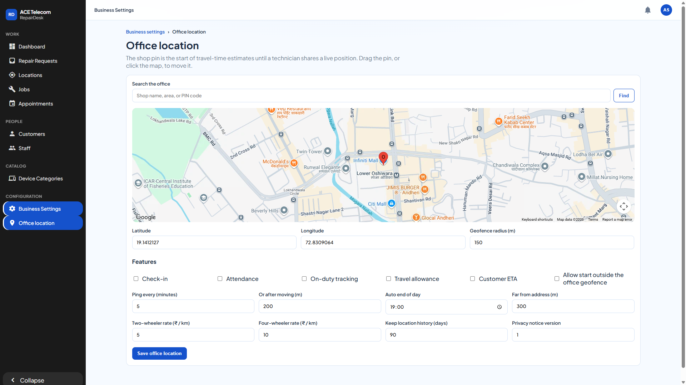
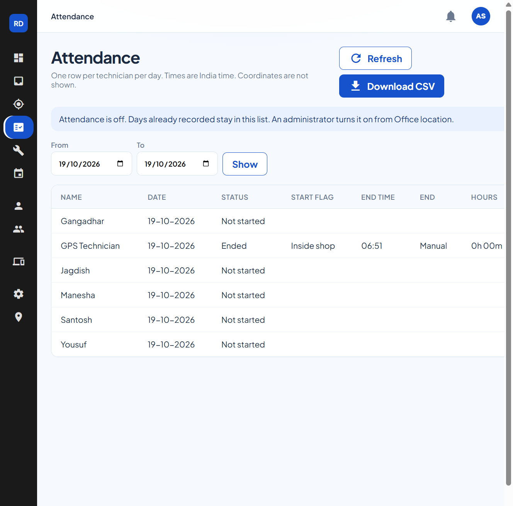
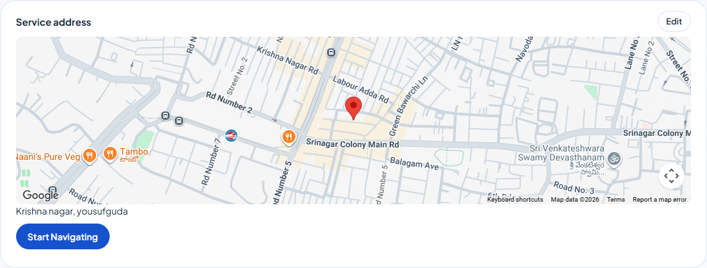
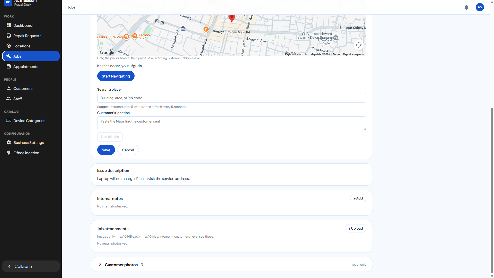
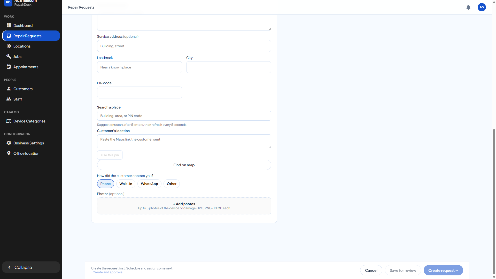

# RepairDesk — Technician locations, attendance, and customer ETA

**Audience:** shop staff and administrators  
**Portals:**

| Site | Address |
| --- | --- |
| Azure Web App | https://repairdesk-admin-portal.azurewebsites.net |
| Azure Static Web App (same screens) | https://black-cliff-0c84a7c00.7.azurestaticapps.net |

Sign-in is the same on both. Administrator sign-in is in the [Admin Portal User Manual](Admin-Portal-User-Manual.md). Staff sign-in is in the [Staff Portal User Manual](Staff-Portal-User-Manual.md). Technician work on the phone is in the [Technician App User Manual](Technician-Portal-User-Manual.md).

This guide explains the location screens that are live now: the staff map of technicians, how a customer ETA is worked out, and what the office attendance settings do. The same steps sit inside each role manual, with a full index of everything that role can do:

- [Staff Portal User Manual](Staff-Portal-User-Manual.md) — intake pin, job pin, Locations, Attendance, and the rest of the counter day
- [Admin Portal User Manual](Admin-Portal-User-Manual.md) — office pin, the Attendance switch, and the repair queue
- [Technician App User Manual](Technician-Portal-User-Manual.md) — Start day and End day, Start Navigating, and how opening a job shares a position

---

## Index

1. [What each role sees](#1-what-each-role-sees)
2. [Staff overview of technicians](#2-staff-overview-of-technicians)
3. [Customer ETA](#3-customer-eta)
4. [Office location and the Attendance switch](#4-office-location-and-the-attendance-switch)
5. [The attendance list](#5-the-attendance-list)
6. [Job pin and Start Navigating](#6-job-pin-and-start-navigating)
7. [What has to be true for the map to be useful](#7-what-has-to-be-true-for-the-map-to-be-useful)

---

## 1. What each role sees

| | Staff | Administrator | Technician (phone app) |
| --- | --- | --- | --- |
| **Locations** — map, last positions, job ETAs | Yes | Yes | No |
| **Attendance** — work days, no coordinates | Yes | Yes | Own **Start day** / **End day** only, and only while Attendance is on |
| Move a job pin, **Start Navigating** | Yes | Yes | **Start Navigating** on the job |
| **Office location** — shop pin, radius, switches | No | Yes | No |

Staff do not open Business Settings or Office location. Those stay with the administrator.

---

## 2. Staff overview of technicians

Open **Work → Locations**.

The page shows three things together:

- **Office** — an **O** pin, once an administrator has saved the shop location.
- **Technicians** — a **T** pin for each technician who has shared a position. The list under the map shows the coordinates and the time of that share. Everyone else stays **No position shared yet**.
- **Open jobs that have a service pin** — unmarked pins. Each row shows the job number, address, assigned technician, travel time, and **Start Navigating**.

A position appears when the technician opens an assigned job in the RepairDesk app and the phone can read GPS. Opening the job sends that point to the portal. Technicians who have not opened a job on a phone with location on stay blank. **Start day** is the work-day record on Attendance. It does not move the **T** pin.

Click **Refresh** to load the latest points and travel times. The page does not move the pins by itself.

### How to read a row

Example from the screenshot:

- **GPS Technician** last shared **19.1410, 72.8310** (Andheri) at 5:40 PM.
- **RD-2026000005** (Lokhandwala, Andheri) is **6 min from the technician · 1.3 km**.
- **RD-2026000006** (Krishna nagar, Yousufguda) is **1003 min from the technician · 703.5 km**, because that job pin is in Hyderabad and the technician’s last point is in Mumbai.

The minutes follow the technician’s last shared point when one exists. If the assigned technician has not shared a point, the minutes start from the office pin instead, and the line says **from the office**. If neither a technician point nor an office pin exists, the row says **No ETA yet**.

A line that says **estimated** used a straight-line fallback because Google’s route was not available. A line without that word is a driving route.

---

## 3. Customer ETA

**Customer ETA** on this screen is the travel time staff use when a customer asks “when will the technician arrive?”

1. The job must have a service pin (created with the request, or placed on the job).
2. The technician must be assigned.
3. Travel time uses the technician’s last shared position when there is one. Otherwise it uses the office pin.
4. A two-wheeler route is used unless that technician is marked as a four-wheeler.

Staff tell the customer that time, or open **Start Navigating** and follow the same destination in Google Maps.

The **Customer ETA** switch on Office location is saved with the other location settings. It does **not** yet show a countdown inside the customer’s repair screen in the app. Until that screen exists, the ETA the customer hears comes from this Locations page.

---

## 4. Office location and the Attendance switch

Only an administrator opens **Configuration → Office location**.

### Place the shop

1. Type the shop name, area, or PIN code and click **Find**, or click the map, or drag the red pin.
2. Check **Latitude**, **Longitude**, and **Geofence radius (m)**. The radius in the screenshot is **150** metres around the pin. That circle is the shop area used when a technician taps **Start day**.
3. Click **Save office location**.

Until a technician shares a live position, travel times start from this pin.

### What the switches mean

All of these are **off** in the screenshot. Leave them off unless you intend to turn that behaviour on. Saving the form stores every switch, so do not tick one by accident.

| Switch | What it is for |
| --- | --- |
| **Check-in** | Later, a technician check-in at the job can record whether they were near the service address. |
| **Attendance** | Shows **Start day** / **End day** on the technician’s home screen. The Attendance list in section 5 stays available either way. |
| **On-duty tracking** | Later, points while the technician is on duty. Today the portal stores the position sent when a technician opens a job. |
| **Travel allowance** | Rates below, in rupees per kilometre, kept for a later allowance calculation. |
| **Customer ETA** | Allows a customer-facing ETA. The number staff see on Locations is already calculated. The customer app does not show it yet. |
| **Allow start outside the office geofence** | A clear fix outside the shop circle can still start the day, flagged **Outside shop**. While this is off, that start is refused and the day is not saved. |

**Auto end of day** (19:00) closes a day that is still open, and the technician gets one in-app notice. **Ping every (minutes)** and **Or after moving (m)** are the interval for later on-duty tracking. **Far from address (m)** is the distance that would flag a later check-in as far from the job. **Keep location history (days)** is how long those later GPS points would be kept. Attendance day rows stay on the list. **Privacy notice version** 1 is the line the phone shows before the first **Start day**.

A fix is clear when its accuracy is no wider than the geofence radius. A clear fix inside the circle is **Inside shop**. No fix, a fix wider than the radius, or no shop pin still starts the day, flagged **Location missing** or **Location uncertain**. A mocked location still starts the day, flagged **Mocked location**. **End day** always closes an open day.

Changing a number or a switch does nothing until you click **Save office location**.

---

## 5. The attendance list

**Work → Attendance** in the portal, or **Attendance** on the phone for Staff and administrators. Technicians do not open this list. They see only their own **Work day** card, and only while **Attendance** is on.

The page opens on today in India. One row per active technician, including **Not started**. Coordinates are not shown. **From** and **To** cover at most 31 days. **Download CSV** saves the same columns. The phone list has no download.

| Column | What it shows |
| --- | --- |
| **Status** | **Not started**, **On duty since** a time, **Ended**, or **Auto-ended** |
| **Start flag** | **Inside shop**, **Outside shop**, **Location uncertain**, **Location missing**, or **Mocked location** |
| **End** | **Manual** or **Auto** |
| **Hours** | For example **7h 40m**, once both times exist |

While the switch is off, the list still opens and says an administrator turns it on from Office location. Opening a job, starting a repair, and **Start Navigating** do not check this list.

---

## 6. Job pin and Start Navigating

Open the job from **Jobs**, or from the job number on Locations.

On **Create request**, the same search and customer-link fields are already on the form, above **Find on map**. That screen is an edit form, so it does not use the job’s Edit button.

### Change the address

The job page shows the address, the map, and **Start Navigating**. The search box stays hidden until you choose to edit.

1. Click **Edit** on the service address.
2. The search box, **Customer’s location**, and **Save** appear.
3. To search, type at least 5 letters. A list appears, then refreshes every 5 seconds while you type. Pick the building. Or paste the Maps link the customer sent and click **Use this pin**. Or drag the pin.
4. Click **Save**. **Cancel** leaves the stored address unchanged. A pasted photo is not a pin.

Dragging the pin on **Office location**, and on **Create request** after **Find on map**, still updates that form before its own save. Those screens are already edit forms, so they do not use this Edit button.

### Start Navigating

**Start Navigating** opens Google Maps directions to that pin.

- On the portal, it opens a new browser tab. Google Maps uses the computer’s location as the start when the browser allows it.
- On the technician’s phone, the same button is under the service address on the job. It opens the Google Maps app when that app is installed.

The button is also on the request page and on each job row on Locations.

---

## 7. What has to be true for the map to be useful

1. An administrator has saved the office pin (section 4).
2. The job has a service address and pin (section 6).
3. The job is assigned to a technician.
4. That technician opens the job in the RepairDesk app with location allowed, so Locations can show a **T** and a time **from the technician**.

If step 4 has not happened, staff still see the job and an ETA **from the office**, as long as the office pin exists.
