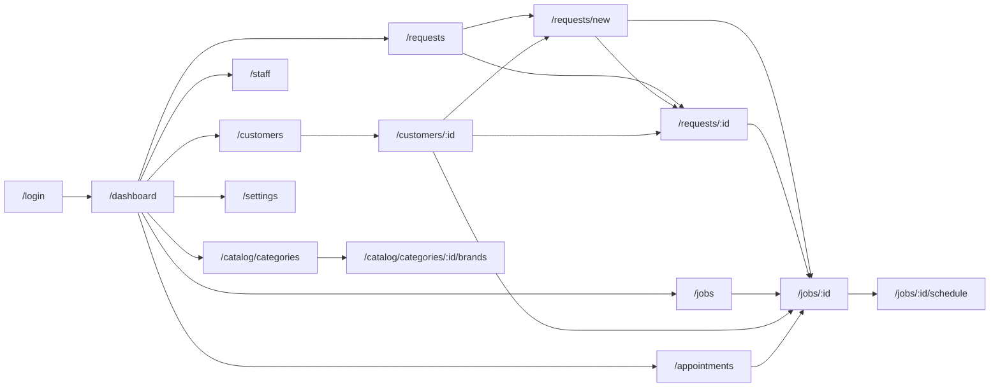

# RepairDesk Admin Panel — UI Specification (Angular Web)

**Product:** RepairDesk (built for ACE Telecom)
**Document type:** UI specification index / information architecture
**Client:** New **Angular** web application (`admin-web/`), separate from the existing Flutter mobile app
**Backend:** Same REST API at `/api/v1` documented in [API.md](../API.md). Feature parity pages consume shipped endpoints. [AP-18](pages/AP-18-create-request.md) **requires new backend** (`POST /customers`, assisted `POST /requests`).
**Status:** Draft for review

> This document set specifies the **screens, elements, and acceptance criteria** for the Angular Admin Panel. It defines *what each page contains and must do*, not how to implement it in Angular (no component code). Data shapes and endpoint contracts are owned by [API.md](../API.md); domain rules are owned by the feature specs in [`docs/features/`](../features/); visual tokens and shared component behavior are owned by [Design-System.md](Design-System.md).

---

## 1. Scope & intent

The Admin Panel brings the **existing** admin capabilities of the Flutter app to a desktop-first web client. Aside from [AP-18](pages/AP-18-create-request.md), every action maps to an endpoint that already exists and is already exercised by the mobile app.

**In scope (feature parity):** repair request review, job management, technician assignment, appointment scheduling, customer lookup, staff/user administration, device category + brand catalog, business settings, notifications, own-account management.

**Post-V1 increment (new backend):** [AP-18 Create Request](pages/AP-18-create-request.md) — staff-assisted / walk-in intake. Requires `POST /requests` with `customerId` + optional `approveOnCreate`, and `POST /customers`. See [features/staff-assisted-intake.md](../features/staff-assisted-intake.md).

**Out of scope for V1 of the panel:** customer-facing flows (request submission, repair tracking) — those stay in the mobile app; analytics/reporting dashboards (PRD §6 explicitly keeps the dashboard a navigation hub, not analytics); invoicing/payments (not in the product at all). Direct **Create job** (bypassing a request) stays out of scope.

**Why a web panel:** the mobile app's dashboard-of-tiles + `Navigator.push` model forces admins back to the dashboard between tasks, and cannot show list + detail together. Back-office work (triaging a queue, assigning technicians, editing catalogs) benefits from a persistent sidebar, wider data tables, and master-detail layouts. Those are the main deliberate departures from the mobile UI; each is called out per page under **Deviations from the mobile app**.

---

## 2. Technology assumptions

These are **assumptions to confirm**, recorded here so the specs have something concrete to lean on. Nothing in the page specs depends on the component library beyond what [Design-System.md](Design-System.md) abstracts.

| Concern | Assumption | Notes |
| --- | --- | --- |
| Framework | Angular (standalone components, lazy-loaded feature routes) | One feature folder per section, mirroring the backend's package-by-feature layout (see [Architecture.md](../Architecture.md)). |
| Component library | Angular Material | Already Material-aligned with the Flutter app's theme, so brand tokens carry over; gives accessible dialogs/menus/tables for free. |
| State | Angular signals + per-feature services wrapping `HttpClient` | Constitution rule applies: no HTTP calls from components. |
| HTTP | Typed services + an interceptor that attaches `Authorization: Bearer <JWT>` and maps errors to the standard error model | See §6. |
| Forms | Reactive forms with validators mirroring the server's rules | Server remains the authority; client validation is a UX convenience only. |
| Routing | Real URLs for every page (deep-linkable, browser back/forward works) | A deliberate improvement over the mobile app, which only routes `/login`, `/register`, `/dashboard`. |
| i18n / currency | English only, no money anywhere in V1 | Matches [Database.md](../Database.md) §1 ("Money / cost: none in V1"). |

**Dev environment note:** the backend's `app.cors.allowed-origins` currently defaults to `http://localhost:3000,http://localhost:8081`. Angular's dev server runs on **`http://localhost:4200`**, so `CORS_ALLOWED_ORIGINS` must include it (dev *and* the deployed panel origin in prod). This is a config change, not a code change — see [Deployment-Runbook.md](../Deployment-Runbook.md).

---

## 3. Roles & access

The panel is for **internal roles only**. Sign-in is rejected for `CUSTOMER` accounts with a clear message (customers use the mobile app), rather than logging them into an empty shell.

| Role | Can sign in to the panel? | Sees |
| --- | --- | --- |
| `ADMIN` | Yes | Everything in §4. |
| `STAFF` | Yes | Everything except the admin-only sections (Staff, Categories/Brands, Settings, and — per current behavior — the Repair Request queue). |
| `TECHNICIAN` | Yes | Jobs and Appointments only (their own work); no customer admin, no catalog, no settings. |
| `CUSTOMER` | **No** | Blocked at login with an explanatory message. |

**Authorization is enforced server-side.** Client-side route guards and hidden nav items are a UX affordance only; every page must still render a usable `403` state if the API refuses, because a user can always type a URL.

> ⚠️ **Known documentation conflict to resolve before build.** [Architecture.md](../Architecture.md) says Staff **cannot** access the pending-request review queue (admin-only), and the current Flutter app implements exactly that (the Repair Requests tile is `ADMIN`-gated). But [PRD.md](../PRD.md) §4, [features/authentication.md](../features/authentication.md) §11, [features/request-review.md](../features/request-review.md), and [gap-analysis.md](../gap-analysis.md) all grant Staff approve/reject. **These specs follow current shipped behavior (admin-only queue)** and flag it per page. If the product decision is that Staff may review, only the route guard and nav visibility change — no page content changes.

---

## 4. Information architecture

### Global shell

Every authenticated page renders inside one persistent shell (specified in [AP-02 App Shell](pages/AP-02-app-shell.md)):

```
┌──────────────────────────────────────────────────────────────┐
│ Top bar: brand · breadcrumb · global search · bell · avatar  │
├────────────┬─────────────────────────────────────────────────┤
│            │                                                 │
│  Sidebar   │  Page content (router outlet)                    │
│  nav       │                                                 │
│  (grouped) │                                                 │
│            │                                                 │
└────────────┴─────────────────────────────────────────────────┘
```

### Sidebar grouping

| Group | Items | Visible to |
| --- | --- | --- |
| **Work** | Dashboard, Repair Requests, Jobs, Appointments | Dashboard/Jobs/Appointments: all internal roles · Repair Requests: `ADMIN` |
| **People** | Customers, Staff | Customers: `ADMIN`, `STAFF` · Staff: `ADMIN` |
| **Catalog** | Device Categories | `ADMIN` |
| **Configuration** | Business Settings | `ADMIN` |
| *(top bar, not sidebar)* | Notifications, My Account | All |

### Route map

| Route | Page | Spec | Roles |
| --- | --- | --- | --- |
| `/login` | Sign in | [AP-01](pages/AP-01-login.md) | Public |
| *(shell)* | App shell / navigation | [AP-02](pages/AP-02-app-shell.md) | Authenticated |
| `/dashboard` | Dashboard hub | [AP-03](pages/AP-03-dashboard.md) | All internal |
| `/requests` | Repair request queue | [AP-04](pages/AP-04-repair-requests.md) | `ADMIN` |
| `/requests/new` | Create request (staff-assisted) | [AP-18](pages/AP-18-create-request.md) | `ADMIN`, `STAFF` |
| `/requests/:id` | Request detail | [AP-05](pages/AP-05-request-detail.md) | `ADMIN` |
| `/jobs` | Jobs list | [AP-06](pages/AP-06-jobs.md) | All internal |
| `/jobs/:id` | Job detail | [AP-07](pages/AP-07-job-detail.md) | All internal |
| `/jobs/:id/schedule` | Schedule / reschedule appointment | [AP-08](pages/AP-08-schedule-appointment.md) | `ADMIN`, `STAFF` |
| `/appointments` | Appointments calendar | [AP-09](pages/AP-09-appointments.md) | All internal |
| `/customers` | Customer search | [AP-10](pages/AP-10-customers.md) | `ADMIN`, `STAFF` |
| `/customers/:id` | Customer detail & history | [AP-11](pages/AP-11-customer-detail.md) | `ADMIN`, `STAFF` |
| `/staff` | Staff management | [AP-12](pages/AP-12-staff.md) | `ADMIN` |
| `/catalog/categories` | Device categories | [AP-13](pages/AP-13-device-categories.md) | `ADMIN` |
| `/catalog/categories/:id/brands` | Brands for a category | [AP-14](pages/AP-14-brands.md) | `ADMIN` |
| `/settings` | Business settings (view + edit) | [AP-15](pages/AP-15-business-settings.md) | `ADMIN` |
| `/notifications` | Notifications inbox | [AP-16](pages/AP-16-notifications.md) | All |
| `/account` | My account | [AP-17](pages/AP-17-account.md) | All |
| `*` | Not found / no access | [AP-02](pages/AP-02-app-shell.md) §Error routes | All |

### Navigation map



---

## 5. Document set

| Spec | Covers |
| --- | --- |
| [Design-System.md](Design-System.md) | Brand tokens, typography, spacing, shared components (data table, status chip, dialog, toast, attachment viewer), the five canonical page states, responsive breakpoints, accessibility baseline, form/validation patterns. |
| [API-Contract-Gaps.md](API-Contract-Gaps.md) | **Read before implementing.** Verified drift between [API.md](../API.md) and the deployed backend, gaps the panel needs closed, security findings, and the product decisions still outstanding. |
| [Tasks.md](Tasks.md) | Implementation plan, batched by page. Batch 1 (AP-01 … AP-04) is broken into mockups → sign-off gate → foundation → implementation → verification, with blockers tracked separately. |
| [pages/AP-01 … AP-18](pages/) | One spec per page: purpose, layout anatomy, **element inventory**, interactions, states, permissions, API calls, **acceptance criteria**, deviations from the mobile app, open questions. |
| [Request-to-Work-Order-Rename.md](../Request-to-Work-Order-Rename.md) | Impact analysis: Request vs Job vs Work Order. **Not a column rename.** Decision required (Job → Work Order recommended). |

> ⚠️ **API.md is not currently a reliable contract.** While writing these specs, every cited endpoint was checked against the backend source, and API.md was found to be wrong about several paths and payloads — including the user edit verb, enable/disable paths, the technician roster, the login body, the dashboard counters, and all appointment mutation paths. **Where API.md and the backend disagree, build against the backend**, as recorded in [API-Contract-Gaps.md](API-Contract-Gaps.md) §1. The page specs follow the verified behavior. Correcting API.md is listed as step 1 of the recommended sequencing.

### Page spec template

Every page spec uses the same sections, in this order, so they're diffable and reviewable:

1. **Page information** — ID, route, roles, entry points, primary API endpoints
2. **Purpose** — one paragraph
3. **Layout anatomy** — regions, with an ASCII sketch
4. **Element inventory** — a table of every element: name, type, content/source, behavior, empty/disabled rules
5. **Interactions & dialogs** — each action, its confirmation/form fields, and its endpoint
6. **Page states** — loading, empty, error, forbidden, plus any page-specific states
7. **Permissions & visibility** — role and record-state conditions
8. **Acceptance criteria** — `AC-<page>-<n>`, Given/When/Then
9. **Deviations from the mobile app** — intentional differences, with rationale
10. **Open questions** — decisions still needed

### Acceptance criteria convention

The existing feature specs in [`docs/features/`](../features/) use **Given/When/Then**; [Tasks.md](../Tasks.md) uses short bulleted checklists. These page specs follow the **feature-spec convention (Given/When/Then)** because they describe observable behavior, and each criterion carries a stable ID (`AC-AP04-03`) so QA and PRs can cite it.

```
**AC-AP04-03** — Given the queue is filtered to "Pending",
When I approve a request from the row action menu,
Then the row leaves the Pending filter, a success toast names the reference number,
And the Pending Review counter in the top bar decreases by one.
```

---

## 6. Cross-cutting requirements

These apply to **every** page and are not repeated in each spec. A page spec only mentions them when it deviates.

### 6.1 Authentication & session

- Every request carries `Authorization: Bearer <JWT>`. JWTs are **non-expiring** by product decision (ADR-003), and validity is re-checked server-side per request against account status — so a disabled account starts failing immediately.
- A `401` from any endpoint clears the session and redirects to `/login?returnUrl=<current>`, showing "Your session is no longer valid. Please sign in again."
- **Token storage is a security decision that must be made before build.** A non-expiring token in `localStorage` is permanently harvestable via any XSS. Recommendation: keep the token in memory with `sessionStorage` as the reload fallback, accept re-login on browser restart, and revisit if the backend later adds refresh tokens. Recorded as an open question in [AP-01](pages/AP-01-login.md).

### 6.2 Errors

All endpoints return the standard error envelope (`timestamp`, `status`, `errorCode`, `message`, `path`, `correlationId`, `fieldErrors[]`) per [API.md](../API.md) §3. The panel maps it consistently:

| `errorCode` / status | Presentation |
| --- | --- |
| `VALIDATION_ERROR` (422) | Field-level messages bound to the offending controls via `fieldErrors[].field`; the form stays open with input preserved. |
| `CONFLICT` (409) | Dialog/toast explaining the conflict; for optimistic-lock conflicts, offer **Reload** to refetch the record. |
| `FORBIDDEN` (403) | Page-level forbidden state (§6.5), not a toast — the user needs to understand they lack access. |
| `NOT_FOUND` (404) | Page-level not-found state with a link back to the parent list. |
| `METHOD_NOT_ALLOWED` (405) | Treated as a client bug: generic error toast + console/telemetry log. |
| `INTERNAL_ERROR` (500) | Generic error state with **Retry**, and the `correlationId` shown in small text so support can trace it. |

**Never** render a raw exception string or JSON dump to the user. (This regressed twice in the mobile app — see [Bugs.md](../Bugs.md) #6 — so it's a hard rule here.)

### 6.3 Optimistic concurrency

Mutating endpoints take the entity `version`. Forms must round-trip the `version` they loaded and handle `409` by offering a reload rather than silently overwriting. Never send a guessed or stale `version`.

### 6.4 Pagination & sorting

The API already returns a paged envelope (`content`, `page`, `size`, `totalElements`, `totalPages`, `sort`) with `size` default 20 / max 100. Every list page uses **real server-side pagination and sorting** with a visible page-size selector (20/50/100). *(The mobile app hardcodes `size=20` and never paginates — a real gap against the 10k-record target in PRD §10 that the panel fixes.)*

### 6.5 Canonical page states

Every page implements all five; [Design-System.md](Design-System.md) defines their appearance:

| State | Rule |
| --- | --- |
| **Loading** | Skeleton rows/cards matching the final layout — not a bare centered spinner — so the layout doesn't jump. |
| **Empty** | Icon + one-line explanation + the primary action that resolves it ("No categories yet" → **Add Category**). |
| **Filtered-empty** | Distinct from empty: names the active filter/query and offers **Clear filters**. Never tell a user "no records exist" when their filter is simply too narrow. |
| **Error** | Human message from the mapping in §6.2 + **Retry** + `correlationId`. |
| **Forbidden** | "You don't have access to this page", the user's role, and a link to `/dashboard`. |

### 6.6 Attachments and images

`GET /attachments/{storageKey}` **requires the auth header**, so images cannot be loaded via a plain ``. Every thumbnail and full-size view fetches the bytes through the authenticated HTTP layer and renders from an object URL, revoking it on destroy. Uploads are `multipart/form-data`; the server enforces magic-byte validation (SEC-002), so the client must surface the server's rejection message rather than assuming success.

### 6.7 Notifications & counters

The bell polls `GET /me/notifications/unread-count` every 30s (matching the mobile app's cadence), displaying `99+` above 99. Dashboard counters come from `GET /dashboard/counters`. **Counter failures must be visible** — a dashed placeholder with a retry affordance, never a silently hidden card. *(The mobile dashboard hides counters on error, which reads as "zero work queued" — a misleading failure mode this panel must not repeat.)*

### 6.8 Feedback & destructive actions

- Every successful mutation shows a toast naming the affected record ("Job JOB-1042 assigned to Priya").
- Every destructive or state-advancing action (delete/archive, approve, reject, cancel, complete) requires an explicit confirmation dialog naming the record and its consequence. Archive dialogs must say the record is **hidden from new work but retained on history**, because that's what the backend actually does (soft delete) and users otherwise fear data loss.
- Buttons enter a busy/disabled state while their request is in flight; no double-submits.

### 6.9 Accessibility & responsiveness baseline

Keyboard-operable throughout, visible focus rings, dialogs that trap focus and restore it on close, form controls with real `<label>`s, status conveyed by text (not color alone), and AA contrast. Breakpoints and the sidebar's collapse behavior are in [Design-System.md](Design-System.md) §Responsive. Target: usable at 1280×720 and above; degrades to a collapsed-rail layout down to 768px.

---

## 7. Traceability

| Concern | Source of truth |
| --- | --- |
| Endpoint contracts, request/response shapes, status codes | [API.md](../API.md) |
| Field types, enums, constraints, soft-delete semantics | [Database.md](../Database.md) |
| Domain/business rules, status lifecycles, notification triggers | [`docs/features/*.md`](../features/) |
| RBAC matrix | [features/authentication.md](../features/authentication.md) §11 + [gap-analysis.md](../gap-analysis.md) |
| Screen inventory + wireframe authority for existing screens | [PRD.md](../PRD.md) §5, §6, §15 + [`docs/wireframes/`](../wireframes/) |
| Known defects and their fixes (several inform rules above) | [Bugs.md](../Bugs.md) |
| Visual tokens, shared components, page states | [Design-System.md](Design-System.md) |

**Rule:** if a page spec appears to contradict `API.md` or `Database.md`, those win and the page spec is a bug. Page specs may *add* UI-level requirements (states, validation UX, layout) that the backend docs don't cover.

---

*Last updated: 2026-08-06 — initial Angular Admin Panel UI specification set.*
