# RepairDesk Staff Portal — User Manual

**Print layout:** [Staff-Portal-User-Manual.html](Staff-Portal-User-Manual.html)  
**Audience:** shop staff (counter / phone desk)  
**Portals (same screens):**

| Site | Address |
| --- | --- |
| Azure Web App | https://repairdesk-admin-portal.azurewebsites.net |
| Azure Static Web App | https://black-cliff-0c84a7c00.7.azurestaticapps.net |

**Related:** [Admin Portal User Manual](Admin-Portal-User-Manual.md) · [Technician App User Manual](Technician-Portal-User-Manual.md)

This is the day-to-day guide for Staff: intake, customers, jobs, visits, the map used for technician travel and customer ETAs, and the attendance list.

---

## Index

1. [Staff credentials](#1-staff-credentials)
2. [Sign in](#2-sign-in)
3. [What Staff can and cannot do](#3-what-staff-can-and-cannot-do)
4. [Dashboard](#4-dashboard)
5. [Customers](#5-customers)
6. [Create a request](#6-create-a-request)
7. [Service address on a new request](#7-service-address-on-a-new-request)
8. [Jobs](#8-jobs)
9. [Assign, schedule, and update a job](#9-assign-schedule-and-update-a-job)
10. [Move a job pin and start navigating](#10-move-a-job-pin-and-start-navigating)
11. [Technician locations and customer ETA](#11-technician-locations-and-customer-eta)
12. [Attendance](#12-attendance)
13. [Appointments](#13-appointments)
14. [Notifications and your account](#14-notifications-and-your-account)
15. [Quick reference](#15-quick-reference)

---

## 1. Staff credentials

Use these to open the portal as Staff. Keep them private.

| Field | Value |
| --- | --- |
| **Portal URL** | https://repairdesk-admin-portal.azurewebsites.net |
| **Same portal** | https://black-cliff-0c84a7c00.7.azurestaticapps.net |
| **Username** | `anita` |
| **First-sign-in password** | `Staff$1234` |
| **Password after first change** | `Anita$1234` |
| **Role** | Staff |

An administrator creates your account and gives you a temporary password. The first time you sign in, RepairDesk asks you to choose a new password. After that, use the new one.

The first sign-in after the site has been idle can take up to a minute. If it looks stuck, wait and try once more.

---

## 2. Sign in

1. Open either portal URL. Both open the same RepairDesk screens.
2. Enter your **Username** and **Password**.
3. Click **Sign in**.

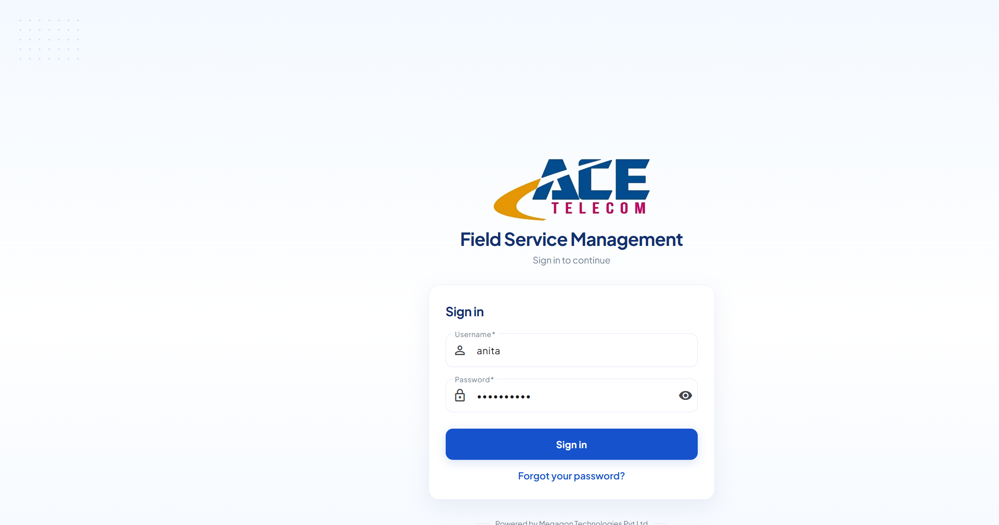

**Forgot your password?** on the sign-in page does not email a reset. Ask an administrator to reset it, then sign in with the new temporary password.

### 2.1 First sign-in — choose a new password

If the account still uses the password it was set up with, you must change it before the dashboard opens.

1. Enter the **Current password** (the temporary one from your admin).
2. Enter a **New password** (minimum 8 characters) and confirm it.
3. Click **Update password**.

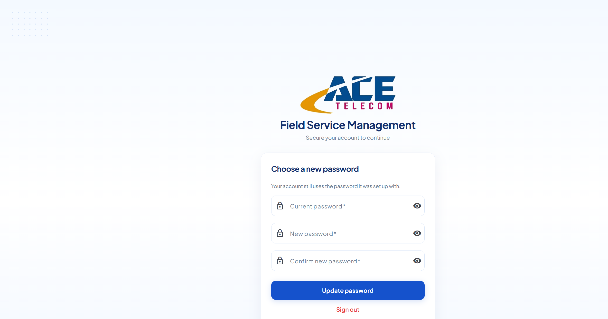

You then land on the **Dashboard**.

---

## 3. What Staff can and cannot do

Staff work the shop floor and the phone. The sidebar is:

| Group | What you see |
| --- | --- |
| **Work** | Dashboard, Repair Requests, Locations, Attendance, Jobs, Appointments |
| **People** | Customers |

| You can | Where |
| --- | --- |
| Create a request for a walk-in or phone customer, including the visit pin | Dashboard → **Create request** |
| Look up customers and their history | People → **Customers** |
| See office, technician positions, job pins, and travel time | Work → **Locations** |
| See who has started and ended the work day | Work → **Attendance** |
| Assign a technician, move the job pin, schedule a visit, add notes and photos, start or cancel a repair | Work → **Jobs** |
| See the week’s appointments and unscheduled jobs | Work → **Appointments** |
| Change your own mobile and password, and sign out | Account menu (top right) |

| You cannot | What happens |
| --- | --- |
| Approve, reject, or request more information on the repair queue | **Repair Requests** opens a page that says review is limited to administrators. Create the request from the dashboard instead. |
| Create Staff or Technician accounts | People → Staff is not in your sidebar |
| Change the device catalog, business hours, the office pin, or the Attendance switch | Catalog and Configuration are not in your sidebar. You can still open the Attendance list |
| Move a pin from the technician’s phone login | Technicians see the address and **Start Navigating**. They do not see **Edit** |

After you create a request it is **Pending review**. An administrator approves it; that creates the **job** with the same reference number. You then assign the technician on the job.

---

## 4. Dashboard

After sign-in you see your name and the Staff sidebar.

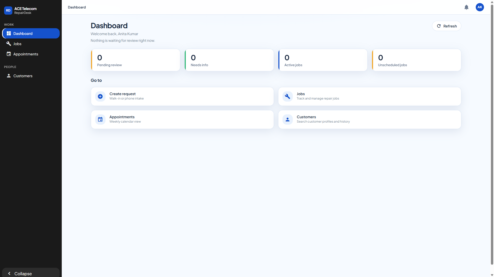

| Card or link | What it does |
| --- | --- |
| **Pending review** / **Needs info** | Counts only. Staff cannot open the review queue from these cards. |
| **Active jobs** | Opens Jobs filtered to work that is still open. |
| **Unscheduled jobs** | Opens Jobs that have no visit booked. A yellow banner appears when any job is unscheduled; **Schedule them** goes to that list. |
| **Create request** | Walk-in or phone intake. This is the main Staff shortcut. |
| **Locations** | The technician map and travel times. |
| **Attendance** | Who started and ended the work day. Times are India time. Coordinates are not shown. |
| **Jobs**, **Appointments**, **Customers** | The same pages as the sidebar. |

---

## 5. Customers

**People → Customers.** Search by name, username, or mobile. Open a row for history, then **New request** to intake another repair for that person.

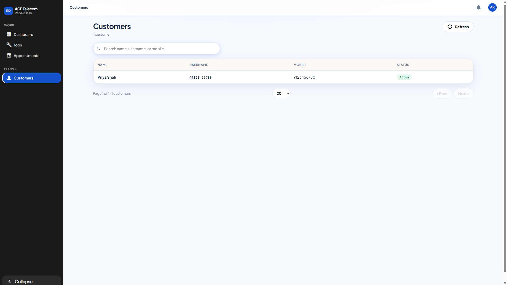

Do not create customers from the Staff page. That page is administrator-only. A walk-in who is not in the directory is added from **Create request** (next section).

---

## 6. Create a request

Use this when a customer walks in or calls and did not submit from the mobile app. The request is owned by **them**, not by you.

1. Dashboard → **Create request** (or Customers → open someone → **New request**).
2. Find or create the customer.
3. Check **Contact** for this request. You can edit name and mobile for this repair without changing their account.
4. Fill device type, optional brand and model, and the issue (at least 10 characters).
5. Set the service address and pin (section 7).
6. Choose how they contacted you: **Phone**, **Walk-in**, **WhatsApp**, or **Other**.
7. Add photos if you have them (optional, up to 5, JPG or PNG, 10 MB each).
8. Click **Create request →**. **Save for review** does the same thing: it parks the request for an administrator.

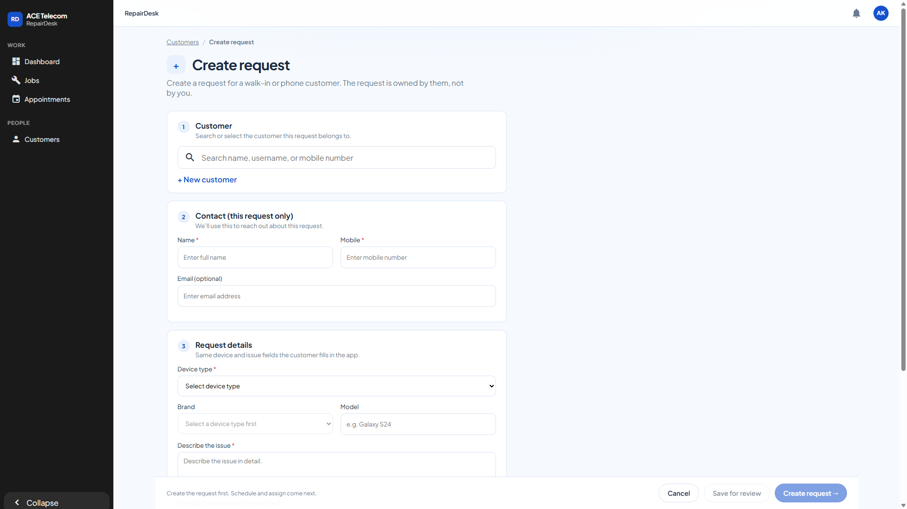

### 6.1 New walk-in customer

If they are not in the directory:

1. Click **+ New customer**.
2. Enter **Name** and **Mobile**. Username and password are optional — the portal can derive or generate them.
3. Click **Create customer**.

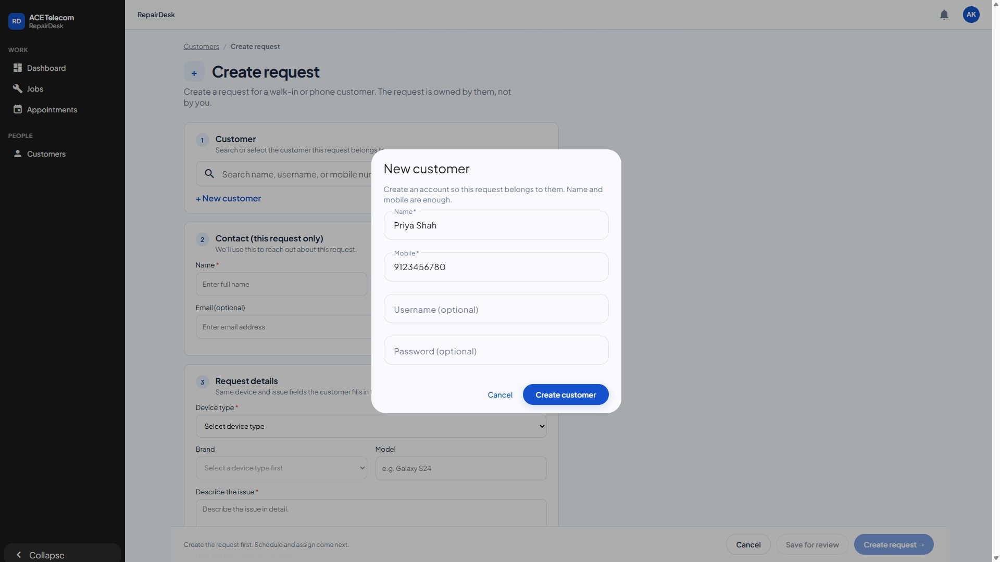

If a password was generated, a dialog shows it **once**. Copy it and give it to the customer so they can use the mobile app later. It cannot be retrieved again.

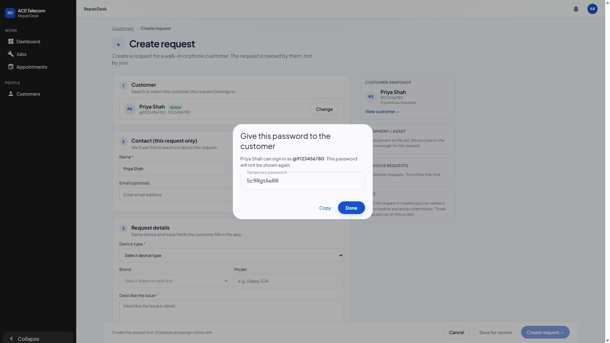

### 6.2 After you submit

With the customer selected, the right rail shows their snapshot and previous requests.

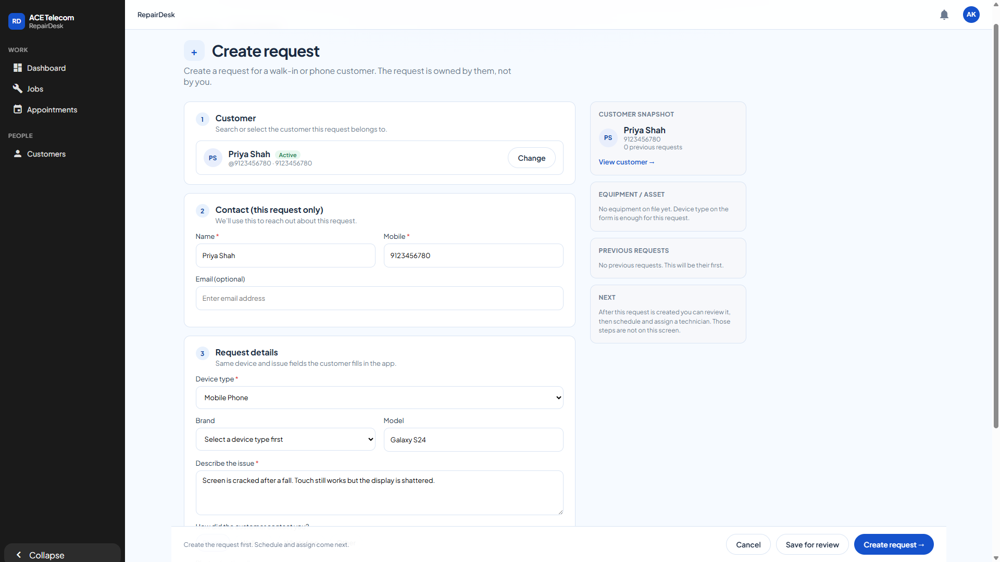

You land on the **customer** page. The new request appears as **Pending review**. There is no job yet.

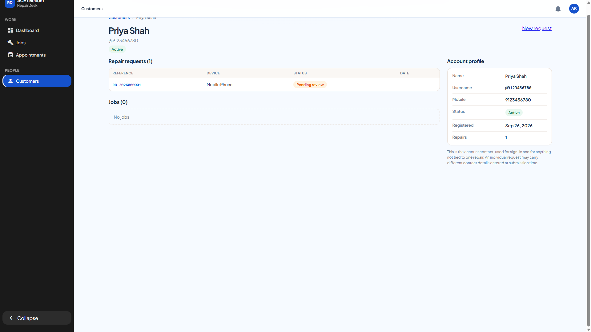

Tell an administrator that a request is waiting. When they approve it, a job with the **same reference number** (for example `RD-2026000006`) appears under **Jobs**. Schedule and assign are not on the create screen.

---

## 7. Service address on a new request

The address is optional, but the technician follows the **pin**. A neighbourhood name alone puts the pin at the centre of that area. Pick a building, drag the pin to the door, or use the Maps link the customer sent.

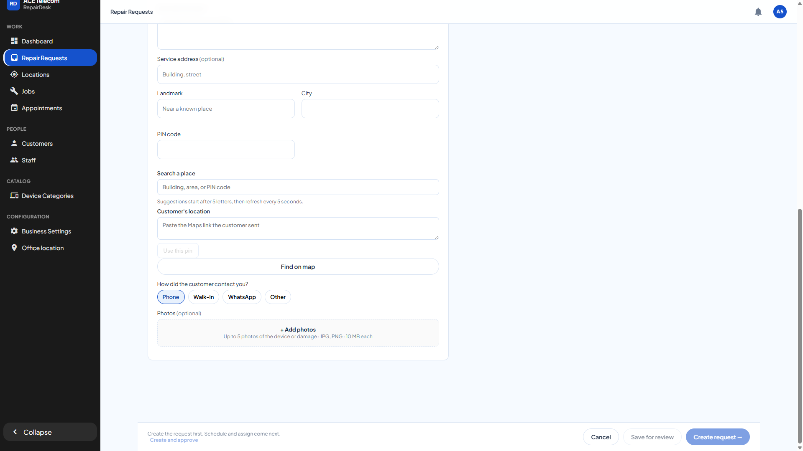

1. Type **Service address**, and landmark, city, and PIN code if you have them.
2. Use one of these to place the pin:
   - **Search a place.** Type at least 5 letters. A list appears, then refreshes at most every 5 seconds while you keep typing. Click the building. The address line fills from that place.
   - **Customer’s location.** Paste the Google Maps link the customer sent, including a `maps.app.goo.gl` short link, then click **Use this pin**. A photo of a map is not a pin.
   - **Find on map.** This looks up the address you typed. When a pin appears, drag it or click the map to move it.
3. The line under the map shows the coordinates. Dragging the pin is the last word: it overrides the search.
4. Submit the request. The pin is stored with the request and copied onto the job when an administrator approves it.

If the list never appears and a message says **Place search is unavailable**, Google place search is switched off for the shop. You can still paste the customer’s Maps link or drag the pin after **Find on map**.

---

## 8. Jobs

Assignment is on the **job**, not on Create request. Open **Work → Jobs** after the request is approved.

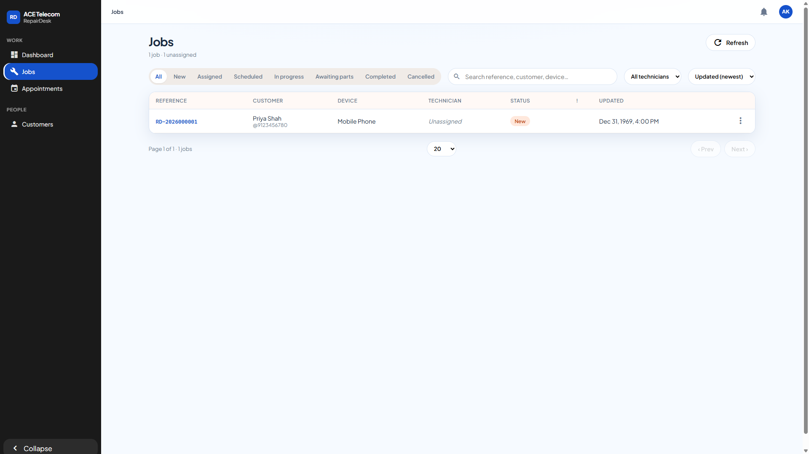

| Control | What it does |
| --- | --- |
| Status chips | All, and each job status (Created, Assigned, Scheduled, In progress, Awaiting parts, Completed, Cancelled) |
| Search | Reference, customer, or device |
| Technician | All technicians, Unassigned, or one person |
| Sort | Updated, reference, status, or priority |
| Refresh | Loads the list again |

Open a row to work that job. The reference number matches the request.

---

## 9. Assign, schedule, and update a job

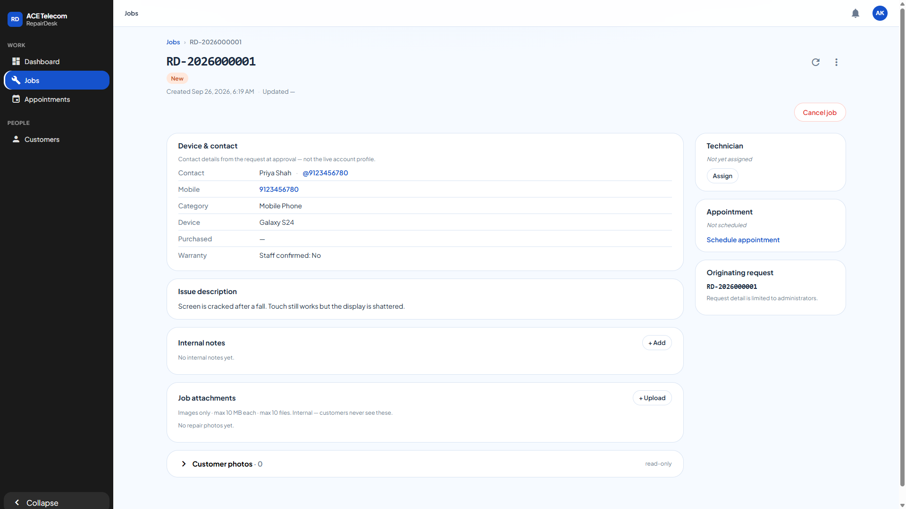

### 9.1 Assign a technician

1. Open the job.
2. In the **Technician** card, click **Assign**.
3. Choose an **Active Technician** and click **Assign**.

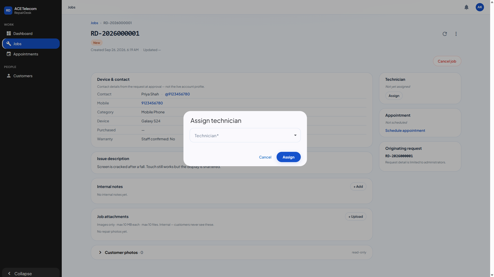

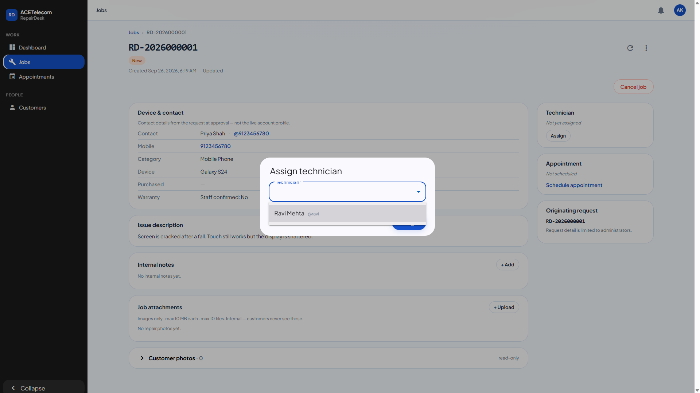

Only active technicians appear. After assign, the job status becomes **Assigned**. You can **Change** or **Unassign** while the job is still Created or Assigned.

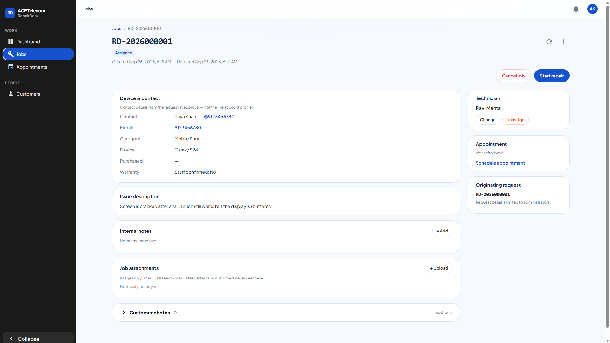

### 9.2 What else is on the job

| Action | When |
| --- | --- |
| **Schedule appointment** | Book a visit. Shown while the job is Created, Assigned, or Scheduled. |
| **Change** / **Unassign** | Wrong technician, or they are unavailable. Assign is available on Created and Assigned jobs. |
| **+ Add** (internal notes) | Parts, promises, anything the customer must not see. Notes stay on the job. |
| **+ Upload** (job attachments) | Bench photos. Images only, max 10 MB each, max 10 files. Customers never see these. |
| **Customer photos** | Photos from the request. Read-only. Expand the row to view them. |
| **Start repair** | Shown on Assigned and Scheduled. Usually the technician does this. Staff can start it if needed. |
| **Mark awaiting parts** / **Resume** / **Mark complete** | While the repair is in progress, or waiting on a part. Complete asks for a short resolution. |
| **Cancel job** | Work cannot proceed. Confirm the reason. This is not undoable. |
| **More actions → Set priority** | Normal, high, or urgent. |
| **More actions → Confirm warranty** | Records whether staff confirmed warranty. |
| **Reveal** next to a serial | Shows the device serial. Hide it again when you are done. |
| **Open request** | The repair request this job came from. |
| **Start Navigating** and **Edit** | The visit pin. Section 10. |

Contact name and mobile on the job are the details captured when the request was approved. They are not a live copy of the customer’s account.

---

## 10. Move a job pin and start navigating

Open the job from **Jobs**, or from the job number on **Locations**.

Before you click **Edit**, the page shows the map, the address, and **Start Navigating**. The search box stays hidden.

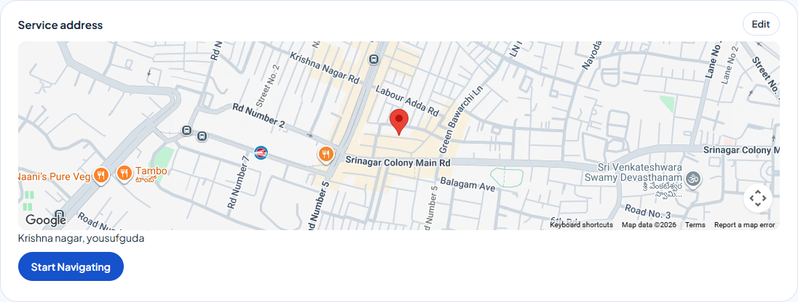

### 10.1 Change the pin

1. Click **Edit** on the service address.
2. The search box, **Customer’s location**, **Save**, and **Cancel** appear. The hint under the map says nothing is stored until you save.

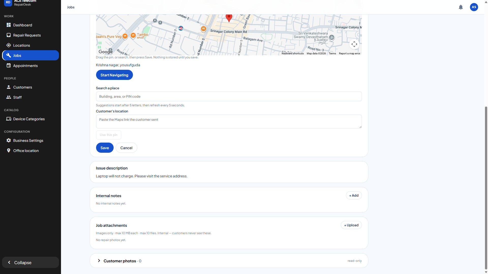

3. Place the pin in one of these ways:
   - Type at least 5 letters in **Search a place** and pick a suggestion. The list refreshes at most every 5 seconds.
   - Paste the Maps link the customer sent and click **Use this pin**.
   - Drag the pin, or click the map. Dragging wins over a search.
4. Click **Save**. **Cancel** leaves the stored address unchanged.

The technician follows the saved coordinates. A typed area name without a picked building or a dragged pin is only the centre of that area.

If suggestions do not appear, use the customer’s Maps link or drag the pin, then **Save**.

### 10.2 Start Navigating

**Start Navigating** opens Google Maps directions to that pin in a new browser tab. Google Maps uses this computer’s location as the start when the browser allows it. The same button is on each job row on **Locations**, and on the technician’s phone under the service address.

### 10.3 On the phone, as Staff

If you are signed in to the RepairDesk Android app as Staff (not as a technician), the job shows **Edit** under the service address. **Edit** opens **Place the pin**:

- Search a place. Suggestions start after 5 letters, then every 5 seconds.
- **Customer’s location**, then **Use customer’s pin**.
- **Use my location** for where the phone is standing.
- Drag the map so the centre pin sits on the door.
- **Use this pin** to keep it. The job then says **Job location saved**.

A technician signed in on that phone does not see **Edit**.

---

## 11. Technician locations and customer ETA

Open **Work → Locations** in the portal, or **Locations** on the RepairDesk phone app when you are signed in as Staff. Technicians do not see this page.

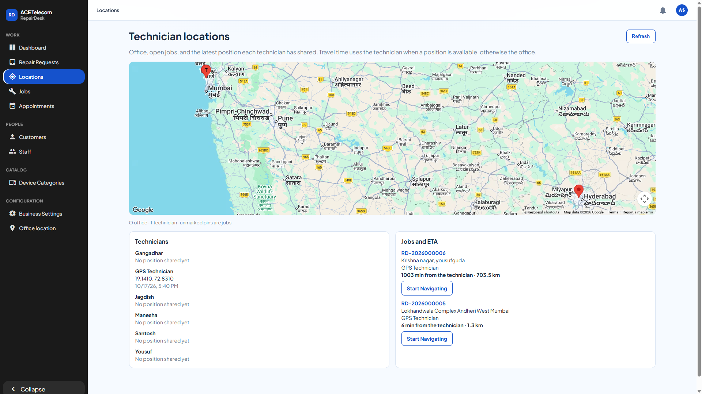

The page shows three things together:

| On the map | Meaning |
| --- | --- |
| **O** | The shop, once an administrator has saved the office pin. |
| **T** | A technician who has shared a position. |
| Unmarked pin | An open job that has a service pin. |

Under the map:

- **Technicians** lists every technician. A shared position shows coordinates and the time. Everyone else stays **No position shared yet**.
- **Jobs and ETA** lists each open job that has a pin: reference, address, assigned technician, travel time, and **Start Navigating**.

Click **Refresh** to load the latest points. The page does not move the pins by itself.

### How a position gets onto the map

A position appears when the technician opens an assigned job in the RepairDesk app and the phone can read GPS. Opening the job sends that point for this map. The work day is a separate record on **Attendance** (section 12). If location is off, the job still opens and that technician stays **No position shared yet**.

### How to read the travel time

Example from the screenshot:

- **GPS Technician** last shared **19.1410, 72.8310** at 5:40 PM.
- **RD-2026000005** (Lokhandwala, Andheri) is **6 min from the technician · 1.3 km**.
- **RD-2026000006** (Krishna nagar, Yousufguda) is **1003 min from the technician · 703.5 km**, because that job pin is in Hyderabad and the last shared point is in Mumbai.

| The line says | Meaning |
| --- | --- |
| **from the technician** | Travel starts at that technician’s last shared point. |
| **from the office** | That technician has not shared a point, so travel starts at the shop pin. |
| **No ETA yet** | There is no technician point and no office pin. |
| **estimated** | Google’s route was not available, so the minutes are a straight-line fallback. A line without that word is a driving route. |

Travel time uses a two-wheeler route. Tell the customer that time when they ask when the technician will arrive. The **Customer ETA** switch on Office location does not add a countdown inside the customer’s repair screen. Until that screen exists, the number the customer hears comes from this page.

---

## 12. Attendance

Open **Work → Attendance** in the portal, or **Attendance** on the RepairDesk phone app when you are signed in as Staff. An administrator sees the same list. Technicians do not. This page is the work day. It does not replace **Locations**.

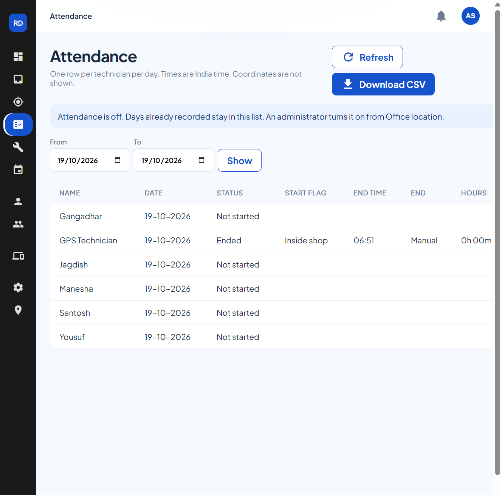

The page opens on today’s date in India. One row is shown for each active technician, including people who have not started. Inactive accounts are left out. The line under the heading says coordinates are not shown.

| Column | What it shows |
| --- | --- |
| **Name** | The technician |
| **Date** | The India date, written day-month-year |
| **Status** | **Not started**, **On duty since** a time, **Ended**, or **Auto-ended** |
| **Start flag** | **Inside shop**, **Outside shop**, **Location uncertain**, **Location missing**, or **Mocked location**. Blank when the day was not started |
| **End time** | India time the day closed. Blank while the day is open or was not started |
| **End** | **Manual** when the technician tapped **End day**. **Auto** when the shop’s end-of-day time closed it |
| **Hours** | Time between start and end, for example **7h 40m**. Blank until both times exist |

Set **From** and **To**, then click **Show**. The range can cover at most 31 days. A longer range stays on the page and says **Date range must be 31 days or less.** **Refresh** loads the list again. **Download CSV** saves those same columns as a spreadsheet file. The phone has no download.

While Attendance is off, the list still opens. A notice says: *Attendance is off. Days already recorded stay in this list. An administrator turns it on from Office location.*

### How a day gets onto the list

Only an administrator can turn **Attendance** on, from **Office location**. After they save, the technician’s home screen shows **Work day**.

- The phone shows one line before the first start: the start time, and whether they were at the shop, are stored. **Not now** leaves the day unstarted. **Start day** checks the phone’s location for up to 8 seconds. A fix is clear when its accuracy is no wider than the shop radius.
- A clear fix inside the shop radius (150 metres unless the office changed it) is **Inside shop**.
- A clear fix outside that circle is refused. The phone says how far they are, and the day is not saved. If the office has allowed a start outside the shop, the day starts and the flag is **Outside shop**.
- No fix, a fix too wide to trust, or no shop pin still starts the day, flagged **Location missing** or **Location uncertain**. A mocked location still starts the day, flagged **Mocked location**.
- **End day** closes an open day, including away from the shop. The end is **Manual**.
- Tapping **Start day** again on the same India date does not open a second day.
- At **Auto end of day** (19:00 unless an administrator changed it), a day that is still open closes by itself. Status becomes **Auto-ended**, End is **Auto**, and the technician gets one in-app notice. The job is left as it is.

Opening a job, **Start Repair**, and **Start Navigating** do not check the work day. A technician can still work when the day says **Not started**.

### On the phone, as Staff

The home screen has an **Attendance** tile, subtitled **Technician work days**. The cards show the same facts as the portal table.

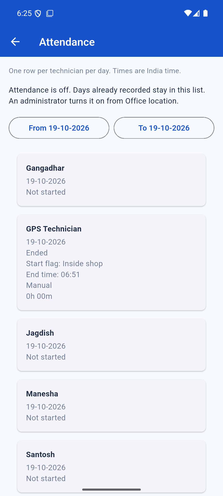

Tap **From** or **To** to pick dates. Pull down to refresh. You cannot turn Attendance on from the phone. **Office location** stays with the administrator.

---

## 13. Appointments

**Work → Appointments** — weekly calendar. Unscheduled jobs sit in the right rail. Open a job (or **Schedule appointment** on the job) to book a visit for the assigned technician.

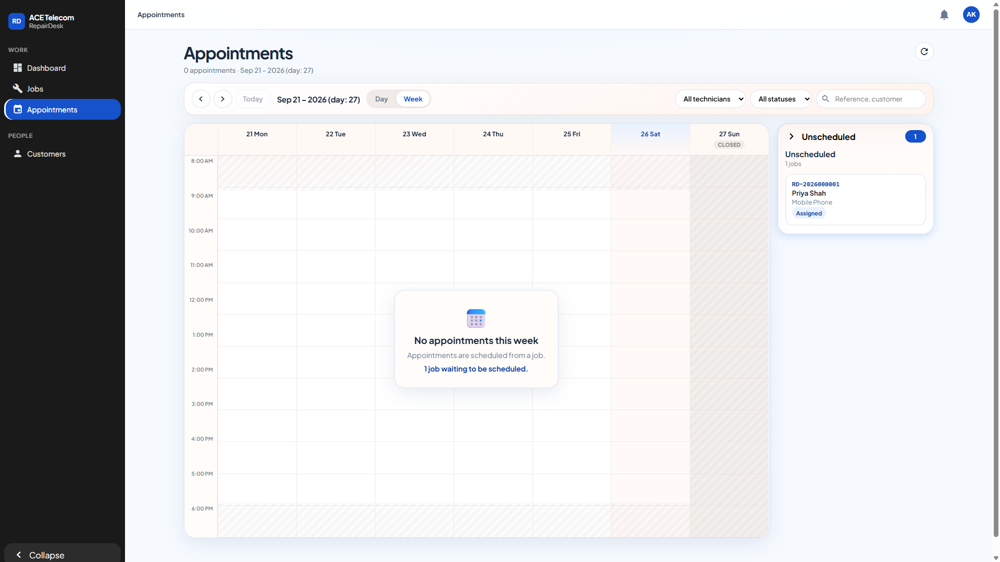

The technician sees that visit under **My Appointments** in the app. They cannot book or move it themselves.

---

## 14. Notifications and your account

| Item | Where |
| --- | --- |
| Notifications | Bell at the top right. Open a row to go to that job or request. |
| Your name, username, role, and mobile | Account menu (top right) → **My Account** |
| Change mobile | My Account → Profile → **Change** |
| Change password | My Account → Security → **Change**. Minimum 8 characters. |
| Sign out | My Account → Session → **Sign out** |

You cannot change your username, display name, or role. Ask an administrator.

---

## 15. Quick reference

| Item | Value |
| --- | --- |
| Portal | https://repairdesk-admin-portal.azurewebsites.net (same screens on the Static Web App) |
| Staff username | `anita` |
| Staff password (after first change) | `Anita$1234` |
| Create a request | Dashboard → **Create request** |
| Place a pin on a new request | Search (5 letters), paste the customer’s Maps link, or **Find on map**, then drag |
| Assign a technician | Jobs → open the job → **Assign** |
| Move a saved job pin | Job → **Edit** → search, paste, or drag → **Save** |
| Directions | **Start Navigating** |
| Where technicians are | Work → **Locations** → **Refresh** |
| Who started the day | Work → **Attendance**. **Download CSV** for the same columns |
| Look up a customer | People → **Customers** |
| Book a visit | Job → **Schedule appointment**, or Appointments |
| Request review / approve | Administrator only |
| Office pin, the Attendance switch, catalog, business hours | Administrator only. Staff can still open the Attendance list |
| Issue description | Minimum 10 characters |
| Photos on create | Optional; max 5; JPG/PNG; 10 MB each |
| Job attachments | Images only; max 10; 10 MB each; customer never sees them |
