# Ace Smart Care Technician App — User Manual

**Print layout:** [Technician-Portal-User-Manual.html](Technician-Portal-User-Manual.html)  
**Audience:** field / bench technicians  
**App:** Ace Smart Care for Android (ACE Telecom)

This guide is only about the Ace Smart Care phone app. The app used to be called RepairDesk. Some screenshots were taken before the rename and still show **RepairDesk** or *Field Service Management* at the top. The steps are the same. It covers signing in as a **Technician**, starting and ending the work day when the shop has turned Attendance on, finding jobs assigned to you, reading the map on the job, starting navigation in Google Maps, starting and finishing repairs, adding notes and photos, and checking appointments and notifications.

---

## Index

1. [How you get access](#1-how-you-get-access)
2. [Sign in](#2-sign-in)
3. [Home — My work](#3-home--my-work)
4. [Work day](#4-work-day)
5. [My Jobs](#5-my-jobs)
6. [Work a job](#6-work-a-job)
7. [The map and Start Navigating](#7-the-map-and-start-navigating)
8. [How the shop sees where you are](#8-how-the-shop-sees-where-you-are)
9. [My Appointments](#9-my-appointments)
10. [Notifications](#10-notifications)
11. [Account and password](#11-account-and-password)
12. [Quick reference](#12-quick-reference)

---

## 1. How you get access

An **Administrator** creates your Technician account and gives you:

- the Ace Smart Care app (APK file or install link)
- your **username**
- a **temporary password**

You will get these details from the Admin. Do not invent a login and do not use the **Register** link on the sign-in screen — that is for customers. If you cannot sign in, ask the Admin to check that your account is **Active** and that they sent the right username.

| Field | Value |
| --- | --- |
| **App** | Provided by your Administrator |
| **Username** | Provided by your Administrator |
| **Temporary password** | Provided by your Administrator |
| **Role** | Technician |

The first sign-in after the server has been idle can take up to a minute. If it looks stuck, wait and try once more.

Allow location when the phone asks. Opening a job then shares one position so the shop can estimate travel time. The job still opens if you deny location or the GPS fix is weak. Denying location does not block the repair.

---

## 2. Sign in

1. Open the **RepairDesk** app.
2. Enter the **Username** and **Password** from your Admin. Tap the eye icon to show or hide the password.
3. Tap **Sign In**.

| Sign-in screen | Details entered |
| --- | --- |
| 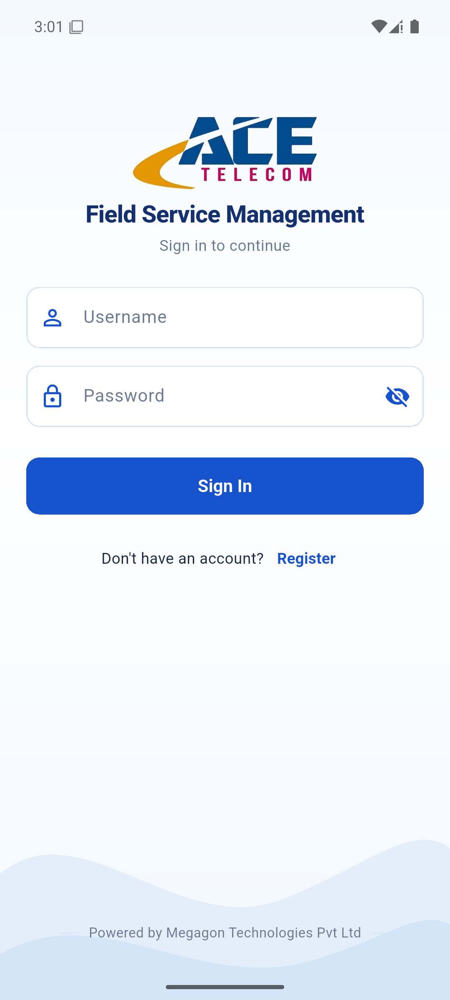 | 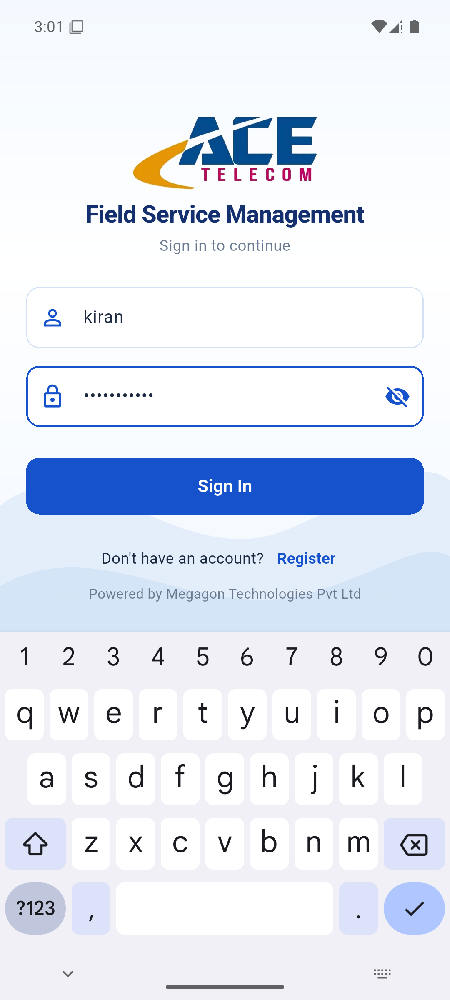 |

After your first sign-in, change the temporary password (see [section 11](#11-account-and-password)).

---

## 3. Home — My work

You land on **My work**. The line under it confirms your role: *Role: TECHNICIAN — jobs and appointments assigned to you.*

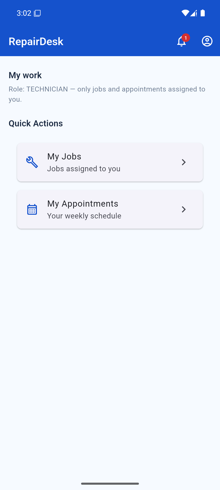

| Item | What it does |
| --- | --- |
| **My Jobs** | Jobs assigned to you |
| **My Appointments** | Your weekly schedule |
| Bell icon (top right) | Notifications; the red badge shows how many are unread |
| Person icon (top right) | Your account, password, and Sign Out |

Your home screen has **My Jobs** and **My Appointments**. You do not see **Locations**, **Attendance**, or **Office location**. While Attendance is off, those two tiles are the whole home screen. While an administrator has turned Attendance on, a **Work day** card sits above them. That card is [section 4](#4-work-day).

### What a Technician can and cannot do

| You can | You cannot (Staff or Admin does it) |
| --- | --- |
| See jobs assigned to you | Create a walk-in / phone request |
| See the map and address on the job | Move the job pin. You do not see **Edit** |
| Tap **Start Navigating** and follow the route in Google Maps | Search for a place, paste a Maps link, or drag the pin |
| Start, pause for parts, and complete a repair | Assign or unassign a technician |
| Add internal notes and bench photos | Schedule or reschedule a visit |
| See visits booked for you | Cancel a job |
| Share one position by opening the job with location allowed | See the Locations map |
| Start and end the work day when Attendance is on | See other technicians’ days, turn Attendance on, or open Office location |

If **My Jobs** is empty, nothing is assigned to you yet. Ask Staff or an Admin to assign the job.

---

## 4. Work day

The **Work day** card is on **My work** only while an administrator has turned **Attendance** on. While it is off, home stays **My Jobs** and **My Appointments**.

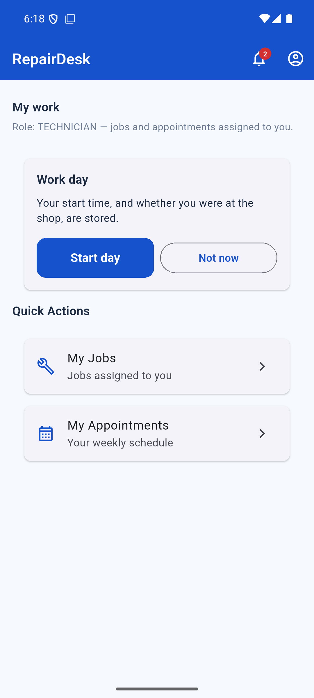

The card says: *Your start time, and whether you were at the shop, are stored.*

1. Tap **Start day**. The phone checks location for up to 8 seconds. The button reads **Checking location…** while it waits.
2. Tap **Not now** to leave the day unstarted. The card then says **Work day not started**, with **Start day** underneath if you want to begin later. Your jobs stay on the home screen either way.

A fix is clear when its accuracy is no wider than the shop radius an administrator saved on Office location.

| What the phone finds | What happens |
| --- | --- |
| A clear fix at the shop | The day starts. The card says **On duty since** a time, and **Start flag: Inside shop** |
| A clear fix away from the shop | The day is not saved. The card says how many metres you are from the shop: *You are 400 m from the shop. Start day was not saved.* Go to the shop and tap **Start day** again. If the shop has allowed a start outside the shop, the day starts and the flag is **Outside shop** |
| No fix, a fix too wide to trust, or no shop pin saved | The day still starts. The flag is **Location missing** or **Location uncertain** |
| A mocked location | The day still starts. The flag is **Mocked location** |

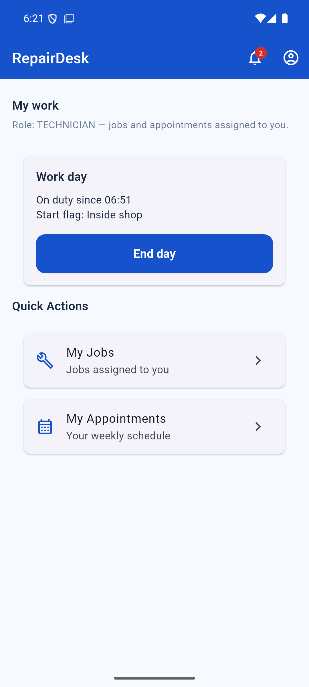

**End day** closes the day. You can end it away from the shop. A missing or outside fix is recorded and does not stop the end. The card then says **Ended**, the start time, the end time, and **Manual**.

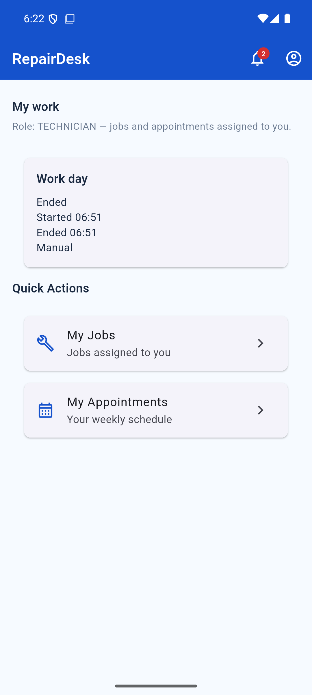

A second **Start day** on the same India date does not open a second day. It shows the day already saved.

If you are still on duty at the shop’s end-of-day time (19:00 unless the office changed it), the day closes by itself. The card says **Auto-ended**. You get one notification that your work day ended automatically at that time. The job stays as it is. There is no text message.

**Start Repair**, opening a job, and **Start Navigating** do not wait for a started day. You can open **My Jobs** with the day unstarted.

You do not see other technicians’ days. Staff and administrators read those on **Attendance**.

---

## 5. My Jobs

Tap **My Jobs**. You see only your assignments.

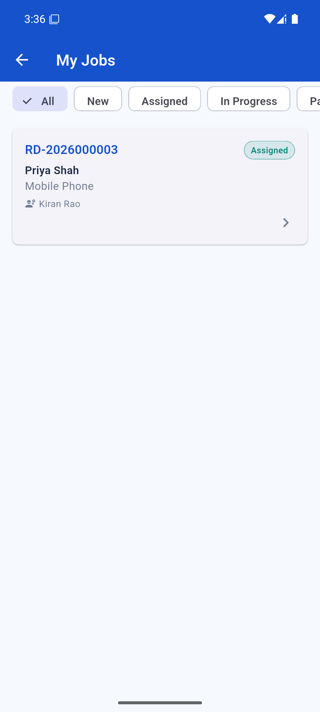

- Filter chips across the top: **All · New · Assigned · In Progress · Parts** … (swipe left for more)
- Each card shows the reference (for example `RD-2026000001`), status, customer, device category, and your name
- Tap a card to open the job

The same reference number follows the repair from the customer's request to the finished job.

---

## 6. Work a job

The **Job Detail** screen shows the device and customer contact, the issue, who it is assigned to, the actions you can take, internal notes, customer photos, and attachments. Scroll down for the map — that is [section 7](#7-the-map-and-start-navigating).

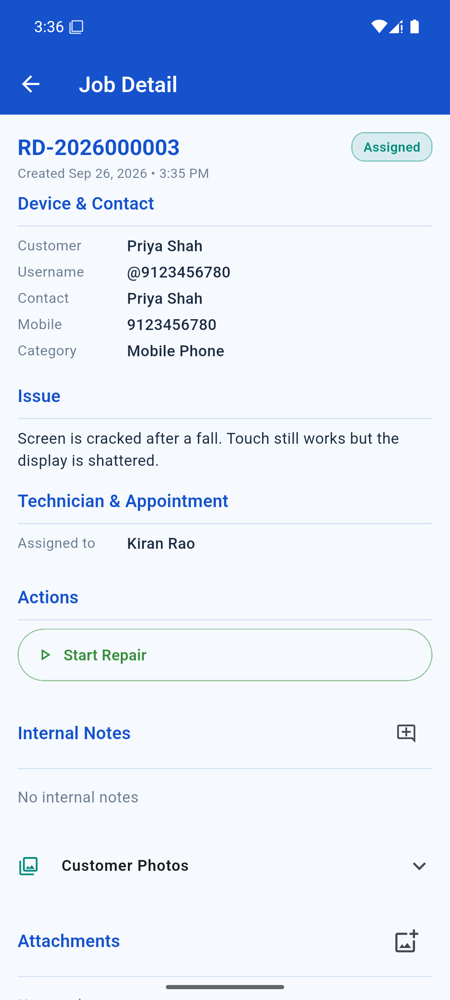

Booking or moving a visit is done by Staff or Admin. If you need one, ask them.

### 6.1 Start the repair

When the job is **Assigned** or **Scheduled**:

1. Tap **Start Repair**.
2. The app asks you to confirm. Tap **Start Repair** again to begin, or **Not now** to leave the job as it is.

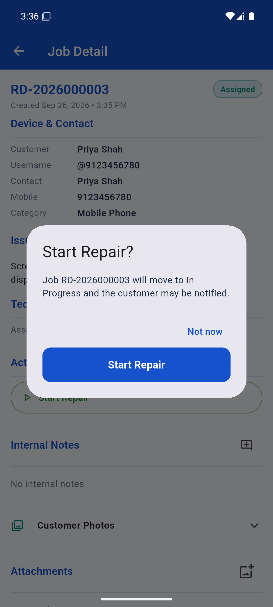

The job moves to **In Progress**, a short *Start Repair — done* message appears, and the customer may be notified.

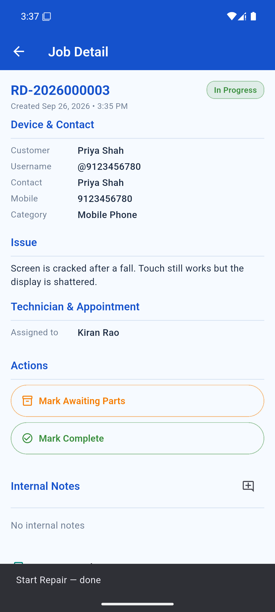

### 6.2 While you work (In Progress)

| Action | When |
| --- | --- |
| **Mark Awaiting Parts** | You cannot finish until a part arrives |
| **Resume** | Shown while the job is Awaiting Parts — tap it when the part is in and you can continue |
| **Mark Complete** | The repair is done. You will be asked for a short resolution summary |

If a job should be cancelled, tell Staff — only Staff or Admin can cancel a job.

### 6.3 Internal notes

Notes are for the shop only — the customer never sees them. They are permanent and attributed to you.

1. Tap the note icon next to **Internal Notes**.
2. Type the note (parts ordered, delays, findings).
3. Tap **Save** (or **Cancel** to discard).

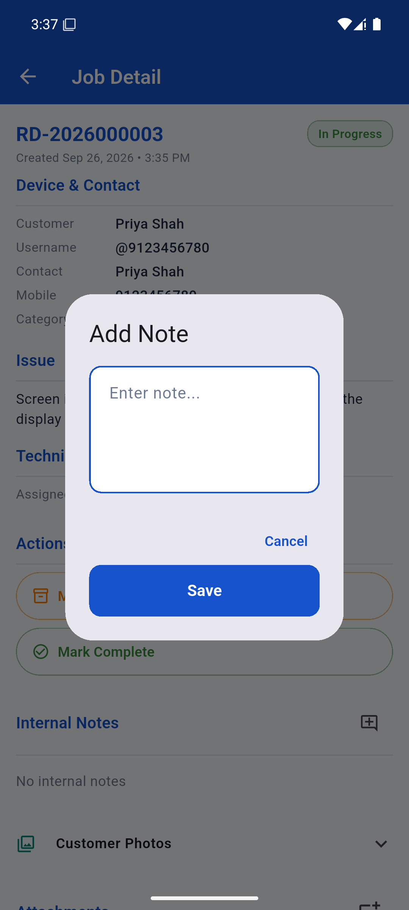

### 6.4 Customer photos and attachments

Scroll down the job to find:

- **Customer Photos** — anything the customer attached to the request. Tap to expand. Read-only.
- **Attachments** — your bench photos. Tap the add-photo icon to take or pick an image. Customers never see these.

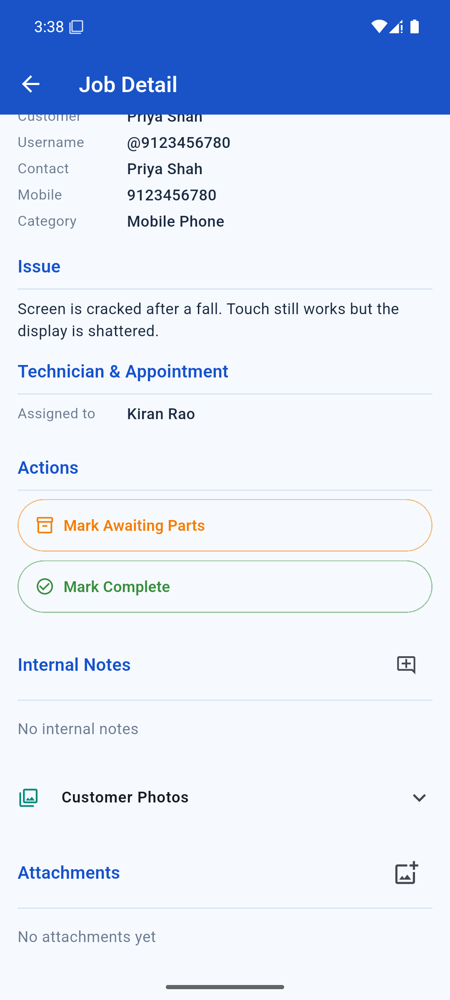

---

## 7. The map and Start Navigating

Scroll the job until the map appears. It sits above the written address. You follow this pin. You do not type a new address on the job.

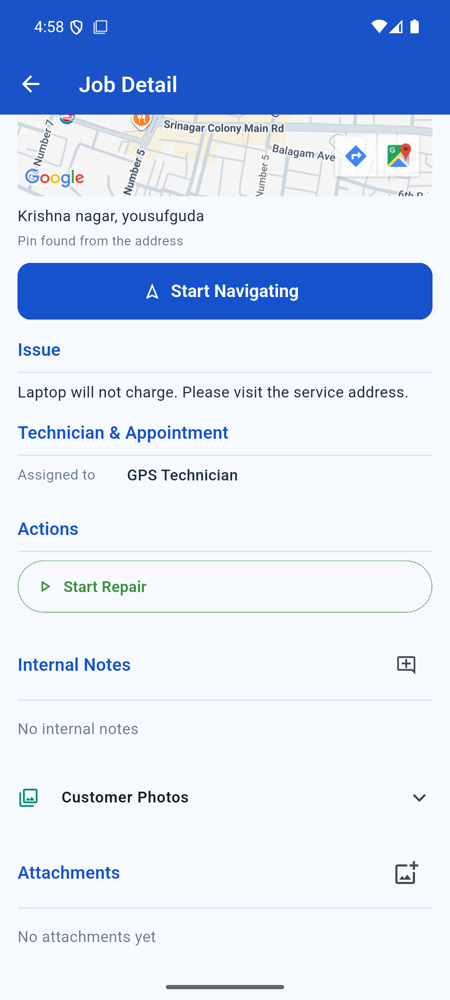

On that part of the screen you see:

- a map with one pin
- the address Staff or an Admin saved (for example *Krishna nagar, yousufguda*)
- a short line that says how the pin was chosen
- a blue **Start Navigating** button

| Line under the address | Meaning |
| --- | --- |
| **Pin found from the address** | Someone searched or used **Find on map** when they saved the job |
| **Pin placed on the map** | Someone dragged the pin |
| **Pin from the customer’s location link** | Someone pasted the Maps link the customer sent |
| **No address yet** | A visit address has not been saved. Ask the shop before you leave |

You do not see **Edit**. You cannot search, paste a link, or drag the pin. If the pin is the wrong door, call the shop and ask them to move it, then open the job again.

A photo of a map in a chat is not a pin. You follow the pin already saved on the job.

### How to start navigation

1. Open **RepairDesk** and sign in.
2. On **My work**, tap **My Jobs**.
3. Tap the job you are going to.
4. Scroll until you see the map and the blue **Start Navigating** button.
5. Tap **Start Navigating**.
6. **Google Maps** opens. The destination is the saved pin. Driving is already selected. **Your location** is the start when Maps is allowed to use the phone’s location.
7. Check the time and distance. They change with where you are standing.
8. Tap **Start** at the bottom of Google Maps and follow the turn-by-turn route.

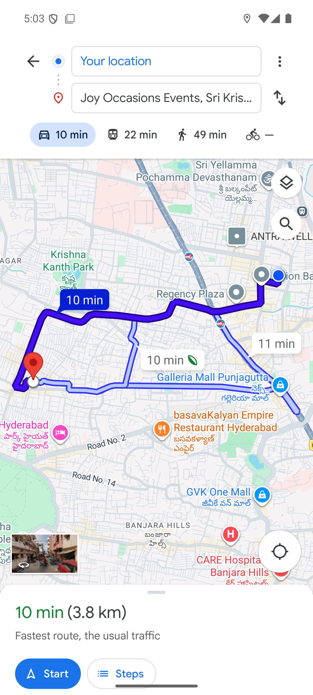

The name in the destination box is Google’s name for that pin. It can be a nearby shop or colony name. It is still the pin saved on the job. The route on the map runs from the blue dot (you) to the red pin (the visit).

If Google Maps is not installed, the same directions open in the phone’s browser. The destination is still the saved pin.

If Maps asks you to choose a start, location is off for Google Maps. Allow location for Maps, or pick a start yourself. RepairDesk still opens the job if its own location permission is denied.

The first time Maps opens it may offer to sign in (“Take the shortcut”). You can skip that. The route works without a Google sign-in.

---

## 8. How the shop sees where you are

Opening an assigned job is what shares your position for the shop’s Locations map. That share is separate from the work day in [section 4](#4-work-day). There is no separate “share location” button.

1. Allow location for RepairDesk when the phone asks.
2. Open the assigned job. That sends one position.
3. Leave for the visit with **Start Navigating**.

If the fix fails or location is off, the job stays usable. The shop then estimates travel from the office instead of from you.

You only appear on jobs assigned to you. You do not see other technicians, and you do not see office settings.

---

## 9. My Appointments

From home, tap **My Appointments**. This is your weekly schedule; use the arrows at the top to move between weeks. You only see visits booked for you. Staff book those from the job.

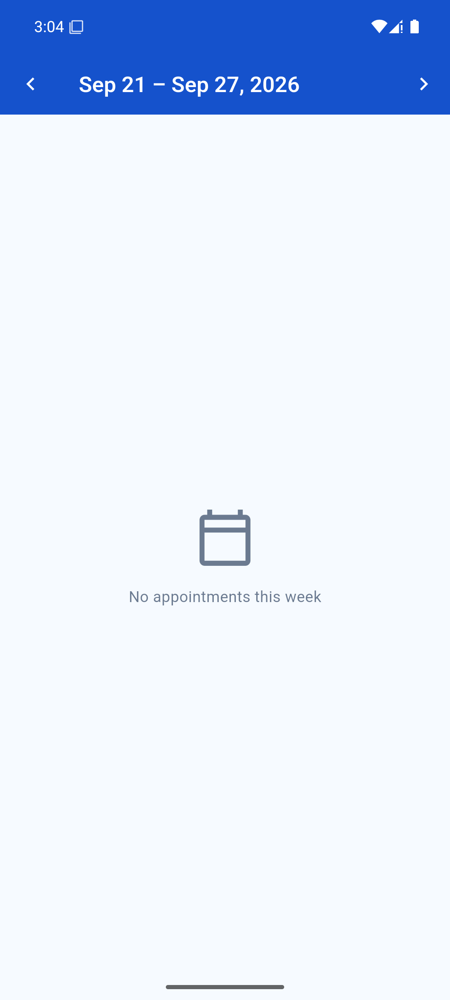

*No appointments this week* means nothing is scheduled for you yet. The job can still appear under **My Jobs** — Staff may assign you before they book a slot.

---

## 10. Notifications

Tap the **bell** on the home screen. You are notified when a job is assigned to you and when something changes on your jobs. Tap a notification to open the job; tap **Mark all read** to clear the badge.

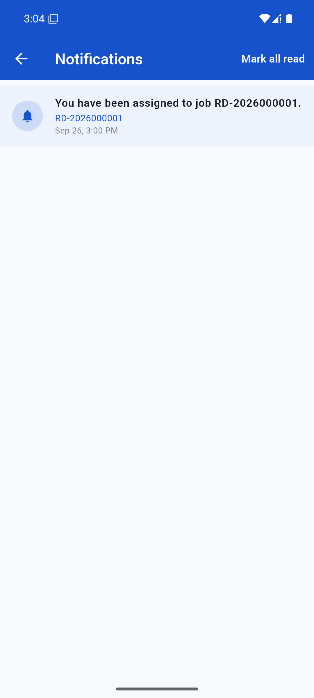

---

## 11. Account and password

Tap the **person** icon on the home screen to open **Account**. It shows your name, username, role, and mobile number.

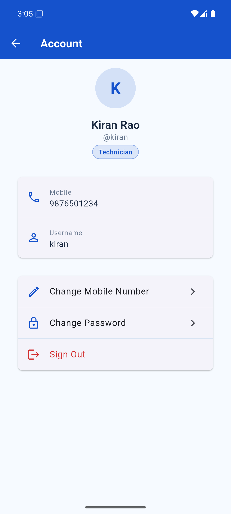

### Change your password

Do this right after your first sign-in, so only you know your password.

1. Tap **Change Password**.
2. Enter your **Current password** (the temporary one from the Admin).
3. Enter a **New password** (minimum 8 characters) and confirm it.
4. Tap **Change**.

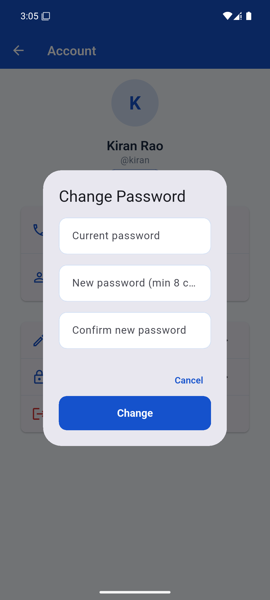

If you forget your password, ask the Admin to reset it. They will give you a new temporary password the same way.

**Sign Out** is at the bottom of the Account screen. Sign out if you share the phone.

---

## 12. Quick reference

| Item | Where |
| --- | --- |
| Username and password | From your Administrator |
| After first sign-in | Account → **Change Password** |
| Forgotten password | Ask the Admin to reset it |
| Location permission | Allow it. The job still opens if GPS is off |
| Your jobs | Home → **My Jobs** |
| Map and address | On the job, above **Start Repair** |
| Start navigation | Job → **Start Navigating**, then **Start** in Google Maps |
| Wrong door | Ask the shop to move the pin. You cannot move it |
| So the shop can see you on the map | Open the assigned job with location allowed |
| Work day | Home, when Attendance is on → **Start day**, then **End day** |
| Start work | Job → **Start Repair**, then confirm |
| Waiting on parts | Job → **Mark Awaiting Parts**, later **Resume** |
| Finish | Job → **Mark Complete** |
| Notes | Job → note icon next to Internal Notes |
| Bench photos | Job → Attachments → add-photo icon |
| Your schedule | Home → **My Appointments** |
| Alerts | Home → bell icon |
| Create request / assign / schedule / cancel / move the pin | Staff or Admin — not on your app |
| Attendance list and the Attendance switch | Staff or Admin. You only see your own **Work day** card, and only while Attendance is on |
